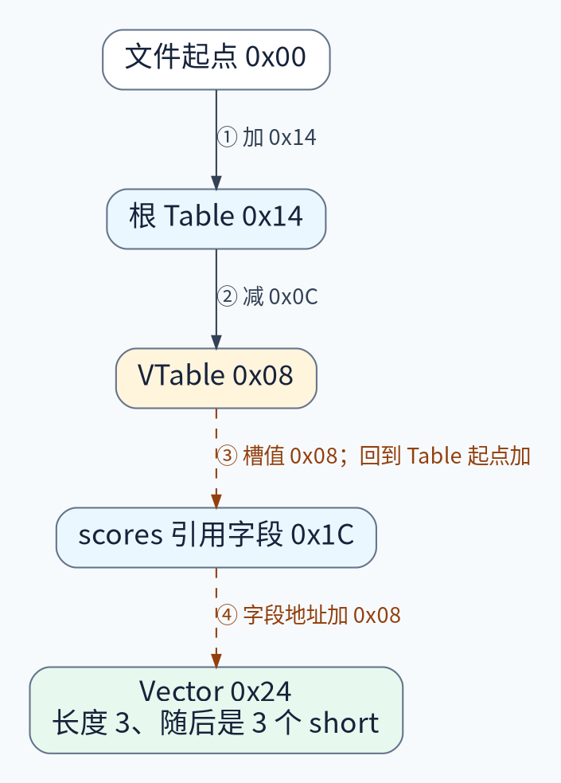
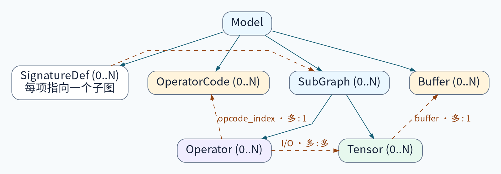

# LiteRT 源码笔记（一）：从 FlatBuffers 字节读懂模型

拿到一个 `.tflite` 文件，先问三个问题：二进制怎么寻址？图里各个索引查哪张表？权重字节究竟在哪？本篇先回答这三件事；[第二篇](02-load-model-ir.md)再把同一份模型沿 Loader 走到 LiteRT 内部 IR。

**阅读顺序**：概念边界 → 手算 FlatBuffers 偏移 → 用 ADD 串起模型表 → 量化、稀疏与特殊张量。Schema 片段只保留教学所需字段，不作为另一个可生成兼容模型的 Schema。

## 1. 整体架构与概念边界

### 1.1 FlatBuffers、`.fbs`、`.tflite` 和 LiteRT 分别是什么

| 名称 | 所处层次 | 职责 |
| --- | --- | --- |
| **FlatBuffers** | 通用序列化技术 | 定义二进制布局、偏移寻址规则及生成代码；允许直接从序列化数据读取字段 |
| **`.fbs`** | Schema 源文件 | 用 FlatBuffers 的语法声明 `table`、`struct`、`union` 等结构 |
| **`.tflite`** | 模型文件 | 符合 TFLite Schema 的 FlatBuffer 二进制模型，保存计算图、张量、权重与元信息 |
| **LiteRT** | 模型处理与执行框架 | 加载模型，构建内部表示（IR），并在后续阶段完成编译、加速及执行 |
| **`LiteRtModelT`** | LiteRT 内部对象 | 加载后可用于分析、修改或编译的模型 IR 根对象（与 FlatBuffers 的 `ModelT` 不是同一种对象） |

**关键结论：**FlatBuffers 是编码规则，`.fbs` 是规则的定义文件，`.tflite` 是使用该规则产生的数据文件。LiteRT 通过这些数据构造自己的模型对象。

### 1.2 从磁盘到运行时的阶段划分

```text
磁盘模型文件（.tflite）
    │
    ▼
GetAllocationFromFile()
    │  mmap / file copy，获得可访问的字节区域
    ▼
FlatbufferWrapper
    │  FlatBuffer 验证、保持底层 Allocation 生命周期
    ▼
tflite::Model*（Packed View）
    │  通过相对偏移按需访问原始字节
    ▼
UnpackModel()
    │  Subgraph / Tensor / Op / Signature / Metadata
    ▼
LiteRtModelT（LiteRT 内部 IR）
    │
    ▼
CompiledModel 等后续执行路径
    │  算子解析、编译、资源准备、执行（进入运行时后才发生）
    ▼
CPU / GPU / NPU
```

这里有两层含义不同的“加载”：

- **文件映射 / 反序列化视图**：使二进制字节可寻址，获得 `const tflite::Model*`，**不等于**将所有字段复制到 C++ 对象。
- **LiteRT IR 构建**：读取模型字段并建立 `LiteRtModelT`、`LiteRtTensorT`、`LiteRtOpT` 等对象。部分权重仍可能只是对底层字节区域的非拥有引用。

---

上面的图选的是 LiteRT Model API 路线。如果只想用兼容的 [InterpreterBuilder](03-interpreter-builder.md)，从 FlatBuffer 视图即可开始建运行时图，不先构造 `LiteRtModelT`。下面的寻址原理与 Schema 两条路线共用。追到 CompiledModel 内部时，两条路线还会在 `InterpreterBuilder` 汇合，见 [ADD 实验的路线 B](05-reading-lab.md#3-路线-b用-compiledmodel-看外部-buffer-怎样绑定)。

## 2. FlatBuffers：文件如何编码



*图 1-1　FlatBuffers 的四段寻址。根偏移从文件起点算；Table 向 VTable 寻址；字段位置以 Table 为基准；引用目标以字段自身为基准。图中仍用正文 EXMP 的 scores 例子。*

### 2.1 主要语言结构

| Schema 结构 | 核心特点 | 典型用途 |
| --- | --- | --- |
| `table` | 字段可选，借助 VTable 定位字段 | 模型、张量、算子等可扩展结构 |
| `struct` | 固定布局，通常内联存储，不通过 VTable 查找成员 | 小型、固定长度的数值对象 |
| `vector` | 同类型序列，前面保存元素数量 | Tensor Shape、Tensor 索引、字节数组 |
| `string` | UTF-8 字节序列，记录字节长度，尾部另有 `\0` | 名称与标识符 |
| `union` | 由类型标记与实际值配对表达多种可能结构 | `QuantizationDetails`、算子 options |
| `enum` | 整数常量 | `TensorType`、算子类型 |

FlatBuffers 通常在数据前面保存一个 **Root Offset**；生成的 C++ 访问代码依据相对偏移，直接读取对象在内存中的位置。

### 2.2 与内存布局有关的概念

| 概念 | 常见存储尺寸 | 说明 |
| --- | --- | --- |
| `uoffset_t` | 4 字节 | 无符号相对偏移；常见于从字段位置**向后**引用对象，以及文件头的根偏移 |
| `soffset_t` | 4 字节 | 有符号相对偏移；Table 起点借此找到 VTable |
| `voffset_t` | 2 字节 | VTable 内字段偏移等信息 |
| VTable | 可变 | 记录 VTable 自身大小、Table 对象大小以及各字段在对象中的偏移 |
| Alignment | 因类型而异 | 对齐要求由类型和序列化器决定，可能插入 padding |
| Little-endian | — | FlatBuffers 二进制中的多字节数值按小端序编码 |
| Vector | 4 字节长度 + 元素区 | 对标量元素可连续读取；对 Table 则通常保存一组相对偏移 |

`voffset_t` 的值是**相对于 Table 对象起始位置**的字段偏移，而不是相对于整个文件的绝对偏移。

### 2.3 手工分析一个二进制实例

以下是用于学习寻址机制的简化示例，**不是实际 TFLite Schema**：

```fbs
table Example {
  id:int;
  scores:[short];
  name:string;
}

root_type Example;
file_identifier "EXMP";
```

假设文件的十六进制内容如下：

| 文件偏移（十六进制） | 字节数 | 原始字节 | 含义 |
| --- | ---: | --- | --- |
| `0x00–0x03` | 4 | `14 00 00 00` | Root Offset = `0x14` = 20 |
| `0x04–0x07` | 4 | `45 58 4D 50` | 文件标识符 `EXMP` |
| `0x08–0x09` | 2 | `0A 00` | VTable 大小：10 字节 |
| `0x0A–0x0B` | 2 | `10 00` | Table 对象大小：16 字节 |
| `0x0C–0x0D` | 2 | `04 00` | `id` 相对于 Table 起点偏移 4 |
| `0x0E–0x0F` | 2 | `08 00` | `scores` 字段偏移 8 |
| `0x10–0x11` | 2 | `0C 00` | `name` 字段偏移 12 |
| `0x12–0x13` | 2 | `00 00` | Padding |
| `0x14–0x17` | 4 | `0C 00 00 00` | Table 到 VTable 的距离：12 |
| `0x18–0x1B` | 4 | `2C 01 00 00` | `id = 300` |
| `0x1C–0x1F` | 4 | `08 00 00 00` | `scores` 字段指向 `0x24` |
| `0x20–0x23` | 4 | `10 00 00 00` | `name` 字段指向 `0x30` |
| `0x24–0x27` | 4 | `03 00 00 00` | `scores` 元素个数 = 3 |
| `0x28–0x29` | 2 | `E8 03` | `scores[0] = 1000` |
| `0x2A–0x2B` | 2 | `D0 07` | `scores[1] = 2000` |
| `0x2C–0x2D` | 2 | `B8 0B` | `scores[2] = 3000` |
| `0x2E–0x2F` | 2 | `00 00` | Padding |
| `0x30–0x33` | 4 | `03 00 00 00` | `name` 的 UTF-8 字节数 = 3 |
| `0x34–0x37` | 4 | `41 64 61 00` | `Ada` + NUL 终止符 |

**以 `scores` 为例，完整寻址过程：**

1. 在 `0x00` 读取 `0x14`，得到根 Table 起始地址 `0x14`。
2. 在 Table 起点 `0x14` 读取有符号距离 `0x0C`，得到 VTable 地址：`0x14 - 0x0C = 0x08`。
3. 根据字段在 Schema 中的顺序找到 `scores` 的 VTable 槽位 `0x0E`，读到值 `0x08`。
4. `scores` 字段自身的位置为 `0x14 + 0x08 = 0x1C`。
5. 在 `0x1C` 读取 `uoffset_t = 8`，得到 vector 起点 `0x1C + 8 = 0x24`。
6. 在 `0x24` 读取长度 `3`，从 `0x28` 开始按 `short`（2 字节）解释为 `[1000, 2000, 3000]`。

计算公式：

```text
root_table = buffer_base + read_uoffset(buffer_base)
vtable     = table_start - read_soffset(table_start)
field      = table_start + read_voffset(vtable, field_slot)
target     = field + read_uoffset(field)          // 对于偏移引用字段
```

**容易混淆的点：**VTable 偏移、字段的相对偏移和 `uoffset_t` 引用都叫“offset”，但**基准地址不同**。读源码时必须先判断当前访问的是哪一种偏移。

---

## 3. TFLite Schema：模型保存了什么



*图 1-2　TFLite 文件：表归属与索引引用。实线是文件里的表归属，箭头终点括号是每个上级对象的表项数量；虚线是索引引用。多个 Operator 可引用同一 OperatorCode；多个 Tensor 可指向同一个 Buffer。Operator 与 Tensor 可以多对多，但索引只在所在子图内解释。0..N 是表关系，不表示任意空模型都可运行。*

### 3.1 `Model → SubGraph → Tensor / Operator`

以下为**仅保留核心字段的教学示意**，不等于完整或可直接替换的官方 `schema.fbs`：

```fbs
table Tensor {
  shape:[int];
  type:TensorType;
  buffer:uint;             // 在 Model.buffers 中的索引
  name:string;
  // 另有 quantization、sparsity、shape_signature 等字段
}

table Operator {
  opcode_index:uint;       // 在 Model.operator_codes 中的索引
  inputs:[int];            // 在所属 SubGraph.tensors 中的索引
  outputs:[int];
  // 另有 builtin_options、custom_options 等字段
}

table SubGraph {
  tensors:[Tensor];
  inputs:[int];
  outputs:[int];
  operators:[Operator];
}

table Model {
  version:uint;
  operator_codes:[OperatorCode];
  subgraphs:[SubGraph];
  buffers:[Buffer];
  // 另有 signature_defs、metadata、external_buffer_groups 等字段
}

root_type Model;
file_identifier "TFL3";
```

与传统的对象引用不同，这些结构大量使用**整数索引**关联：

```text
Model
 ├── operator_codes[]       ← Operator.opcode_index
 ├── buffers[]              ← Tensor.buffer
 ├── subgraphs[]
 │    ├── tensors[]         ← Operator.inputs[] / outputs[]
 │    ├── operators[]
 │    ├── inputs[]          ← SubGraph 的入口 Tensor 索引
 │    └── outputs[]         ← SubGraph 的出口 Tensor 索引
 ├── signature_defs[]
 └── metadata[]
```

- `Tensor.buffer`：**模型中权重/常量数据存储区域的索引**，不是运行时已分配的输入/输出 `TensorBuffer`。
- `Operator.opcode_index`：查到 `Model.operator_codes` 后，才能确定具体是 `ADD`、`CONV_2D` 或自定义算子。
- `SubGraph.inputs/outputs`：存储对应 `Tensor` 的索引，**不是**把输入/输出 Tensor 实体再保存一份。
- `Tensor.shape`：形状信息；动态维度还可能涉及 `shape_signature`、`has_rank` 等字段，不能只读 `shape` 就推断所有情况。

### 3.2 用一个 ADD 把索引走通

假设主图有两个输入 `x`、`y` 和一个输出 `z`，三者都是 `FLOAT32[2]`。这是一个教学模型，不涉及常量权重。

```text
Model.operator_codes[0] : ADD
Model.buffers[0]       : 空 Buffer（没有内嵌常量字节）
SubGraph[0].tensors    : [x, y, z]
SubGraph[0].inputs     : [0, 1]
SubGraph[0].outputs    : [2]
SubGraph[0].operators  : [{opcode_index: 0, inputs: [0, 1], outputs: [2]}]
```

这里出现了三种彼此独立的索引：`opcode_index=0` 查全模型的算子类型表；`inputs=[0,1]` 查本子图的张量表；张量的 `buffer=0` 查全模型的 Buffer 表。文件只保存关系和形状，不保存调用者下一次会传入的 `x=[1,2]`、`y=[3,4]`；运行时绑定输入并执行后才会得到 `z=[4,6]`。如果改成把 `y` 固定为常量，可以让它引用非零 Buffer，同时将 `SubGraph.inputs` 改成 `[0]`。ADD 的操作数仍是 `[0,1]`：**算子输入与模型对外的输入并不是同一个集合**。

### 3.3 Subgraph 是什么

一个 `SubGraph` 保存一组 Tensor、Operator 以及计算图的对外输入和输出。算子通过 Tensor 索引连接，从而形成数据依赖。

```text
SubGraph.tensors:
  T0: input
  T1: weight
  T2: intermediate
  T3: output

SubGraph.operators:
  Op0: CONV_2D  inputs=[T0,T1] → outputs=[T2]
  Op1: RELU     inputs=[T2]    → outputs=[T3]

SubGraph.inputs  = [T0]
SubGraph.outputs = [T3]
```

一个模型可以包含多个 `SubGraph`。它们不通过 `SubGraph` 直接包含其他 `SubGraph` 的方式递归嵌套；某些控制流/复合算子可以通过选项字段引用其他 Subgraph 的索引。因此，**“没有嵌套对象”并不意味着 Subgraph 间没有调用或依赖关系**。

### 3.4 `Operator`、`OperatorCode` 和 `Options`

| 项 | 作用 | 容易误解之处 |
| --- | --- | --- |
| `OperatorCode` | 声明算子的类型、版本及可能的 custom code | 是模型级类型目录，不是一次计算实例 |
| `Operator` | 表示计算图中的一个算子实例 | `inputs/outputs` 指向具体 Tensor |
| `builtin_options` | 特定内建算子的属性/参数 | 例如 padding、stride、activation，而非统一叫“offset/dim” |
| `builtin_options_2` | 另一组算子选项 union | 是 Schema 扩展机制的一部分，不应简单解释为“一个 union 装不下” |
| `custom_options` | 自定义算子的字节配置数据 | 与模型中的权重 `Buffer` 不是一回事 |
| `intermediates` | 算子内部需要的辅助 Tensor 索引 | 不等同于一个子图中普通的中间结果 Tensor |

### 3.5 `SignatureDef`：面向外部的具名接口

```fbs
table SignatureDef {
  inputs:[TensorMap];
  outputs:[TensorMap];
  signature_key:string;
  deprecated_tag:string (deprecated);
  subgraph_index:uint;
}
```

`TensorMap` 将外部使用的**参数名称**关联到 Subgraph 内部的**Tensor 索引**。因此：

- `signature_key`：用于选择一个模型入口；
- `subgraph_index`：指定该 Signature 对应哪个 Subgraph；
- `inputs/outputs`：给输入输出 Tensor 提供具名映射。

在所核对的 `UnpackSignatures()` 实现中，Loader 会检查 Tensor 索引和输入/输出数量，并按 Subgraph 的 I/O 顺序组织签名。如果模型没有显式 Signature，加载代码会为主 Subgraph 创建默认 Signature。

### 3.6 外部权重：三个“数据位置”必须区分

| 类型 | Schema 表达方式 | 字节实际所在位置 |
| --- | --- | --- |
| **FlatBuffer 内部数据** | `Buffer.data` | FlatBuffer 的普通字段内部 |
| **同文件追加数据** | `Buffer.offset` + `Buffer.size` | 同一个模型文件中，位于 FlatBuffer 主体之外的附加字节区域 |
| **独立外部权重** | `Tensor.external_buffer` → ExternalBuffer 元数据 | 另一个资源/文件，由支持该机制的运行时根据外部资源映射解析 |

> 重要：`ReadBuffer()` 内部使用的 `is_external`，就其实现而言主要表示“**数据在 FlatBuffer 主体之外、但仍位于当前 Allocation 中**”，不能直接理解成“位于独立 `.bin` 文件”。

---

到这里，已经能从一个 Operator 找到**算什么、从哪读、向哪写**。下一步要回答的是另一个问题：如果某个 Tensor 是量化或稀疏权重，Buffer 里的字节该怎样解释？量化改变数值的表示，稀疏编码额外描述哪些位置存在；两者都不改变 Operator 用 Tensor 编号连边的方式。

## 4. 量化、稀疏张量及特殊结构

### 4.1 量化的核心公式

一般的线性量化关系可写为：

$$
 x_{\mathrm{dequantized}} = s\,(q-z)
$$

其中：

- `q`：存储的整数权重或激活值；
- `s`（scale）：量化比例；
- `z`（zero point）：零点偏移；
- `x`：反量化后的近似浮点值。

**Per-tensor** 为整个 Tensor 共用一组参数；**per-channel** 通常每个通道一组；**blockwise** 将指定维度划分成若干块，为每块关联量化参数。

### 4.2 `BlockwiseQuantization`

保留这条量化路径涉及的 Schema 字段，简化如下：

```fbs
union QuantizationDetails {
  CustomQuantization,
  BlockwiseQuantization,
  MultiAxisQuantization,
}

table BlockwiseQuantization {
  scales:int;          // SubGraph.tensors 中 scale Tensor 的索引
  zero_points:int;     // zero point Tensor 索引；-1 表示不存在（视为 0）
  block_size:int;      // 旧式表示：主要描述沿末维的分块大小
  block_shape:[int];   // 更一般的 N 维分块描述；依具体实现支持情况而定
}
```

**需要区分“Schema 有字段”和“Loader 支持字段”。**在本篇核对的 `UnpackTensor()` 路径中，`MakeBlockWiseQuantization()` 只接收 `scales`、`zero_points` 和 `block_size`；**不能据此断言 `block_shape` 已在该 IR 路径中生效**。其余版本或其他执行路径应单独验证。

对一般的 `block_shape`，坐标 `i[d]` 对应的分块坐标为 `floor(i[d] / block_shape[d])`；每轴需要的分块数为 `ceil(tensor_shape[d] / block_shape[d])`。Schema 规定非空 `block_shape` 优先于旧字段 `block_size`，但这里跟踪的 Loader 仍只读取 `block_size`。因此不要拿只写了新字段的文件来验证下面的旧式示例。

#### 具体例子

```text
Tensor[1] Weight
  shape = [2, 4]
  type = INT8
  buffer = 5
  quantization.details_type = BlockwiseQuantization
  quantization.details:
    scales = 3
    zero_points = -1
    block_size = 2

Tensor[3] WeightScales
  shape = [2, 2]
  type = FLOAT32
  buffer = 6

Buffer[5]（概念上的 INT8 数值）
  [10, 20, 3, 4,
    5, 10, 4, 6]

Buffer[6]（概念上的 FLOAT32 数值）
  [0.1, 1.0,
   0.2, 0.5]
```

此例沿最后一个维度每 2 个元素组成一块：

| 权重块 | 量化整数 `q` | Scale | Zero point | 反量化结果 `s × (q-z)` |
| --- | --- | ---: | ---: | --- |
| 第一行第 1 块 | `[10,20]` | 0.1 | 0 | `[1,2]` |
| 第一行第 2 块 | `[3,4]` | 1.0 | 0 | `[3,4]` |
| 第二行第 1 块 | `[5,10]` | 0.2 | 0 | `[1,2]` |
| 第二行第 2 块 | `[4,6]` | 0.5 | 0 | `[2,3]` |

注意：上述 `Buffer[6]` 是为人阅读写出的浮点数；**真实文件中的 `Buffer.data` 是相应数据类型的二进制字节**，并不是以十进制文本保存。

### 4.3 Sparse Tensor 与 CSR

**Sparse Tensor（稀疏张量）**含有较多零元素，使用非零值及其位置元数据可以减少存储开销。

考虑矩阵：

```text
[ 0, 5, 0, 7 ]
[ 2, 0, 0, 0 ]
[ 0, 0, 6, 0 ]
```

典型二维 CSR 表示：

```text
values         = [5, 7, 2, 6]
column_indices = [1, 3, 0, 2]
row_pointers   = [0, 2, 3, 4]
```

| 数组 | 意义 |
| --- | --- |
| `values` | 按行排列的非零值 |
| `column_indices` | 每个非零值对应的列索引 |
| `row_pointers` | 每行非零元素在 `values` 中的起始边界，长度等于行数 + 1 |

第 `i` 行的非零元素数量是 `row_pointers[i+1] - row_pointers[i]`。例如第二行对应 `[2:3)`，只有一个非零值 `2`，列号为 `0`。

### 4.4 TFLite 的 `SparsityParameters` 和 TACO 风格元数据

TFLite Schema 的稀疏编码机制借鉴了 **TACO（Tensor Algebra Compiler）** 一类多维张量稀疏表示思想，但**模型文件中存的是稀疏表示元数据**，不能把这些字段理解为“把 TACO 的计算代码一起保存了”。

```fbs
table SparsityParameters {
  traversal_order:[int];
  block_map:[int];
  dim_metadata:[DimensionMetadata];
}
```

- `traversal_order`：说明遍历维度的顺序。例如 `shape=[M,N]` 的普通行优先矩阵，顺序可以是 `[0,1]`；其他顺序代表不同遍历布局。
- `block_map`：在采用 block sparsity 时，记录块内维度和原始维度的映射。普通非块稀疏可不使用。
- `dim_metadata`：为每个参与遍历的维度保存 dense/sparse 格式及定位元数据。

对于某个 **`SPARSE_CSR` 维度**，常用字段有：

```text
array_segments:  每个父坐标的孩子索引区间边界
array_indices:   每个实际保留的孩子坐标
```

例如，若有 `P` 个父坐标，`array_segments` 的长度通常是 `P+1`，其中 `array_segments[k+1] - array_segments[k]` 是第 `k` 个父坐标下保留的孩子数量。

### 4.5 Variant、Variable 与普通中间张量

- **Variant Tensor**：内容可能是特殊容器或复合值，例如 TensorList 一类表示。不能简单解释为“shape 可变化的 Tensor”。
- **Variable Tensor**：表示带可变状态的张量，通常与跨次执行保存/修改状态有关；也不等同于普通 shape 动态变化。
- **普通中间张量**：例如 `Conv → Relu` 之间的 Tensor，是数据流中的一个节点，不必是 `variant` 或 `variable`。
- **Operator intermediates**：算子内部辅助 Tensor 索引；与普通算子输出作为下一算子输入的中间 Tensor 不同。

这些概念是否能被当前 LiteRT IR 加载路径接受，取决于对应的 `UnpackTensor()` / `UnpackOp()` 检查，不应由 Schema 中存在字段直接推断。

## 对照源码

- [FlatBuffers 二进制布局](https://flatbuffers.dev/internals/)
- [LiteRT 使用的 TFLite Schema](https://github.com/tensorflow/tensorflow/blob/master/tensorflow/compiler/mlir/lite/schema/schema.fbs)
- [接着读：模型加载、权重与内部 IR](02-load-model-ir.md)
