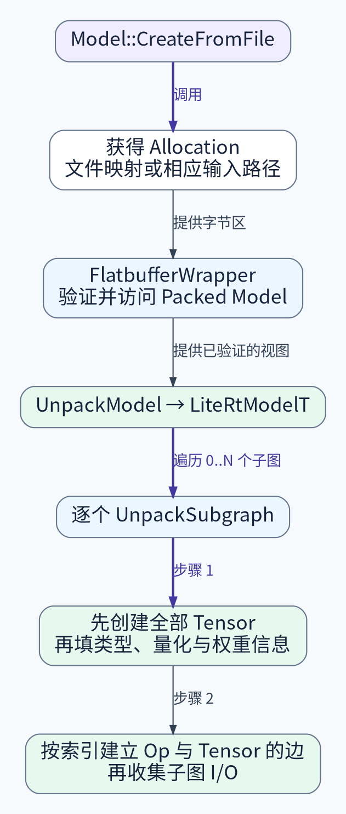
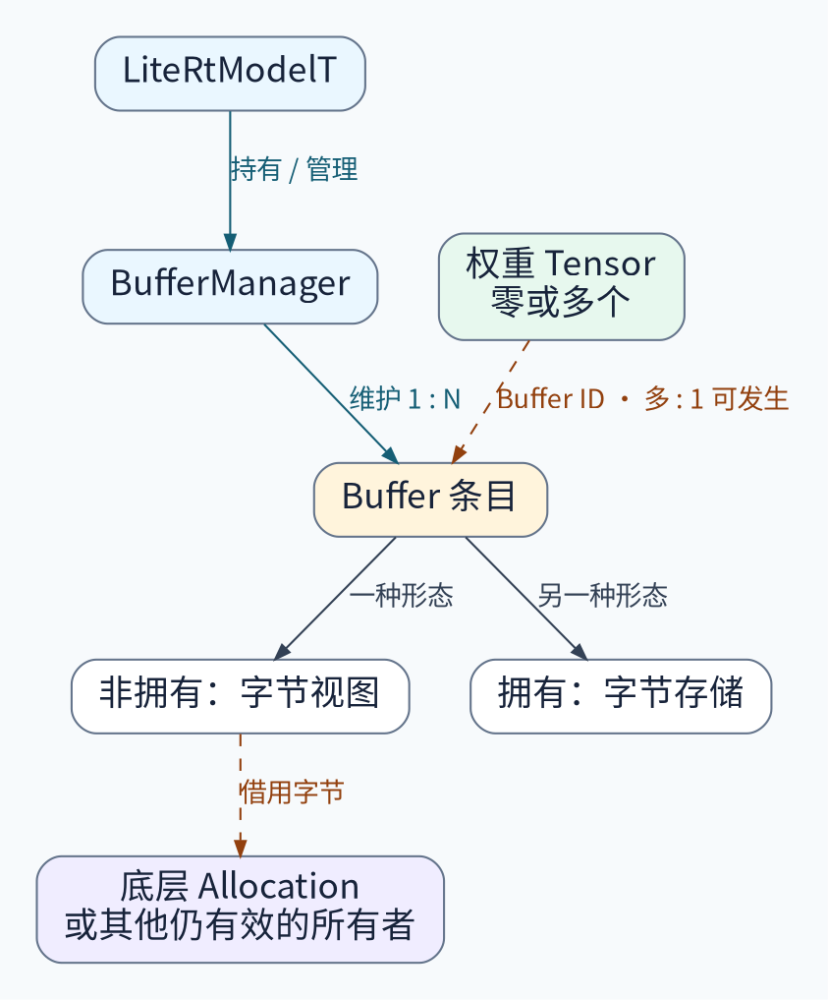

# LiteRT 源码笔记（二）：模型加载、权重与内部 IR

[第一篇](01-model-format.md)从 `.tflite` 字节读出了子图、张量和操作数索引。本篇从 `Model::CreateFromFile()` 往下走，看这些索引如何成为 LiteRT 内部对象和边，以及权重数据为何经常不必复制。加载成功并不意味着执行资源准备完毕。

**两条源码路径不要混用**：本篇的 `LiteRtModelT` 属于 LiteRT Model API；[第三篇](03-interpreter-builder.md)谈的是兼容的 TFLite `InterpreterBuilder` 路径，它从 `tflite::Model` 或 `FlatBufferModel` 等入口构造自己的运行时结构，并不要求先经过本篇的 `UnpackModel()`。

**源码基准**：以 LiteRT [`e3c11f0`](https://github.com/google-ai-edge/LiteRT/tree/e3c11f0d0e7ec02ecb6fd4ee872d5ee569402f62) 的加载实现为对照。算子循环、同文件追加选项、外部权重组的行为并非所有版本都相同。

**阅读顺序**：文件字节与校验 → 从视图建 IR → Tensor/权重 → Operator/连边 → Signature、Metadata 与 Dispatch 资产。代码摘出关键分支；省略项不能直接用于编译。

## 1. LiteRT 模型加载的整体调用链



*图 2-1　加载控制流：从字节视图到独立对象图。对象建立与数据拷贝不是同一件事。先读和校验 FlatBuffer，再解包；每个子图先创建全部 Tensor 对象，再填描述和权重信息，然后才按索引建立 Op 输入输出边。*

### 1.1 主要入口

这里跟踪 C++ 模型 API 的文件加载路径：

```text
litert::Model::CreateFromFile(...)
    └── litert::internal::LoadModelFromFile(filename, allow_modifications)
         ├── FlatbufferWrapper::CreateFromTflFile(...)
         │    ├── tflite::GetAllocationFromFile(...)
         │    └── FlatbufferWrapper::CreateFromAllocation(...)
         │         ├── VerifyFlatbuffer(...)
         │         └── tflite::FlatBufferModel::BuildFromAllocation(...)
         ├── UnpackModel(...)
         │    ├── LiteRtModelT + FlatbufferContext
         │    ├── UnpackSubgraph(...)
         │    │    ├── 先创建全部 Tensor 对象
         │    │    ├── UnpackTensor(...) × N
         │    │    ├── UnpackOp(...) × M  [条件编译]
         │    │    └── 收集 Subgraph I/O
         │    ├── external_buffer_groups
         │    ├── SignatureDef
         │    ├── metadata
         │    └── operator_codes [条件编译]
         ├── 保存 SourcePath
         ├── 关联 Dispatch Op bytecode asset [条件编译]
         └── 尝试解析文件路径可获得的外部权重组 [较新实现]
```

**最终返回的对象**是 `LiteRtModelT` 的智能指针。它已经建立可用于后续处理的内部 IR，但模型并未因此完成算子执行、后端编译或全部外部权重解析。

### 1.2 相关源码文件

| 文件 | 重点 |
| --- | --- |
| `litert/core/model/model_load.cc` | `LoadModelFromFile()`、`UnpackModel()`、`UnpackSubgraph()`、`UnpackTensor()`、`UnpackOp()` |
| `litert/core/util/flatbuffer_tools.cc` | `FlatbufferWrapper`、模型文件分配、FlatBuffer 验证、部分类型映射工具 |
| `litert/core/model/flatbuffer_to_litert.cc` | 将 TFLite 数据结构映射到 LiteRT 类型和量化结构 |
| `litert/core/model/model.h` | `LiteRtModelT`、Subgraph/Tensor/Op 等对象声明及模型所有权 |
| `litert/core/model/buffer_manager.h` | 模型权重 Buffer 的登记、索引与所有权管理 |
| `tflite/schema/schema_generated.h` | FlatBuffers 生成的 C++ 访问类 |

---

## 2. 文件映射、校验与 FlatbufferWrapper

### 2.1 `Allocation`：先获得字节区域，而不是 C++ Tensor 对象

`CreateFromTflFile()` 内部通过 `GetAllocationFromFile()` 获取 `tflite::Allocation`。通常可能采用：

1. **`MMAPAllocation`**：在可用且满足条件的情况下使用文件映射，减少一次完整文件数据复制。
2. **`FileCopyAllocation`**：将文件内容读取到内存中。

两者都提供对字节数据的访问，但底层资源归属和释放方式不同。是否一定使用 mmap 仍取决于平台、调用参数和具体实现。

`std::move(alloc)` 将 `Allocation` 的**所有权**交给后续对象；底层文件映射或复制出的内存因此能够在 `FlatBufferModel` 存活期间保持有效。

### 2.2 `FlatbufferWrapper::CreateFromAllocation()`

根据核对到的较新实现，过程可概括为：

```cpp
Expected<FlatbufferWrapper::Ptr> FlatbufferWrapper::CreateFromAllocation(
    ::tflite::Allocation::Ptr alloc) {
  if (alloc == nullptr || !alloc->valid()) {
    return Error(kLiteRtStatusErrorFileIO, "Invalid allocation");
  }

  if (!VerifyFlatbuffer(static_cast<const uint8_t*>(alloc->base()),
                        alloc->bytes())) {
    return Error(kLiteRtStatusErrorInvalidFlatbuffer, "Invalid flatbuffer");
  }

  auto fb_model =
      ::tflite::FlatBufferModel::BuildFromAllocation(std::move(alloc));
  if (fb_model == nullptr) {
    return Error(kLiteRtStatusErrorInvalidFlatbuffer,
                 "Failed to build flatbuffer model");
  }
  return FlatbufferWrapper::Ptr(new FlatbufferWrapper(std::move(fb_model)));
}
```

这段检查在 `BuildFromAllocation()` 之前。读不同版本时，先确认它的入口是否显式调用 `VerifyFlatbuffer()`。

#### 从文件入口跟到校验分支

源码节选：[flatbuffer_tools.cc:332–338](https://github.com/google-ai-edge/LiteRT/blob/e3c11f0d0e7ec02ecb6fd4ee872d5ee569402f62/litert/core/util/flatbuffer_tools.cc#L332-L338)。

```cpp
Expected<FlatbufferWrapper::Ptr> FlatbufferWrapper::CreateFromTflFile(
    absl::string_view path, bool allow_modifications) {
  auto error_reporter = tflite::DefaultErrorReporter();
  auto allocation = tflite::GetAllocationFromFile(path.data(), error_reporter,
                                                  allow_modifications);
  return FlatbufferWrapper::CreateFromAllocation(std::move(allocation));
}
```

1. 从 `CreateFromTflFile()` 开始：`GetAllocationFromFile()` 返回可访问的字节区域，`allow_modifications` 传递给底层 I/O 策略，不是在这里修改计算图。
2. `CreateFromAllocation()` 先检查 Allocation，再用 `base()` 和 `bytes()` 校验 FlatBuffer；这两层失败分别是文件 I/O 和无效模型，不要合成同一个错误。
3. `BuildFromAllocation(std::move(alloc))` 成功后，模型接管 Allocation；再由 Wrapper 持有模型。这解释了后面从 Packed Model 取出的视图为什么可以继续读取。

### 2.3 验证什么、不验证什么

原笔记把这里拆成两次排查：先问「文件有没有变成可读字节」，再问「这些字节能不能按 TFLite Schema 解释」。两项都通过仍不代表图能用；例如某个算子引用了不存在的 Tensor，下文要等解包时才能发现。

完整 FlatBuffers Schema Verifier 的检查重点包括：

- 根表和文件标识符是否合法；
- 偏移是否位于允许的缓冲范围内；
- Table、VTable、字段布局能否正确访问；
- Vector/String 的长度是否合理、边界是否越界；
- 嵌套对象结构与验证深度、表数量等限制。

而 **`Model.buffers[0]` 是否为空**、某个 `Tensor.buffer` 是否有效、`Operator.inputs` 是否指向合法 Tensor 等问题，属于 **TFLite 语义约束或 LiteRT 解包阶段的额外检查**，不能全部归入 FlatBuffers 结构校验。

源码中还存在 `LITERT_SKIP_FLATBUFFER_VERIFICATION` 条件编译路径：定义该宏时，LiteRT 的额外验证可能退化为基本边界和标识符检查。有关底层 `FlatBufferModel` 是否继续检查、检查强度如何，仍需结合相应构建版本的实现判断。**加载了文件不意味着模型的所有语义与算子都可执行**。

### 2.4 `Packed Model`：零拷贝访问视图

类似下面的 TFLite 访问代码：

```cpp
model_ = ::tflite::GetModel(allocation_->base());
```

核心过程是从原始字节读取 Root Offset，定位 `tflite::Model` 根表，然后把这一地址作为 FlatBuffers 生成的访问对象使用。

这里的 `tflite::Model` **不是**将每个字段“真正反序列化”为独立堆对象后的普通 C++ 结构。它是一种紧贴二进制布局的访问接口。调用 `model->subgraphs()`、`subgraphs()->Get(i)` 等方法时，访问器仍会根据相对偏移定位字段。

对比：

| 类型 | 使用方式 | 主要特点 |
| --- | --- | --- |
| `tflite::Model`（Packed） | 直接从字节区域读取 | 无需完整复制模型结构；依赖底层 Allocation 生命周期 |
| `tflite::ModelT`（Native / UnPacked） | `UnPack()` 得到拥有字段的 C++ 对象 | 便于修改，但通常会分配并复制相应对象/数据 |
| `LiteRtModelT` | `UnpackModel()` 构建 | LiteRT 自己的 IR，有图连接、BufferManager、资产等信息 |

**不能把 `tflite::ModelT` 与 `LiteRtModelT` 混为一谈。**

---

## 3. 从 Packed Model 到 LiteRT 内部 IR

### 3.1 `UnpackModel()` 创建根对象和上下文

```cpp
auto litert_model = std::make_unique<LiteRtModelT>(std::move(flatbuffer));

FlatbufferContext context(
    litert::internal::GetTflFlatbuffer(*litert_model),
    litert_model->Buffers());

const auto* packed_model = context.PackedModel();
```

职责划分：

- `LiteRtModelT`：拥有或关联根模型资源，保存 LiteRT IR 的 Subgraph、Signature、Metadata 等信息。
- `FlatbufferWrapper`：保证 FlatBuffers 的原始字节可持续访问。
- `BufferManager`：统一登记和管理模型常量/权重 Buffer。
- `FlatbufferContext`：把 Packed Model、BufferManager 和索引映射提供给解包函数。

模型中保存 `StoredBufferManager` 时，可见如下所有权设计：

```cpp
using StoredBufferManager =
    std::variant<BufferManager::Ptr, BufferManager*>;

StoredBufferManager buffer_manager_ = std::make_unique<BufferManager>();
```

它允许模型在不同构造情形下**自己持有**一个 `BufferManager`，或**借用外部提供的** `BufferManager`。`std::variant` 区分的是所有权形态，不是复制了两份 Buffer 内容。

#### 把模型和子图里的两层循环连起来

源码节选：[model_load.cc:612–624](https://github.com/google-ai-edge/LiteRT/blob/e3c11f0d0e7ec02ecb6fd4ee872d5ee569402f62/litert/core/model/model_load.cc#L612-L624)。

```cpp
  const auto* packed_model = context.PackedModel();

  if (packed_model->subgraphs()) {
    const auto num_subgraphs = packed_model->subgraphs()->size();
    for (auto i = 0; i < num_subgraphs; ++i) {
      const auto* tfl_subgraph = packed_model->subgraphs()->Get(i);
      if (tfl_subgraph == nullptr) {
        return Error(kLiteRtStatusErrorInvalidFlatbuffer);
      }
      LITERT_RETURN_IF_ERROR(UnpackSubgraph(context, *tfl_subgraph,
                                            litert_model->EmplaceSubgraph()));
    }
  }
```

1. 外层每读到一个文件子图，就用 `EmplaceSubgraph()` 建一个 IR 子图，再传给 `UnpackSubgraph()`。这里还没有创建 Interpreter。
2. 进入 `UnpackSubgraph()` 后，才运行下一节的两遍 Tensor 循环。先创建对象、再填属性，让 `UnpackTensor()` 能引用编号更靠后的 Tensor；找到对象不等于其属性已经填完。
3. 接下来的算子解包才把这些 Tensor 接成图；子图的对外 I/O 列表另有一轮，不依赖扫描算子的连线。

### 3.2 解包一个 Subgraph

对每个 Packed Subgraph，Loader 创建一个 `LiteRtSubgraphT`，然后调用 `UnpackSubgraph()`。

```cpp
const auto* packed_model = context.PackedModel();
for (size_t i = 0; i < packed_model->subgraphs()->size(); ++i) {
  const auto* tfl_subgraph = packed_model->subgraphs()->Get(i);
  LITERT_RETURN_IF_ERROR(UnpackSubgraph(
      context, *tfl_subgraph, litert_model->EmplaceSubgraph()));
}
```

上面省略了可空指针检查；实际源码在访问对象前做了相关校验。

### 3.3 **先创建全部 Tensor，再依次填充内容**

关键是把对象预创建和字段填充分成两遍。`UnpackSubgraph()` 不在同一个循环里“创建一个 Tensor，立刻解包一个 Tensor”，而是先完成预创建：

```cpp
const auto num_tensors =
    tfl_subgraph.tensors() ? tfl_subgraph.tensors()->size() : 0;

for (auto i = 0; i < num_tensors; ++i) {
  litert_subgraph.EmplaceTensor();
}

for (auto i = 0; i < num_tensors; ++i) {
  const auto* tfl_tensor = tfl_subgraph.tensors()->Get(i);
  auto& litert_tensor = litert_subgraph.Tensor(i);
  LITERT_RETURN_IF_ERROR(UnpackTensor(
      context, litert_subgraph, *tfl_tensor, litert_tensor));
  litert_tensor.SetTensorIndex(i);
}
```

**这样安排的原因：**在处理 `Tensor[1]` 的 Blockwise Quantization 时，`details->scales()` 可能引用 `Tensor[3]`。即使 `Tensor[3]` 还未填入具体类型与权重数据，**其 `LiteRtTensorT` 对象也必须已经存在**，才能保存稳定的指针引用。

```text
预创建：T0 T1 T2 T3 ... Tn
         │  │     │
填充：   T0 → T1 → T2 → T3 → ...
               │
               └── T1.quantization.scales → &T3
```

这也解释了为何需要与地址稳定性相适配的模型容器及对象生命周期管理，而不是把 Tensor 仅作为临时循环变量。

---

## 4. Tensor、权重与 BufferManager



*图 2-2　权重的所有权：视图和拥有型数据。示意两种存储形态，不是说一个 Tensor 同时走两条路径。多个 Tensor 可经 Buffer ID 引用同一条目；如果条目只保存借用视图，底层 Allocation 必须仍有效。同文件追加权重仍来自该 Allocation；外部 sidecar 的路径见本节正文。*

### 4.1 `UnpackTensor()` 的处理顺序

主要分为：

1. 解析常量权重 Buffer：普通 `buffer` 或 `external_buffer`；
2. 映射 Tensor 数据类型与 Shape；
3. 映射量化参数；
4. 处理名称以及暂不支持的特性。

注意：**一个 Tensor 在 IR 中存在，不代表该 Tensor 当前已分配推理所用的读写缓冲区。**例如中间结果 Tensor 通常需在执行前或运行时由后端分配；`Weights()` 所关注的是模型常量/权重相关存储。

### 4.2 途径 A：`Tensor.buffer != 0`

读取流程如下：

```text
Tensor.buffer = 原始 TFLite Buffer 索引
    │
    ▼
ReadBuffer(context, buffer_ind)
    ├── Buffer.offset != 0 → 同文件追加区域
    ├── Buffer.data != null → FlatBuffer 内嵌数据
    └── 否则 → 空数据引用
    │
    ▼
RegisteredTflBufferIds 查重
    ├── 已存在：复用 LiteRT BufferId
    └── 不存在：Register / SetWeightsFromUnownedBuffer
                   │
                   └── 保存 TFLite 索引 → LiteRT BufferId 映射
```

关键代码摘录：

```cpp
const auto buffer_ind = tfl_tensor.buffer();
if (buffer_ind != 0) {
  auto buffer = ReadBuffer(context, buffer_ind);
  if (!buffer) return buffer.Error().Status();

  auto it = context.RegisteredTflBufferIds().find(buffer_ind);
  if (it != context.RegisteredTflBufferIds().end()) {
    litert_tensor.Weights().SetBufferId(it->second);
  } else {
    BufferContext lrt_buf_ctx;
    lrt_buf_ctx.should_append = buffer->is_external;
    SetWeightsFromUnownedBuffer(
        litert_tensor.Weights(), buffer->buffer, lrt_buf_ctx);
    context.RegisteredTflBufferIds()[buffer_ind] =
        litert_tensor.Weights().GetBufferId();
  }
}
```

其中：

- `RegisteredTflBufferIds`：避免**同一个 TFLite Buffer 索引**被重复登记，保留共享权重关系。
- `BufferRef<uint8_t>`：指向现有字节的**非拥有引用**，本身不负责释放底层内存。
- `should_append`：用于保留“原始字节来自追加区域”的序列化语义，并非要求当前立刻执行文件追加。
- `LiteRT BufferId`：是 `BufferManager` 内部的句柄，**不要求与原始 TFLite Buffer 索引相等**。

#### `ReadBuffer()` 怎样选中字节来源

源码节选：[model_load.cc:285–312](https://github.com/google-ai-edge/LiteRT/blob/e3c11f0d0e7ec02ecb6fd4ee872d5ee569402f62/litert/core/model/model_load.cc#L285-L312)。

```cpp
  const auto& tfl_buffer = **buffer;

  if (tfl_buffer.offset() != 0) {

    const auto* alloc_base = context.AllocBase();
    const auto offset = tfl_buffer.offset();
    const auto size = tfl_buffer.size();
    if (!IsRangeInAllocation(offset, size, context.AllocSize())) {
      return Error(kLiteRtStatusErrorInvalidFlatbuffer);
    }

    return TflBufferContext{BufferRef<uint8_t>(alloc_base + offset, size),
                            true};
  } else if (tfl_buffer.data()) {

    const auto* start = tfl_buffer.data()->data();
    const auto size = tfl_buffer.data()->size();

    return TflBufferContext{BufferRef<uint8_t>(start, size), false};
  } else {
    return TflBufferContext{};
  }
```

1. `GetTflBuffer()` 先用文件下标定位 `Buffer`。非零 `offset` 优先，`IsRangeInAllocation()` 检查模型 Allocation 的范围后才能按偏移取字节。
2. 没有追加偏移时才看 `data()`；如果两个来源都没有，返回空的 Buffer 上下文。两条路径都不打开独立的权重文件。
3. 回到上面的调用方后，同一个文件下标可以复用同一个 IR Buffer ID；`should_append` 保留的是序列化布局，不是复制字节的命令。

读 `offset` 时，可以先画出两个边界：FlatBuffer 主体的末尾，以及**整个模型文件**的末尾。权重可以在前一个边界之后，只要不越过后一个边界。这正是「文件里的追加区」和下面「独立权重文件」的区别。

### 4.3 途径 B：`Tensor.external_buffer != 0`

当普通 `Tensor.buffer` 不使用且 `external_buffer` 提供有效引用时，Loader 查找独立外部权重描述：

```cpp
BufferContext lrt_buf_ctx;
lrt_buf_ctx.external = ExternalBufferRef{
    (*external)->id(),
    (*external)->group(),
    (*external)->offset(),
    (*external)->length(),
    (*external)->packing() ? (*external)->packing()->str() : std::string()
};

SetWeightsFromUnownedBuffer(
    litert_tensor.Weights(), BufferRef<uint8_t>(), lrt_buf_ctx);
```

这里保存的是外部权重的 **ID / Group / Offset / Length / Packing 等元数据**；传入的 `BufferRef` 为空，说明这段模型加载代码没有立即获取独立权重文件中的有效数据指针。这是 `UnpackTensor()` **这一阶段**的行为。较新的文件入口（[外部权重组加载变更](https://github.com/google-ai-edge/LiteRT/commit/a420b1bbfddea3d0681c0b3a9afa3e3d3e43e04b)）在 `UnpackModel()` 之后还会尝试打开权重组文件：组名为相对路径时相对模型目录解析；同组只尝试打开一次，可读时检查权重范围并将对应字节放入拥有数据的 Buffer；不可读时保留空视图，仍可由运行时选项提供权重源。这个补充属于文件入口，不应外推到所有内存加载入口。

### 4.4 Buffer 所有权与生命周期

```text
LiteRtModelT
 ├── FlatbufferWrapper
 │    └── FlatBufferModel
 │         └── Allocation ──────────┐
 │                                  │ owns bytes / mmap
 └── BufferManager                 │
      ├── BufferId = A → BufferRef ─┘  (non-owning)
      ├── BufferId = B → BufferRef ─┘  (non-owning)
      └── BufferId = C → ExternalBufferRef metadata
```

**需要保证的前提：**只要模型权重仍使用非拥有 `BufferRef` 指向 Allocation 内的区域，底层 Allocation 就不能先于该引用被销毁。`FlatbufferWrapper` 与 `LiteRtModelT` 的所有权设计正是理解这一安全边界的关键。

### 4.5 Tensor 类型映射

```cpp
TflTensorType tfl_tensor_type(
    tfl_tensor.type(), TflShapeInfo(tfl_tensor));
auto tensor_type = MapTensorType(tfl_tensor_type);
if (!tensor_type) {
  return tensor_type.Error().Status();
}
litert_tensor.SetType(std::move(*tensor_type));
```

`MapTensorType()` 的目的不是只“映射 INT32 等枚举值”，还包括根据 Shape 信息确定 LiteRT 的相应 Tensor 类型表达。`has_rank`、`shape_signature` 中的动态维度等信息可能影响映射结果。

### 4.6 Blockwise Quantization 在 IR 中如何保存

```cpp
int scales_tensor_ind = details->scales();
int zero_points_tensor_ind = details->zero_points();
int block_size = details->block_size();

LiteRtTensor scales_tensor = &parent.Tensor(scales_tensor_ind);
LiteRtTensor zero_points_tensor = nullptr;
if (zero_points_tensor_ind != -1) {
  zero_points_tensor = &parent.Tensor(zero_points_tensor_ind);
}

litert_tensor.SetQarams(
    MakeBlockWiseQuantization(scales_tensor, zero_points_tensor,
                              block_size));
```

实际代码还会先校验 `scales_tensor_ind`、`zero_points_tensor_ind` 是否越界，上面为突出对象关联而省略。

这里的 `scales_tensor` 是一个**指向 LiteRT IR Tensor 对象的指针/句柄**，不是当场把 `scales` 的数值数组复制到 `Quantization` 里。与此相比，Per-tensor 和 Per-channel 的常见量化参数可以直接通过标量/数组保存。

### 4.7 不支持特性的判定边界

在当前核对的 `UnpackTensor()` 代码中：

| 条件 | 本加载路径行为 | 是否可以说“LiteRT 全局不支持”？ |
| --- | --- | --- |
| `is_variable()` | 返回 `kLiteRtStatusErrorUnsupported` | 不可以，只能限定该加载路径和版本 |
| `variant_tensors()` 非空 | 返回 `kLiteRtStatusErrorUnsupported` | 同上 |
| `sparsity() != nullptr` | **记录 Warning，不直接返回失败** | 更不能据此说“稀疏张量必定加载失败” |
| `shape_signature` 含动态信息 | 由类型映射等路径处理 | 不能简单等同于 `variable` 或 `variant` |

这张表将**Schema 支持、Loader 接受、运行时能执行**三个不同层面的支持状态区分开了。

---

## 5. Operator 解包与图连接

### 5.1 `LITERT_NO_BUILTIN_OPS` 的实际影响

在所核对的 `model_load.cc` 中，`UnpackOp()` 函数及 Subgraph 中逐个解包 Op 的循环都位于：

```cpp
#if !defined(LITERT_NO_BUILTIN_OPS)
#endif
```

模型级 `operator_codes` 的部分解包及后续 Dispatch Op 资产附加，也受到相关条件编译约束。

| 构建方式 | **该模型加载路径**的表现 | 需要注意 |
| --- | --- | --- |
| 未定义宏 | 可解包 Op 并建立相应 IR 连接 | 并不保证所有算子一定有可运行的 CPU Kernel |
| 定义宏 | 跳过这里的 Op 解包及部分后处理 | **不能仅凭这个宏认定某个运行时一定使用哪种 Delegate**；算子解析/执行还涉及后续 Resolver 与后端配置 |

因此不能把“定义该宏”理解为“运行时一定依赖 Delegate”。较新 `compiled_model.cc` 中确有不同的 Resolver 分支，例如选择特定算子注册或 Stub Resolver；但这属于后续执行层面，不等同于 `UnpackOp()` 的语义。


**版本对照**：[`v2.3.2`](https://github.com/google-ai-edge/LiteRT/blob/v2.3.2/litert/core/model/model_load.cc#L320) 的 `UnpackSubgraph()` 还没有给算子解包循环加这层条件；本篇引用的后续快照才有。

### 5.2 `LiteRtOpT` 保存什么

关键字段可以按用途归纳为：

```cpp
OwningBufferRef<uint8_t> custom_options_;
std::vector<LiteRtTensor> inputs_;
std::vector<LiteRtTensor> outputs_;
std::string custom_code_;
uint32_t op_index_;
int32_t tfl_op_code_ind_;
TflOptions tfl_option_;
TflOptions2 tfl_option_2_;
```

分别承载自定义选项、输入/输出 Tensor 引用、算子标识和 TFLite options 等信息。字段的具体实现类型、默认值和定义位置可能随版本调整。

### 5.3 解包前的限制检查

```cpp
if (tfl_op.intermediates() && !tfl_op.intermediates()->empty()) {
  return kLiteRtStatusErrorUnsupported;
}

if (tfl_op.mutating_variable_inputs() &&
    !tfl_op.mutating_variable_inputs()->empty()) {
  return kLiteRtStatusErrorUnsupported;
}
```

含义分别是：本路径尚未处理要求内部临时 Tensor 的算子结构，以及会修改变量输入的算子语义。它们不等价于一般的中间 Tensor 或普通输入/输出。

### 5.4 输入输出边如何建立

```text
从 tfl_op.inputs[] 读取 Tensor 索引
    │
    ├── -1 → 可选输入缺省，跳过
    ├── 无效索引 → 返回错误
    └── 有效 → AttachInput(tensor, op)

从 tfl_op.outputs[] 读取 Tensor 索引
    │
    ├── 无效索引 → 返回错误
    └── 有效 → AttachOutput(tensor, op)
```

**输入边和输出边的语义并不相同：**

- `AttachInput()`：把 Tensor 关联为当前 Op 的一个输入，并建立 Tensor **被哪些 Op 使用**的关系。
- `AttachOutput()`：把 Tensor 关联为当前 Op 的一个输出，建立 Tensor 的 **Defining Op**（生产者）关系。
- `SetDefiningOp()` 是输出 Tensor 一侧的核心操作；**不能说 AttachInput 和 AttachOutput 都调用 SetDefiningOp**。

例如：

```text
T0 ──input──▶ Op0 ──output──▶ T2 ──input──▶ Op1 ──output──▶ T3
T1 ──input──▶ Op0
```

`T2` 的 Defining Op 是 `Op0`，而 `Op1` 是 `T2` 的使用者。一个 Tensor 可以被多个 Op 使用，但在普通 SSA 风格图结构中通常应有明确的生产者。

#### 顺着 `UnpackOp()` 看一条输入边

源码节选：[model_load.cc:207–234](https://github.com/google-ai-edge/LiteRT/blob/e3c11f0d0e7ec02ecb6fd4ee872d5ee569402f62/litert/core/model/model_load.cc#L207-L234)。

```cpp
  const auto num_inputs = tfl_op.inputs() ? tfl_op.inputs()->size() : 0;
  for (auto i = 0; i < num_inputs; ++i) {
    const auto input_ind = tfl_op.inputs()->Get(i);
    if (input_ind == -1) {
      continue;
    }
    if (input_ind < 0 ||
        static_cast<size_t>(input_ind) >= parent.Tensors().size()) {
      return kLiteRtStatusErrorInvalidFlatbuffer;
    }
    AttachInput(&parent.Tensor(input_ind), litert_op);
  }

  const auto num_outputs = tfl_op.outputs() ? tfl_op.outputs()->size() : 0;
  for (auto i = 0; i < num_outputs; ++i) {
    const auto output_ind = tfl_op.outputs()->Get(i);
    if (output_ind < 0 ||
        static_cast<size_t>(output_ind) >= parent.Tensors().size()) {
      return kLiteRtStatusErrorInvalidFlatbuffer;
    }
    AttachOutput(&parent.Tensor(output_ind), litert_op);
  }
```

1. 沿文件中的输入列表逐项取下标。可选输入的 `-1` 先跳过，不按负数索引访问 Tensor 表。
2. 其他负值和越界属于无效模型。合法下标才取当前子图的 Tensor 并交给 `AttachInput()`，形成 Op 到 Tensor 的输入关联及 Tensor 到消费者的反向关系。
3. 输出方向见同函数紧接的循环：用 `AttachOutput()` 建生产者关系。不要用这个函数来寻找整个子图的对外输入。

### 5.5 解析 Custom Options 与 Builtin Options

**Custom Options：**

```cpp
if (tfl_op.large_custom_options_size() != 0) {
}
const auto* custom_opts = tfl_op.custom_options();
if (custom_opts) {
  litert_op.SetCustomOptions(custom_opts->data(), custom_opts->size());
}
```

这里调用 `SetCustomOptions()` 将 FlatBuffer 中提供的配置传给 IR 对象。**不要简单说成“仅保存原始 offset 和 size”**，因为 `LiteRtOpT` 中使用的是 `OwningBufferRef` 等容器，具体是否复制/持有要按 Set 方法实现判断。`large_custom_options_size` 在此处是 Warning 而非直接硬错误。

**Builtin Options：**

```cpp
TflOpPtr tfl_op_ptr(tfl_op.UnPack());
litert::internal::SetTflOptions(
    litert_op, std::move(tfl_op_ptr->builtin_options));
litert::internal::SetTflOptions2(
    litert_op, std::move(tfl_op_ptr->builtin_options_2));
```

这一阶段使用 FlatBuffers 生成的 `UnPack()` 构造 Native `OperatorT`，然后取出两组 builtin options，并交给 LiteRT 的对应存储结构。

**注意两种 Unpack 的范围差异：**`tfl_op.UnPack()` 是 FlatBuffers 对单个 Operator 结构的解包；`UnpackModel()` 是 LiteRT 对整个模型的 IR 重建，不能混为同一步骤。

最后通过 `context.SetOpCode(...)` 将 `opcode_index` 映射到具体算子类型/自定义标识，并保存当前 Op 在 Subgraph 中的索引。


较新的 `UnpackOp()` 还支持[大块 Custom Options](https://github.com/google-ai-edge/LiteRT/commit/1b06059e12a4a9f9376b63cc91157f29f52d05ed)。优先读取内嵌 `custom_options`；没有内嵌数据且 `large_custom_options_offset > 1` 时，从**同一个 Allocation** 取数。先验证 `offset <= alloc_size`，再验证 `size <= alloc_size - offset`，避免直接相加溢出。这里保存的是算子选项，不是 Tensor 权重。

### 5.6 Subgraph 输入输出收集

全部 Tensor 和（条件允许时的）Op 处理完成后，再把 Subgraph 声明的 I/O Tensor 索引转换为内部对象引用：

```cpp
litert_subgraph.Inputs().push_back(
    &litert_subgraph.Tensor(tfl_input_ind));

litert_subgraph.Outputs().push_back(
    &litert_subgraph.Tensor(tfl_output_ind));
```

这一步负责的是 **Subgraph 对外边界**，而不是 Operator 之间的边。因此，`AttachInput/AttachOutput` 和 `Subgraph.Inputs()/Outputs()` 虽名字相似，职责不同。这里存的是 IR 对象引用；[第三篇的 Interpreter I/O](03-interpreter-builder.md#inputs--outputs-是怎样填进去的) 读同样的文件字段，但保存的是整数索引。

---

## 6. 模型级元信息与 Dispatch Op

### 6.1 模型级信息

`UnpackModel()` 在处理所有 Subgraph 后，还会保存：

- **`external_buffer_groups`**：外部权重分组信息和名称；
- **`signature_defs`**：具名模型接口；必要时生成默认 Signature；
- **`metadata`**：按名称保存模型额外信息；
- **`operator_codes`**：条件编译允许时保存算子类型目录。

其中部分对象先调用 FlatBuffers 生成的 `UnPack()`，再转为 LiteRT 的内部表示。不能把这些信息都概括为“简单读取，无额外处理”，例如 Signature 解包还包含索引与数量校验。

#### 按子图顺序整理 Signature 的别名

源码节选：[model_load.cc:574–597](https://github.com/google-ai-edge/LiteRT/blob/e3c11f0d0e7ec02ecb6fd4ee872d5ee569402f62/litert/core/model/model_load.cc#L574-L597)。

```cpp
    std::vector<std::string> input_names;
    std::vector<LiteRtTensor> input_tensors;
    input_names.reserve(tfl_inputs.size());
    for (auto& tensor : litert_subgraph->Inputs()) {
      input_names.push_back(input_aliases.contains(tensor)
                                ? input_aliases.at(tensor)
                                : std::string(tensor->Name()));
      input_tensors.push_back(tensor);
    }
    std::vector<std::string> output_names;
    std::vector<LiteRtTensor> output_tensors;
    output_names.reserve(tfl_outputs.size());
    for (auto& tensor : litert_subgraph->Outputs()) {
      output_names.push_back(output_aliases.contains(tensor)
                                 ? output_aliases.at(tensor)
                                 : std::string(tensor->Name()));
      output_tensors.push_back(tensor);
    }

    parent.EmplaceSignature(litert_subgraph, std::move(input_names),
                            std::move(input_tensors), std::move(output_names),
                            std::move(output_tensors),
                            tfl_signature->signature_key);
```

1. 前面先根据 Signature 的 Tensor 索引在所属子图定位对象，建立 `Tensor → 名称` 的表。
2. 输出和输入各自按子图原来的 I/O 顺序遍历，给每个对象查别名，找不到就用 Tensor 自身名称。序列化的具名映射不必和子图 I/O 使用相同的顺序。
3. 最终一项名称对应同位置的 Tensor 引用，不会多造一份 Tensor 或分配输入输出数据。

### 6.2 Dispatch Op 是什么

**Dispatch Op** 是 LiteRT 特定用途的 Custom Op 表示。它可以把某个被离线编译/转换的子图包装为单个调度节点，并通过资产信息引用该子图对应的编译产物或执行入口。

例如（概念示例，并非任何模型必然采用此融合）：

```text
普通图：CONV_2D → ADD → RELU
            │ 通过某种编译/转换路径
            ▼
         Dispatch Op
            │
            └── 关联一段已编译的 Bytecode / Asset
```

`DispatchOpOptions` 示例：

```cpp
struct DispatchOpOptions {
  size_t bytecode_size;
  size_t bytecode_offset;
  std::string name;
};
```

这几个字段指出资产名称，以及对应 Bytecode 在当前模型 Allocation 中的起始位置与大小。

### 6.3 加载过程如何附加 Bytecode

源码中的关键逻辑可以概括为：

```text
遍历 Subgraph.Ops()
   │
   ├─ 不是 LiteRT Dispatch 自定义算子 → 跳过
   │
   └─ 是 Dispatch Op
        ├─ 解析 custom_options → bytecode_offset / size / name
        ├─ 校验 [offset, offset + size] 在 Allocation 范围内
        ├─ 查重：相同 offset 是否已注册 BufferId
        │    └─ 没有 → RegisterNonOwnedBuffer(bytecode_view)
        └─ AttachAssetToOp(op, buffer_id, name)
```

**重要区分：**`RegisterNonOwnedBuffer` 是为 IR 注册对 Bytecode 的引用；`AttachAssetToOp` 是建立资产与 Op 的关联。**这一步并未执行 Bytecode，也不等于已经完成后端编译或初始化。**

原始代码通过 `bytecode_offset` 作为查重 Key；这一选择有利于对相同位置的资产复用，但在推理其普遍正确性时，应注意它依赖序列化约定和范围检查。

#### Dispatch Op 怎样找到已有的 Bytecode

源码节选：[model_load.cc:742–761](https://github.com/google-ai-edge/LiteRT/blob/e3c11f0d0e7ec02ecb6fd4ee872d5ee569402f62/litert/core/model/model_load.cc#L742-L761)。

```cpp
          if (!IsRangeInAllocation(dispatch_opts.bytecode_offset,
                                   dispatch_opts.bytecode_size,
                                   allocation_size)) {
            return Error(kLiteRtStatusErrorInvalidFlatbuffer);
          }
          BufferRef<uint8_t> byte_code(
              model_flatbuffer.AllocBase() + dispatch_opts.bytecode_offset,
              dispatch_opts.bytecode_size);
          const BufferManager::BufferId buf_id =
              model->Buffers()->RegisterNonOwnedBuffer(byte_code);
          buffer_id_map.insert({dispatch_opts.bytecode_offset, buf_id});
        }

        model->AttachAssetToOp(op, buffer_id_map[dispatch_opts.bytecode_offset],
                               std::move(dispatch_opts.name));
```

1. 进入这段之前已经根据 custom code 识别了 Dispatch Op，并从其选项取出 `offset`、`size` 和名称。副本 ID 表以偏移为键，只在还没登记该偏移时进入范围检查与注册。
2. 边界检查针对整个模型 Allocation。成功后构造 `BufferRef`，登记的是非拥有的字节视图；相同偏移的其他 Dispatch Op 复用已登记的 ID。
3. `AttachAssetToOp()` 只挂资产与名字，不在这时执行 Bytecode。本段是所给快照的文件加载路径，不代表所有加载入口都做相同步骤。

这里要注意：为什么查重键是 `bytecode_offset`，而不是 `(offset, size)`？这段代码把「同一偏移」当成「同一份资产」，因此必须依赖序列化端让引用同一偏移的记录指向同一段 Bytecode。范围检查与按偏移复用是两件事；不能仅凭这个表推断两条记录的长度已被逐一比对。

### 6.4 到此为止完成了什么

`LoadModelFromFile()` 返回时，大体完成：

| 完成事项 | 结果 |
| --- | --- |
| 读取/映射文件 | 可访问文件的原始字节区 |
| FlatBuffer 验证 | 符合当前构建版本所执行的校验条件 |
| 建立 Packed View | 能从内存按偏移定位模型结构 |
| 构造 LiteRT Model | 建立 Subgraph、Tensor 以及条件允许时的 Op IR |
| 建立 Buffer 引用 | 保留权重地址或外部资源元数据 |
| 建立 I/O 和签名 | 可识别图边界与具名接口 |
| 关联 Dispatch Asset | 保留 Bytecode 对应的地址与所属 Op |

**不等于已完成：**输入输出推理缓冲区全量分配、全部算子可执行性验证、Delegate/后端准备、编译、执行及输出计算。

---

## 7. 关键总结与排查清单

### 7.1 最核心的五个结论

1. **FlatBuffers 主要负责“按偏移读取”，不是自动创建一整棵普通 C++ 对象树。**生成的 Packed 访问类直接引用原始二进制内存。
2. **LiteRT 的 `UnpackModel()` 是另一层 IR 转换。**它将模型索引关系转化为可操作的 Subgraph / Tensor / Op 对象关系。
3. **权重 Buffer 管理与执行 TensorBuffer 分配是不同概念。**`BufferManager` 和 `Weights()` 在这一代码路径主要围绕常量数据展开。
4. **Tensor 的预创建是为了支持交叉引用。**例如 Blockwise Quantization 可以提前保存指向尚未填充完成的 scales Tensor 的引用。
5. **“能解析模型文件”不代表“模型能运行”。**结构校验、IR 建立、算子支持、外部权重装载及硬件执行属于不同层面。

### 7.2 源码阅读排查表

| 现象/问题 | 优先查看 |
| --- | --- |
| 模型文件加载失败 | `GetAllocationFromFile()`、`VerifyFlatbuffer()`、`BuildFromAllocation()` |
| Tensor Buffer 索引越界 | `GetTflBuffer()`、`ReadBuffer()` |
| 权重读取偏移不正确 | `Buffer.offset/size` 与 Allocation 边界检查 |
| 同一份权重被重复注册 | `RegisteredTflBufferIds()`、`RegisteredExternalBufferIds()` |
| 量化 scales/zero_points 指针无效 | Tensor 是否全部预创建、对应索引是否越界 |
| 模型包含 Sparse Tensor | `UnpackTensor()` Warning 与后续执行路径 |
| 模型 Op 数量为零 | `LITERT_NO_BUILTIN_OPS` 是否定义、使用的具体加载接口 |
| Op 类型识别失败 | `operator_codes`、`context.SetOpCode()` |
| 无法通过 Signature 名称调用 | `UnpackSignatures()`、默认 Signature 创建 |
| Dispatch Op 没有关联 Bytecode | Custom Code、Custom Options、资产 offset/size、条件编译路径 |
| 模型加载成功但推理失败 | 后续 `CompiledModel` / Operator Resolver / 设备后端 / TensorBuffer 准备流程 |

## 对照源码

- [Model Loader：model_load.cc](https://github.com/google-ai-edge/LiteRT/blob/e3c11f0d0e7ec02ecb6fd4ee872d5ee569402f62/litert/core/model/model_load.cc)
- [FlatBuffer 工具：flatbuffer_tools.cc](https://github.com/google-ai-edge/LiteRT/blob/e3c11f0d0e7ec02ecb6fd4ee872d5ee569402f62/litert/core/util/flatbuffer_tools.cc)
- [类型与量化映射：flatbuffer_to_litert.cc](https://github.com/google-ai-edge/LiteRT/blob/e3c11f0d0e7ec02ecb6fd4ee872d5ee569402f62/litert/core/model/flatbuffer_to_litert.cc)
- [接着读：InterpreterBuilder](03-interpreter-builder.md)
