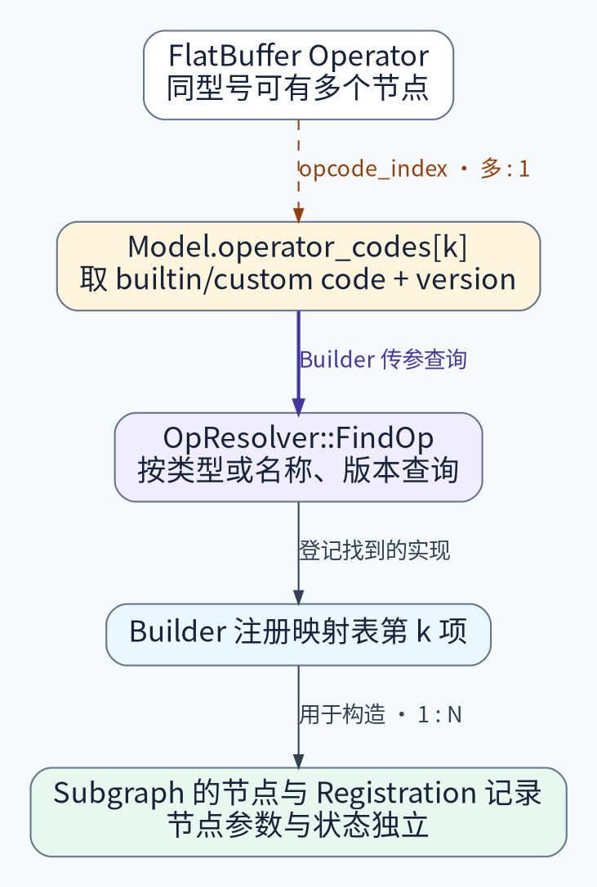
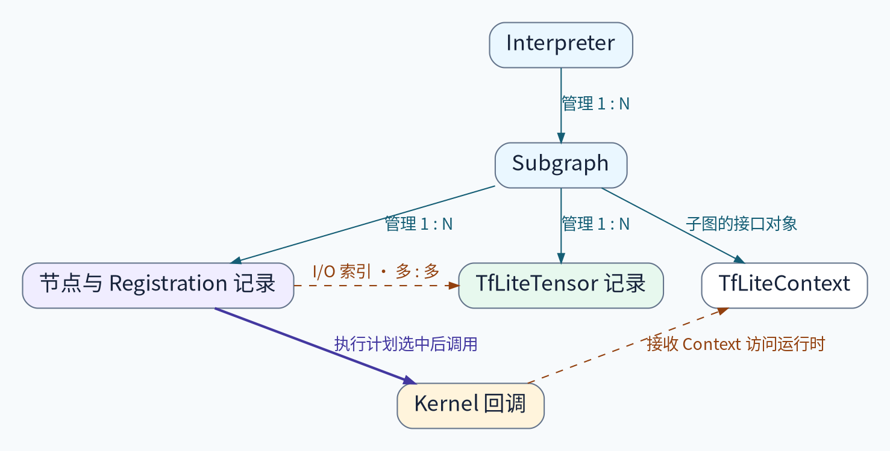

# InterpreterBuilder（一）：创建 Interpreter 和运行时子图

上一篇：[文件到 IR](02-load-model-ir.md) · [目录](README.md) · 下一篇：[Builder（二）](03b-interpreter-tensors.md)

这一篇从 `.tflite` 的 FlatBuffer 视图跟到运行时子图。区分两个路径：上一主题的 `LiteRtModelT` 是 LiteRT 内部 IR；这里的 `InterpreterBuilder` 读的是 TFLite FlatBuffer 视图，不要求先构建 `LiteRtModelT`。

文中的 C++ 按调用现场节选；长片段可展开。链接指向核对过的上游版本，片段不作为独立程序编译。

先把这组三篇的交接记下来：**本篇建子图与张量槽位、确定 I/O 编号；下一篇填每个槽的描述；第三篇才把节点、张量索引和内核接起来。** 如果看到 `AddTensors()` 就以为已经能填模型输入，后面遇到空的数据指针便很难知道该查哪一步。

## 1. Builder 的构造与入口检查

```cpp
std::unique_ptr<tflite::Interpreter> interpreter;
tflite::InterpreterBuilder builder(model, resolver);
if (builder(&interpreter) != kTfLiteOk || !interpreter) {
  // ...
}
```

示例里的 `model` 来自已经打开的 FlatBuffer；`resolver` 则由调用方提供，例如默认的 `tflite::ops::builtin::BuiltinOpResolver`。[构造函数](https://github.com/google-ai-edge/LiteRT/blob/e3c11f0d0e7ec02ecb6fd4ee872d5ee569402f62/tflite/core/interpreter_builder.cc#L220-L252)把它保存为 `op_resolver_`；创建 Builder 本身不会按节点查找或运行算子。真正的第一次查找在下文的 `BuildLocalIndexToRegistrationMapping()`。

传给 `operator()` 的是一个用于接收结果的 `unique_ptr`，不是已经构造好的 Interpreter。Interpreter 并非不能直接构造；从模型建图时，把校验、子图导入和算子绑定交给 Builder。构建过程可概括为：

```text
校验输出、模型指针及 Model.version()
  → 为 Model.operator_codes 建立本地注册表
  → 创建 Interpreter 及各 Subgraph
  → 导入图的 I/O，解析 Tensor、Node 和变量
  → 导入 SignatureDef、Metadata
  → 登记满足条件的延迟工厂，应用显式 Delegate
  → 移交 Interpreter
```

顺序示意中，登记延迟工厂和应用显式 Delegate 是两个独立动作；原稿对应路径先登记工厂，再调用 `ApplyDelegates`。`Model.version()` 与 `TFLITE_SCHEMA_VERSION` 比较，是 TFLite 模型 schema 的兼容性检查，并非要求生成文件的 FlatBuffers 库版本等于某个版本。输出指针存在时，Builder 先 `reset`，临时 Interpreter 构建完成才 `move` 给调用者。检查通过也不代表可直接 `Invoke()`：通常还要填好输入形状并调用 `AllocateTensors()`。

常用的 `FlatBufferModel` 构造重载从模型对象取 `GetModel()`、错误报告器、元数据和 `allocation()`，传入的 `OpResolver` 负责查算子；另外也有直接接收 `const tflite::Model*` 并显式传入 ErrorReporter、options、Allocation 的重载。原始模型字节可被运行时张量或自定义参数借用；调用者应遵守该 API 的模型、Resolver 和外部对象生命周期约定，不可在构建成功后立刻销毁这些依赖。

对照：[InterpreterBuilder 实现](https://github.com/google-ai-edge/LiteRT/blob/e3c11f0d0e7ec02ecb6fd4ee872d5ee569402f62/tflite/core/interpreter_builder.cc#L220-L252)。

从 `FlatBufferModel` 构建 `InterpreterBuilder` 时，先把模型视图和创建运行时所需的依赖传给 Builder。

```cpp
InterpreterBuilder::InterpreterBuilder(
    const FlatBufferModel& model, const OpResolver& op_resolver,
    const InterpreterOptions* options_experimental)
    : model_(model.GetModel()),
      op_resolver_(op_resolver),
      error_reporter_(ValidateErrorReporter(model.error_reporter())),
      metadata_(model.ReadAllMetadata()),
      allocation_(model.allocation()) {
  if (options_experimental) {
    options_ = *options_experimental;
  }
}
```

创建interpreterbuilder需要之前传入以下的参数：

- model： 即load时获得的flatbuffermodel对象，一个用来代表tflite文件的RAII对象
- op_resolver: 接口，用来将文件中的op映射到实际可执行的算子
- error——reporter： 处理报错故障信息
其它依赖包括错误报告器、元信息和 `Allocation`。`Allocation` 是模型字节的底层存储，不是运行时输入的分配器。

初始化完成后，调用重载的 `operator()`，传入一个接收结果的 `std::unique_ptr<Interpreter>` 地址。不是先手动构造 Interpreter 再传进去。

```cpp
TfLiteStatus InterpreterBuilder::operator()(
    std::unique_ptr<Interpreter>* interpreter) {
  if (!interpreter) {
    TF_LITE_REPORT_ERROR(error_reporter_,
                         "Null output pointer passed to InterpreterBuilder.");
    return kTfLiteError;
  }
  interpreter->reset();

  if (!model_) {
    TF_LITE_REPORT_ERROR(error_reporter_, "Null pointer passed in as model.");
    return kTfLiteError;
  }

  if (model_->version() != TFLITE_SCHEMA_VERSION) {
    TF_LITE_REPORT_ERROR(error_reporter_,
                         "Model provided is schema version %d not equal "
                         "to supported version %d.\n",
                         model_->version(), TFLITE_SCHEMA_VERSION);
    return kTfLiteError;
  }

  if (BuildLocalIndexToRegistrationMapping() != kTfLiteOk) {
    TF_LITE_REPORT_ERROR(error_reporter_, "Registration failed.\n");
    return kTfLiteError;
  }
```

先排除空的输出指针和空模型，再比较 `Model.version()` 与 `TFLITE_SCHEMA_VERSION`。这里检查的是模型 schema 的版本，不是生成它的 FlatBuffers 库版本。

## 2. 从文件 opcode 找到 Registration



*图 3-1　Builder：从文件算子编号到每节点运行时记录。多条 Operator 可用同一个 opcode_index，也可共享同类注册信息。子图把所选 Registration 记录下来，并为每个节点保存独立的输入输出索引和状态；这不意味着多个节点共用一个 user_data。*

模型里一张全局 `operator_codes` 表描述算子类型，子图里的每个 `Operator.opcode_index` 用表索引指向它。一个 `ADD` 出现十次，十个节点可以共享同一个 opcode 表项，却各自有 I/O 和参数。Builder 调用 `BuildLocalIndexToRegistrationMapping()`，给每个表项缓存一次解析结果：

| 文件中的信息 | Resolver 按什么查 | 查不到时 |
|---|---|---|
| 内建 op | `FindOp(builtin_code, version)` | 该版本未注册，构建失败；只支持同名的其他版本不够 |
| 自定义 op | `FindOp(custom_code, version)` | 名称存在但未注册时，可放入未解析占位项，留待 Delegate 或 Prepare；没有名称仍是错误 |

举例：两条 Operator 都写 `opcode_index=0`，第 0 项描述 ABS 及模型要求的版本。Builder 对这项调用 `resolver.FindOp(BuiltinOperator_ABS, version)`，两个节点随后分别从本地表拿到同一份实现信息。**0 是文件表的位置，ABS 是算子类型，version 是实现查找条件**。[执行篇会沿同一个 ABS 展开](04-resolver-delegate.md#1-resolver-查找什么)，并追到实际回调。

`GetBuiltinCode` 是读取 schema 里内建编号的兼容入口，不应假定历史模型只使用新版编号字段。`flatbuffer_op_index_to_registration_` 是按原表顺序保存的 `const TfLiteRegistration*` 数组；原始 registration 由 Resolver 提供，Builder 自己管理的 `unresolved_custom_ops_` 则存占位记录。实现先为可能的自定义项预留空间，再把指针放进索引表，避免向量扩容使旧地址失效。模型里未命名的 CUSTOM、超出范围的内建 opcode、未注册的 built-in 版本都不该被当作“等待 Delegate”的普通情况。

`TfLiteRegistration` 不只是算子名和版本，它描述 init、free、prepare、invoke 等回调及相关元数据；外部 API 使用的 `TfLiteOperator` 是不透明句柄，由其创建和配置函数操作。**不透明**说明调用方不依赖字段布局，并不等于可以不核对具体发行版的 ABI/API 保证。带 `Flex` 前缀的自定义编码通常是转换时选择的 TensorFlow ops（Select TF Ops），须有相应 Flex 支持；不是看到前缀便能自动运行，也不是所有自定义 op 都属于 Flex。

对照：[注册索引与占位项](https://github.com/google-ai-edge/LiteRT/blob/e3c11f0d0e7ec02ecb6fd4ee872d5ee569402f62/tflite/core/interpreter_builder.cc#L253-L295)。

<details>
<summary>展开这段 C++ 跟读代码</summary>

```cpp
TfLiteStatus InterpreterBuilder::BuildLocalIndexToRegistrationMapping() {
  TfLiteStatus status = kTfLiteOk;
  flatbuffer_op_index_to_registration_.clear();
  unresolved_custom_ops_.clear();

  auto opcodes = model_->operator_codes();
  if (!opcodes) {
    return status;
  }
  int num_custom_ops = 0;
  for (const OperatorCode* opcode : *opcodes) {
    if (GetBuiltinCode(opcode) == BuiltinOperator_CUSTOM) {
      num_custom_ops++;
    }
  }
  unresolved_custom_ops_.reserve(num_custom_ops);
  for (const OperatorCode* opcode : *opcodes) {
    const TfLiteRegistration* registration = nullptr;
    status = GetRegistrationFromOpCode(opcode, op_resolver_, error_reporter_,
                                       &registration);
    if (status != kTfLiteOk) {
      if (GetBuiltinCode(opcode) != BuiltinOperator_CUSTOM) {
        return status;
      }
      if (!opcode->custom_code()) {
        TF_LITE_REPORT_ERROR(
            error_reporter_,
            "Operator with CUSTOM builtin_code has no custom_code.\n");
        return status;
      }
      const auto* op_name = opcode->custom_code()->c_str();
      unresolved_custom_ops_.push_back(CreateUnresolvedCustomOp(op_name));
      registration = &unresolved_custom_ops_.back();
      has_flex_op_ |= IsFlexOp(op_name);
      status = kTfLiteOk;
    }
    flatbuffer_op_index_to_registration_.push_back(registration);
  }
  return status;
}
```

</details>

这张映射表的下标与文件 `operator_codes` 保持一致，值为 `const TfLiteRegistration*`；`unresolved_custom_ops_` 则保存 Builder 自己拥有的 CUSTOM 占位对象。Registration 描述内核的版本、类型和生命周期回调。

`TfLiteOperator` 是对 C API 暴露的不透明对象。调用者通过创建与配置函数操作，而不是依赖结构体布局。具体 ABI 保证仍以 API 文档为准。

```cpp
TfLiteOperator* op = TfLiteOperatorCreate(
    kTfLiteBuiltinCustom,
    "MyCustomOp",
    1,
    nullptr);

TfLiteOperatorSetPrepareWithData(op, MyPrepare);
```

```cpp
  std::vector<const TfLiteRegistration*> flatbuffer_op_index_to_registration_;
  std::vector<TfLiteRegistration> unresolved_custom_ops_;
```

不过flatbuffer_op_index_to_registration_由于对应了已有的registration所有权并不在interpreterbuilder内所以使用了const指针而unresolved_custom_ops_的所有权属于interpreterbuilder
`OperatorCode` 对应 schema 中的 table。先统计 CUSTOM 数量，为占位容器 `reserve`，而不是提前 `resize`；后面会存放元素地址，避免扩容使地址失效。

<details>
<summary>展开这段 C++ 跟读代码</summary>

```cpp
TfLiteStatus GetRegistrationFromOpCode(
    const OperatorCode* opcode, const OpResolver& op_resolver,
    ErrorReporter* error_reporter, const TfLiteRegistration** registration) {
  TfLiteStatus status = kTfLiteOk;
  *registration = nullptr;
  auto builtin_code = GetBuiltinCode(opcode);
  int version = opcode->version();

  if (builtin_code > BuiltinOperator_MAX) {
    TF_LITE_REPORT_ERROR(
        error_reporter,
        "Op builtin_code out of range: %d. Are you using old TFLite binary "
        "with newer model?",
        builtin_code);
    status = kTfLiteError;
  } else if (builtin_code != BuiltinOperator_CUSTOM) {
    *registration = op_resolver.FindOp(builtin_code, version);
    if (*registration == nullptr) {
      TF_LITE_REPORT_ERROR(
          error_reporter,
          "Didn't find op for builtin opcode '%s' version '%d'. "
          "An older version of this builtin might be supported. "
          "Are you using an old TFLite binary with a newer model?\n",
          EnumNameBuiltinOperator(builtin_code), version);
      status = kTfLiteError;
    }
  } else if (!opcode->custom_code()) {
    TF_LITE_REPORT_ERROR(
        error_reporter,
        "Operator with CUSTOM builtin_code has no custom_code.\n");
    status = kTfLiteError;
  } else {
    const char* name = opcode->custom_code()->c_str();
    *registration = op_resolver.FindOp(name, version);
    if (*registration == nullptr) {
      status = kTfLiteError;
    }
  }
  return status;
}
```

</details>

`GetRegistrationFromOpCode()` 把文件里的 `OperatorCode` 转成一次 Resolver 查找：内建算子按编号和版本找，自定义算子按名称和版本找。调用方可以在构建前把自己的实现注册到 Resolver；在 [Resolver 一篇](04-resolver-delegate.md#1-resolver-查找什么)再看这两种表如何查找。

找不到有名称的 CUSTOM 时，可先保存占位 Registration。这给后续 delegate 处理留下机会，不代表该算子已有 CPU 实现。`Flex` 前缀标识 Select TF Ops 路径，仍须有相应的 Flex Delegate。

```cpp
  auto* subgraphs = model_->subgraphs();
  auto* buffers = model_->buffers();

  if (subgraphs->empty()) {
    TF_LITE_REPORT_ERROR(error_reporter_, "No subgraph in the model.\n");
    return kTfLiteError;
  }

  if (!buffers) {
    TF_LITE_REPORT_ERROR(error_reporter_, "No buffers in the model.\n");
    return kTfLiteError;
  }

  auto tmp_interpreter = std::make_unique<Interpreter>(error_reporter_);
  if (subgraphs->size() > 1) {
    tmp_interpreter->AddSubgraphs(subgraphs->size() - 1);
  }
```

## 3. 建立 Interpreter 与各个子图



*图 3-2　Interpreter 的对象归属与执行入口。一个 Interpreter 管理多个 Subgraph；一个 Subgraph 管理自己的 Tensor 和节点记录。多个节点可读同一个 Tensor，一个节点也可读取多个 Tensor。Context 是子图交给 kernel 的接口；画出回调关系并不表示 kernel 拥有子图。*

Interpreter 初始化第 0 个 Subgraph；Builder 为序列化子图补齐运行时对象，并按相同索引导入。支持子图特化的版本还可能另行创建附加子图。主子图是默认接口使用的图，有 Signature 时也可以指定其他图。原稿中的 Subgraph 构造参数可以按是否共享理解：

| 每个图独有 | Interpreter 统一管理或提供 |
|---|---|
| 子图索引、`TfLiteContext`、张量、节点及执行计划 | ErrorReporter、外部 Context 数组、子图容器、资源表、名称到资源 ID 的映射、初始化状态映射 |

`TfLiteContext` 是交给 kernel 或 Delegate 的 C 风格接口表。`impl_` 记录实现对象，桥接函数把调用转回当前 Subgraph；它还暴露 `tensors`、`tensors_size` 等。Kernel 和 Delegate 模式不是两张计算图：是在合适时机切换 Context 可调用的接口。Delegate 准备时需要查看执行计划、查询节点和注册信息、替换受支持的节点分区；普通 kernel 不应任意改图。Interpreter 的常规 Context 指向主子图的 Context。原稿中的初始张量 reserve 容量不是张量上限，外部 Context 的枚举数也不是可用加速器数量。

`ExternalCpuBackendContext` 是供子图共享的外部 Context 包装；内部真正提供 CPU 后端状态的 `CpuBackendContext` 可按需创建，不能看到包装对象就认为线程池和矩阵缓存都已初始化。线程数通过 `recommended_num_threads` 等路径传给运行时，`-1` 表示没有显式指定，不代表无限线程。Interpreter options 可以影响零点压缩、委托聚类或大张量分配等行为，具体字段以当前 checkout 为准。

构图也可挂性能采集：`MaybeCreatePlatformProfiler` 是否产生 profiler 取决于平台、编译配置和实现；例如 Android 的 atrace 或 Apple 的 signpost，不能假定每个构建都同时提供同一套采集器。Telemetry profiler 是另一条接收事件的路径，可与平台 profiler 并存；未提供就不应期待出现对应遥测。部分版本会在构图时为遥测记录子图的张量量化信息。

对照：[Interpreter 创建和子图导入](https://github.com/google-ai-edge/LiteRT/blob/e3c11f0d0e7ec02ecb6fd4ee872d5ee569402f62/tflite/core/interpreter_builder.cc#L972-L1024)。

Builder 先建立临时 Interpreter。它自己创建主子图；`AddSubgraphs()` 再补齐其余槽位。看下面的构造函数时，先分清哪些 Context 由每个子图各自持有，哪些资源在 Interpreter 层共享。

```cpp
Interpreter::Interpreter(ErrorReporter* error_reporter)
    : error_reporter_(error_reporter ? error_reporter
                                     : DefaultErrorReporter()) {
#if defined(TFLITE_IS_MOBILE_PLATFORM)
  TFLITE_LOG_PROD_ONCE(TFLITE_LOG_INFO, "Initialized TensorFlow Lite runtime.");
#else
  TFLITE_LOG_ONCE(TFLITE_LOG_INFO, "Initialized TensorFlow Lite runtime.");
#endif

  AddSubgraphs(1);
  context_ = primary_subgraph().context();

  for (int i = 0; i < kTfLiteMaxExternalContexts; ++i) {
    external_contexts_[i] = nullptr;
  }

  own_external_cpu_backend_context_ =
      std::make_unique<ExternalCpuBackendContext>();
  external_contexts_[kTfLiteCpuBackendContext] =
      own_external_cpu_backend_context_.get();
}
```

### 子图初始化：哪些对象共享，哪些独有

对照：[Interpreter AddSubgraphs](https://github.com/google-ai-edge/LiteRT/blob/e3c11f0d0e7ec02ecb6fd4ee872d5ee569402f62/tflite/core/interpreter.cc#L199-L216) · [Subgraph 构造](https://github.com/google-ai-edge/LiteRT/blob/e3c11f0d0e7ec02ecb6fd4ee872d5ee569402f62/tflite/core/subgraph.cc#L301-L380)。

addsubgraph会添加一个新构建的主subgraph，subgraph的构造函数如下：

<details>
<summary>展开这段 C++ 跟读代码</summary>

```cpp
Subgraph::Subgraph(ErrorReporter* error_reporter,
                   TfLiteExternalContext** external_contexts,
                   std::vector<std::unique_ptr<Subgraph>>* subgraphs,
                   resource::ResourceMap* resources,
                   resource::ResourceIDMap* resource_ids,
                   resource::InitializationStatusMap* initialization_status_map,
                   int subgraph_index)
    : external_contexts_(external_contexts),
      registration_externals_(new internal::OperatorsCache),
      error_reporter_(error_reporter),
      next_execution_plan_index_to_prepare_(0),
      next_execution_plan_index_to_plan_allocation_(0),
      subgraphs_(subgraphs),
      subgraph_index_(subgraph_index),
      resources_(resources),
      resource_ids_(resource_ids),
      initialization_status_map_(initialization_status_map),
      options_(nullptr) {
  context_.impl_ = static_cast<void*>(this);
  context_.ResizeTensor = ResizeTensor;
  context_.ReportError = ReportErrorC;
  context_.AddTensors = AddTensors;
  context_.tensors = nullptr;
  context_.tensors_size = 0;
  context_.allow_fp32_relax_to_fp16 = false;
  context_.recommended_num_threads = -1;
  context_.GetExternalContext = GetExternalContext;
  context_.SetExternalContext = SetExternalContext;
  context_.profiler = nullptr;
  context_.GetTensor = nullptr;
  context_.GetEvalTensor = nullptr;
  context_.GetModelMetadata = GetModelMetadata;
#if defined(_WIN32)
  context_.TfLiteIntArrayCreate = TfLiteIntArrayCreate;
  context_.TfLiteIntArrayFree = TfLiteIntArrayFree;
#endif  // defined(_WIN32)

  tensors_.reserve(kTensorsReservedCapacity);
  nodes_and_registration_.reserve(kTensorsReservedCapacity);
  SwitchToKernelContext();
}
```

</details>

子图构造函数收到的七项参数：

| 参数 | 对应对象 | 用途 |
| --- | --- | --- |
| `error_reporter` | Interpreter 的错误报告器 | 统一报告运行时错误 |
| `external_contexts` | 外部 Context 数组 | 共享 CPU Backend 等运行环境 |
| `subgraphs` | Interpreter 的子图表 | 允许访问其它子图 |
| `resources` | 资源表 | 管理 Resource Variable 等资源 |
| `resource_ids` | 资源名字到 ID 的映射 | 按名字找到资源 |
| `initialization_status_map` | 初始化状态表 | 记录某个初始化过程是否完成 |
| `subgraph_index` | 当前编号，主图为 0 | 标识自身，不是资源表索引 |

前六项由 Interpreter 提供；子图还拥有自己的 `TfLiteContext`。`impl_` 保存当前子图地址，使 kernel 可通过 C 风格回调转回 C++ 实现。张量向量的初始预留容量不是模型能容纳的 Tensor 上限。
同一个 Context 可切换普通内核与委托所用的回调集；Delegate 准备期间，临时开放查计划和替换节点等回调。主图 Context 也是 Interpreter 常用的默认 Context，但其他子图有自己的 Context。外部 Context 枚举上限不是硬件数目。

ExternalCpuBackendContext继承自TfLiteExternalContext，用于标识和管理LiteRT runtime的外部共享资源，本身不保存CPU线程池，矩阵缓存或者硬件资源，真正管理CPU计算状态的为CpuBackendContext，有External内部的internal_backend_context指针指向，但在interpreter创建时实际还未拥有。

```cpp
void Interpreter::AddSubgraphs(int subgraphs_to_add,
                               int* first_new_subgraph_index) {
  const size_t base_index = subgraphs_.size();
  if (first_new_subgraph_index) *first_new_subgraph_index = base_index;

  subgraphs_.reserve(base_index + subgraphs_to_add);
  for (int i = 0; i < subgraphs_to_add; ++i) {
    Subgraph* subgraph = new Subgraph(
        error_reporter_, external_contexts_, &subgraphs_, &resources_,
        &resource_ids_, &initialization_status_map_, subgraphs_.size());
    subgraphs_.emplace_back(subgraph);
  }
}
```

Interpreter 初始化时已经创建主图。Builder 按序列化模型子图数补齐，其索引按模型顺序对应；支持特化的版本还可能建附加运行时子图。共享依赖不意味着各子图共享张量和节点。

```cpp
tmp_interpreter->SetNumThreads(num_threads_);

tmp_interpreter->ApplyOptionsImpl(&options_);

tmp_interpreter->SetProfilerImpl(
    tflite::profiling::MaybeCreatePlatformProfiler());
```

之后对创建出的interpreter中的一系列参数做了设置
线程数在子图建立后配置；`-1` 表示没有显式给出建议值，由运行时路径处理。
接着是options, 这个值同样默认为空，再不为空的情况下，每个subgraph会持有一个指向同一个option的指针，option内有以下的参数：

```cpp
preserve_all_tensors false 不强制保留全部中间 Tensor
ensure_dynamic_tensors_are_released false 不强制提前释放全部已不再使用的动态 Tensor
optimize_memory_for_large_tensors 0 不启用大 Tensor 的特殊动态分配优化
disable_delegate_clustering false 不主动禁用 Delegate 聚类优化
```

MaybeCreatePlatformProfiler按照平台创建了性能跟踪的工具

```cpp
std::unique_ptr<tflite::Profiler> MaybeCreatePlatformProfiler() {
#if defined(__ANDROID__)
  return MaybeCreateATraceProfiler();
#elif defined(SIGNPOST_PLATFORM_PROFILER)
  return MaybeCreateSignpostProfiler();
#elif defined(ENABLE_TFLITE_PERFETTO_PROFILER)
  return std::make_unique<tflite::profiling::PerfettoProfiler>();
#else
  return nullptr;
#endif
}
```

可选后端受平台和编译宏影响。这里展示的是平台 profiler 入口；不能从源码同时出现多个名字推断某个构建都启用了它们。

```cpp
  bool telemetry_registered = telemetry_profiler_ != nullptr;
  std::unique_ptr<TfLiteTelemetryInterpreterSettings> telemetry_settings;
  if (telemetry_registered) {
    tmp_interpreter->AddProfiler(std::move(telemetry_profiler_));
    telemetry_settings = std::make_unique<TfLiteTelemetryInterpreterSettings>();
    telemetry_settings->subgraph_infos.resize(subgraphs->size());
  }
```

与atrace等不同，telemetry_profiler属于遥测事件采集器，用于接收模型构建，执行状态，错误，算子执行时间等信息，addprofiler也不会像setprofilerimpl一样替代原有的profiler而是添加一个新的。如果外部调用方没有自建一个telemetry_profiler的情况下，同样该值会默认为空。

## 4. 把文件子图导入运行时子图

先 `AddTensors` 建张量槽位并让 Context 能定位它们，再设图的输入、输出索引，最后逐个配置这些槽位。AddTensors 扩的是 `TfLiteTensor` 描述对象数组，不等于为所有张量的数据分配内存。Builder 把 schema 的 `TensorType` 映射到运行时 `TfLiteType`（例如 `INT32 → kTfLiteInt32`），并统计浮点张量，供后面的默认委托工厂判断。

对照：[BuildSubgraph](https://github.com/google-ai-edge/LiteRT/blob/e3c11f0d0e7ec02ecb6fd4ee872d5ee569402f62/tflite/core/interpreter_builder.cc#L1092-L1139)。

<details>
<summary>展开这段 C++ 跟读代码</summary>

```cpp
  for (int subgraph_index = 0; subgraph_index < subgraphs->size();
       ++subgraph_index) {
    const tflite::SubGraph* subgraph = (*subgraphs)[subgraph_index];
    tflite::Subgraph* modified_subgraph =
        tmp_interpreter->subgraph(subgraph_index);
    modified_subgraph->allocation_ = allocation_;
    auto* subgraph_info =
        telemetry_registered
            ? &telemetry_settings->subgraph_infos[subgraph_index]
            : nullptr;
    auto operators = subgraph->operators();
    auto tensors = subgraph->tensors();
    if (!tensors) {
      TF_LITE_REPORT_ERROR(error_reporter_,
                           "Did not get tensors in subgraph %d.\n",
                           subgraph_index);
      return kTfLiteError;
    }
    if (modified_subgraph->AddTensors(tensors->size()) != kTfLiteOk) {
      return kTfLiteError;
    }
    modified_subgraph->SetInputs(
        FlatBufferIntArrayToVector(subgraph->inputs()));
    modified_subgraph->SetOutputs(
        FlatBufferIntArrayToVector(subgraph->outputs()));

    if (ParseTensors(buffers, tensors, modified_subgraph, subgraph_info) !=
        kTfLiteOk)
      return kTfLiteError;
    if (operators && ParseNodes(operators, modified_subgraph) != kTfLiteOk)
      return kTfLiteError;

    std::vector<int> variables;
    for (int i = 0; i < modified_subgraph->tensors_size(); ++i) {
      auto* tensor = modified_subgraph->tensor(i);
      if (tensor->is_variable) {
        variables.push_back(i);
      }
    }
    modified_subgraph->SetVariables(std::move(variables));
    if (subgraph->name()) {
      modified_subgraph->SetName(subgraph->name()->c_str());
    }
  }
```

</details>

接下来开始填前面创建的子图。先建张量槽和 I/O 列表，再导入 Tensor 与 Node；若开启 telemetry，子图记录还会保留相应张量的量化信息。I/O 列表在这里已可读，不需要等到内核 Prepare。

```cpp
TfLiteStatus Subgraph::AddTensors(int tensors_to_add,
                                  int* first_new_tensor_index) {
  const size_t base_index = tensors_.size();
  if (first_new_tensor_index) *first_new_tensor_index = base_index;
  if (tensors_to_add < 0) return kTfLiteError;
  tensors_.resize(tensors_.size() + tensors_to_add);
  for (size_t i = base_index; i < tensors_.size(); i++) {
    memset(&tensors_[i], 0, sizeof(tensors_[i]));
    tensors_[i].buffer_handle = kTfLiteNullBufferHandle;
  }
  context_.tensors = tensors_.data();
  context_.tensors_size = tensors_.size();
  return kTfLiteOk;
}
```
addtensors对subgraph中的tensors_大小和初始化内存大小以及指向buffer的指针做了初始化，这些值也会被存到每个subgraph的context中。

`SetInputs/SetOutputs` 先检查下标，随后移动有序的 Tensor 编号，而不是搬走 Tensor 本身。`ParseTensors` 与 `ParseNodes` 才配置已有张量槽和计算节点。

### `inputs()` / `outputs()` 是怎样填进去的

实际源码：[interpreter_builder.cc:1105–1111](https://github.com/google-ai-edge/LiteRT/blob/e3c11f0d0e7ec02ecb6fd4ee872d5ee569402f62/tflite/core/interpreter_builder.cc#L1105-L1111)、[subgraph.cc:894–906](https://github.com/google-ai-edge/LiteRT/blob/e3c11f0d0e7ec02ecb6fd4ee872d5ee569402f62/tflite/core/subgraph.cc#L894-L906)、[interpreter.h:247–259](https://github.com/google-ai-edge/LiteRT/blob/e3c11f0d0e7ec02ecb6fd4ee872d5ee569402f62/tflite/core/interpreter.h#L247-L259)、[interpreter.h:491–494](https://github.com/google-ai-edge/LiteRT/blob/e3c11f0d0e7ec02ecb6fd4ee872d5ee569402f62/tflite/core/interpreter.h#L491-L494)、[interpreter.h:535–538](https://github.com/google-ai-edge/LiteRT/blob/e3c11f0d0e7ec02ecb6fd4ee872d5ee569402f62/tflite/core/interpreter.h#L535-L538)。

```text
Builder:
    AddTensors(文件子图的 tensor 数量)
    依文件声明的顺序复制 inputs、outputs 两个整数列表
    交给运行时子图；SetInputs/SetOutputs 检查下标后接管列表
    ParseTensors() → ParseNodes()

Interpreter:
    inputs() / outputs() → 主子图的两个列表
    typed_input_tensor<T>(i) → typed_tensor<T>(主图输入列表[i])
    typed_output_tensor<T>(i) → typed_tensor<T>(主图输出列表[i])
```

1. Builder 先 `AddTensors()` 建好运行时槽位，再把 FlatBuffer `SubGraph.inputs()` 和 `outputs()` 按原顺序各拷进一个 `std::vector<int>`。转换函数 [见源码](https://github.com/google-ai-edge/LiteRT/blob/e3c11f0d0e7ec02ecb6fd4ee872d5ee569402f62/tflite/core/interpreter_builder.cc#L298-L310)：空指针转为空列表，其他情况逐项 `Get(i)`。
2. `SetInputs/SetOutputs` 对照这个运行时子图的 Tensor 表做索引检查，然后移动到 `inputs_` / `outputs_`。这里只保存整数，不建立 `LiteRtTensor` 对象引用，也不分配张量数据。接下来 Builder 才 `ParseTensors()`，然后 `ParseNodes()`。
3. `Interpreter::inputs()` / `outputs()` 返回**主子图**的列表引用，可在 `AllocateTensors()` 之前读取；`typed_input_tensor<T>(i)` 则先用 I/O 位置 `i` 查到 Tensor 编号，再用编号访问张量。使用前先确认 `i` 未越界，不要把 Tensor 编号直接传给这个 typed I/O 接口。
4. 例如主图 `inputs=[3,7]`、`outputs=[9]`：输入位置 0/1 对应 T3/T7，输出位置 0 对应 T9。[第五篇的对照实验](05-reading-lab.md#21-把-io-位置和-tensor-编号分开)把这两个下标分开验证。若按 Signature 名称调用，则走所选 Signature 对应的子图和名称映射，见 [Signature、Metadata 与 Delegate 入口](03c-interpreter-nodes.md#3-signaturemetadata-与-delegate-入口)。
