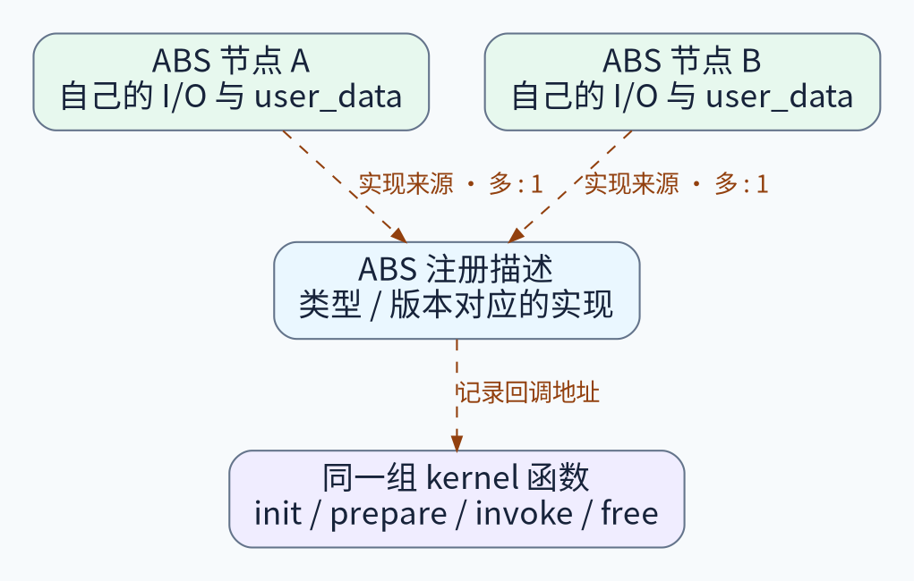
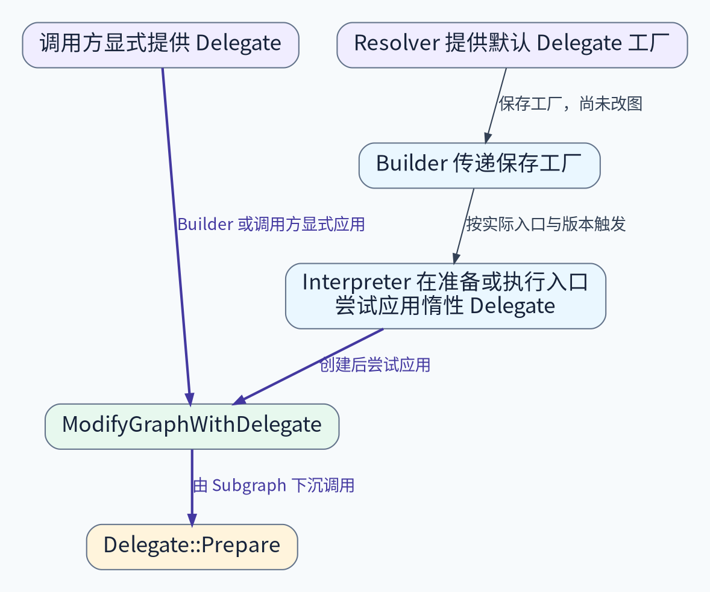
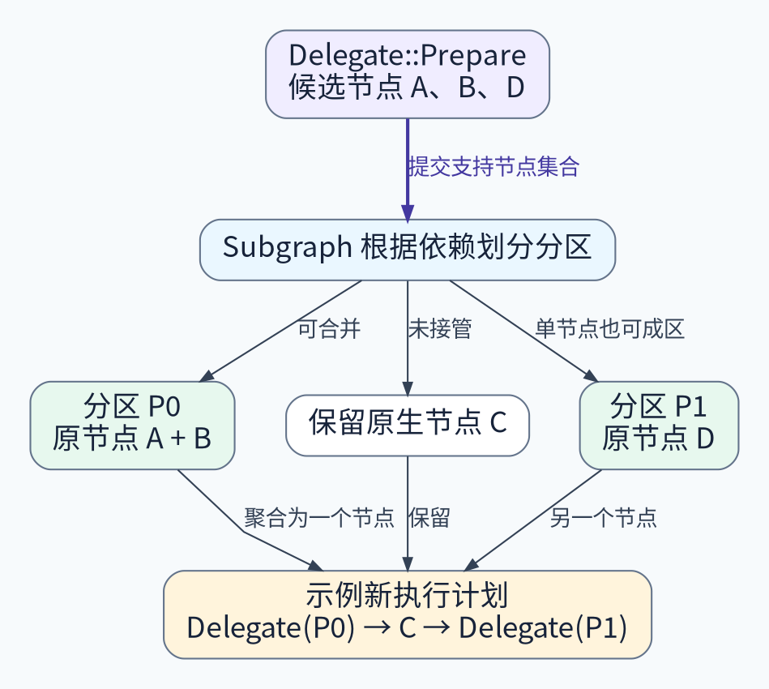

# LiteRT 源码笔记（四）：从算子注册到 Delegate 图改写

上一篇：[InterpreterBuilder 如何搭建执行图](03-interpreter-builder.md) · 下一篇：[源码跟读实验](05-reading-lab.md)

知道模型里有一个 ABS，不等于运行时已经知道怎样求绝对值；知道环境里有 XNNPACK，也不等于 ABS 一定会交给它。本篇顺着两条线看：一条是 **Resolver 为原节点找实现**，另一条是 **Delegate 把满足条件的一部分原节点换成新的执行节点**。这里讨论的是 `tflite/` 下的 Interpreter 路径，不是直接对上一篇模型 IR 调用这些方法。节选以原稿的接口形态为主，宏、默认委托、支持条件和错误处理应以手头的 checkout 为准。

## 1. 从 `OpResolver` 查到 `TfLiteRegistration`

| 需要回答的问题 | 对象 |
| --- | --- |
| 这个内建算子是什么版本？ | `FindOp(builtin_code, version)` |
| 这个自定义算子叫什么、是什么版本？ | `FindOp(custom_name, version)` |
| 可以提供哪些默认 Delegate？ | `GetDelegateCreators()` / `GetOpaqueDelegateCreators()` 返回工厂，不是已创建实例 |
| 是否可能含有用户自定义算子？ | `MayContainUserDefinedOps()`；基类默认保守返回 true，并不说明已找到一个自定义节点 |

Opaque 工厂用于不透明 C API 对象，不能仅按「是不是 Google Play services」来理解。两个 `FindOp` 返回的是注册表项，不是执行结果，也不凭名称或版本号推导向后兼容。

`MutableOpResolver` 在抽象接口之上维护 `(code, version) → registration` 和 `(name, version) → registration`。查找时先看本地表，再按顺序查链里的 Resolver。


- `AddBuiltin` 和 `AddCustom` 分别按枚举和名称注册。在所指定的版本或版本区间内复制并补齐注册信息；同键覆盖原条目。复制的是注册记录，函数指针并不会复制一份函数实现。
- `AddAll` 合入另一个 Mutable Resolver 的映射，并在原稿实现中带入其链式引用；`ChainOpResolver` 本身保存引用，未命中时才调用对方，不是复制条目。链中的对象必须活到查找结束。
- `may_directly_contain_user_defined_ops_` 是保守标记。查询还会考虑链上的 Resolver，不能拿它枚举模型使用的自定义节点。
- `BuiltinOpResolver` 在 Mutable Resolver 上注册标准内建实现，也可能提供默认 Delegate 工厂。它是常见选择，不是唯一选择；应用可以显式提供更小的注册集合，或选择不附自动默认委托的 Resolver。

### 从 `FindOp()` 看本地表与链式查找

源码节选：[mutable_op_resolver.cc:28–56](https://github.com/google-ai-edge/LiteRT/blob/e3c11f0d0e7ec02ecb6fd4ee872d5ee569402f62/tflite/mutable_op_resolver.cc#L28-L56)。

```cpp
const TfLiteRegistration* MutableOpResolver::FindOp(tflite::BuiltinOperator op,
                                                    int version) const {
  auto it = builtins_.find(std::make_pair(op, version));
  if (it != builtins_.end()) {
    return &it->second;
  }
  for (const OpResolver* other : other_op_resolvers_) {
    const TfLiteRegistration* result = other->FindOp(op, version);
    if (result != nullptr) {
      return result;
    }
  }
  return nullptr;
}

const TfLiteRegistration* MutableOpResolver::FindOp(const char* op,
                                                    int version) const {
  auto it = custom_ops_.find(std::make_pair(op, version));
  if (it != custom_ops_.end()) {
    return &it->second;
  }
  for (const OpResolver* other : other_op_resolvers_) {
    const TfLiteRegistration* result = other->FindOp(op, version);
    if (result != nullptr) {
      return result;
    }
  }
  return nullptr;
}
```

1. Builtin 查 `(枚举, version)`，custom 查 `(名称, version)`。同一个算子的不同版本可以落到不同记录，不能只按名字找。
2. 本地命中直接返回；未命中才按顺序问链上的 resolver，直到第一个有效指针。`nullptr` 表示没有实现，不是创建了一个空 Node。
3. 这一层只回答“由谁实现”。Builder 下一步才把注册项和一个具体节点配在一起。

## 2. Registration 是实现表，Node 是图中的一次使用



*图 4-1　Registration 与 Node：同一类实现，多次节点使用。两条 ABS 只是示例；运行时可以为每个节点分别保存 Registration 记录，但回调可指向同一组函数。init 生成的节点状态彼此独立；prepare、invoke 和 free 的实际时机见正文。*

`TfLiteRegistration` 是 C 风格结构体，不是 C++ 抽象基类。源码保留若干用于兼容的版本结构（例如 `TfLiteRegistration_V3`）；不要将兼容结构的名字等同于当前完整结构的字段集。

| Registration 字段 | 如何理解 |
| --- | --- |
| `init(context, buffer, length)` | 节点初始化，返回内核私有状态，保存到 `node.user_data`。自定义算子通常读取 options 字节及长度；内建算子可通过长度为 0 的调用接收内建参数指针，具体以构图入口为准。无需状态的算子允许省略。 |
| `free(context, data)` | 清理的是 `init` 返回的状态，通常不是传给 `init` 的 options 指针。一次初始化对应一次清理；重建节点不是再次调用同一实例的生命周期。 |
| `prepare(context, node)` | 推导输出 shape、校验参数、准备临时存储；分配或动态尺寸变化等场景可能重跑，不是每一次 `Invoke` 都必定跑。合法已解析的算子可以没有 Prepare。 |
| `invoke(context, node)` | 真正执行本节点的计算。 |
| `profiling_string` / `async_kernel` | 前者提供 profiling 描述；后者提供受支持的异步执行接口。返回空不等于内核不能在线程池里使用并行计算。 |
| `registration_external` / `inplace_operator` | 前者连接不透明 `TfLiteOperator` 接口；后者只是可原地复用的声明，在生命周期等条件满足时才可能共享存储。 |

`TfLiteNode` 是节点实例。多个同类节点可以共享实现，但各有自己的 `inputs`、`outputs`（Subgraph 张量表下标）、`intermediates`、`temporaries`、`builtin_data`、`custom_initial_data` 和 `user_data`；委托节点还有 `delegate`，节点可能有副作用。所谓静态内存构建（`TF_LITE_STATIC_MEMORY`）影响可用的辅助 API，不能据此把常规节点理解为只有输入、输出和指针。

`Subgraph::OpPrepare` 把节点交给具体实现：若 external 包装引用已有内部节点，则调用该 registration；否则优先使用带 `user_data` 的 opaque 回调，再尝试不带 data 的回调；最后可使用普通 `op_reg.prepare`。**已解析且 Prepare 为空可以成功；未解析的 Custom/Flex 占位符如果一路留到准备阶段才报错。** 这也解释了为什么构建时可能暂时接受缺少普通 CPU 实现的节点：某个 Delegate 还可能接管它。

## 3. 用 ABS 跟一遍普通 CPU 内核

源码入口：`tflite/kernels/elementwise.cc` 中的 `Register_ABS`，再追 `ElementWiseQuantizedInit` / `ElementWiseQuantizedFree`、`PrepareAbs` / `GenericPrepare` 以及 `AbsEval`。把生成回调的宏展开来看，仍是普通函数指针调用。

1. **Init / Free**：公共 elementwise 内核用 `OpData` 保存量化用的 multiplier、shift、输入/输出零点、`needs_rescale` 以及 INT8 / INT16 查询表指针。Free 清理该状态及其拥有的表。查找表用于适合预计算的非线性操作（例如部分 LOG/SQRT 路径，具体随类型和实现），不是每个 ABS 都要建表。
2. **Prepare**：获取输入、输出张量，检查类型与量化参数。原稿 ABS 实现涉及 FLOAT32、INT8、INT16、INT32；不要把这些类型推广到所有一元算子。仿射量化时，从输入 / 输出 scale 得到比例，转换成固定点 multiplier 与 shift。ABS 的输出形状跟输入一致，调用 `context->ResizeTensor`；这是 Subgraph 填入的回调，不是 ABS 自己管理全部张量内存。
3. **Resize 的两层**：某些形状/存储等价条件下可以快速复用已有内存；需要变化时进入 `ResizeTensorImpl`。动态张量可即时调整存储，arena 张量调整尺寸/字节数并交给后续内存规划。字符串、Resource、Variant 有特殊存储规则，不能直接按维度乘固定字节数。
4. **Invoke**：浮点等非量化路径走直接逐元素计算；量化路径先减输入零点、取绝对值，必要时换算输出尺度，再加入输出零点并夹到目标范围（INT8 为 −128 到 127）。非量化 INT16 的中间值提升到 32 位，不代表最终结果天然能用 INT16 表示；极值要按所读内核的校验/转换处理。

```text
量化路径示意：
centered = input_q - input_zero_point
magnitude = abs(centered)
output_q = saturate(round(magnitude × input_scale / output_scale) + output_zero_point)
```

例如输入零点为 −3、输入 scale 为 0.25，输入编码 −11 表示 −2。输出 scale 为 0.5、输出零点为 1 时，ABS 的结果 2 对应输出编码 5。源码使用定点运算近似缩放，不在循环里逐元素做浮点除法。

### 把 ABS 的 `Prepare` 和 `Invoke` 分开看

源码节选：[elementwise.cc:542–550](https://github.com/google-ai-edge/LiteRT/blob/e3c11f0d0e7ec02ecb6fd4ee872d5ee569402f62/tflite/kernels/elementwise.cc#L542-L550)、[elementwise.cc:212–214](https://github.com/google-ai-edge/LiteRT/blob/e3c11f0d0e7ec02ecb6fd4ee872d5ee569402f62/tflite/kernels/elementwise.cc#L212-L214)、[elementwise.cc:309–330](https://github.com/google-ai-edge/LiteRT/blob/e3c11f0d0e7ec02ecb6fd4ee872d5ee569402f62/tflite/kernels/elementwise.cc#L309-L330)。

```cpp
GENERIC_PREPARE(PrepareAbs, elementwise::IsAbsSupportedType,
                elementwise::kAbsName)

TfLiteRegistration* Register_ABS() {
  static TfLiteRegistration r = {elementwise::ElementWiseQuantizedInit,
                                 elementwise::ElementWiseQuantizedFree,
                                 PrepareAbs, elementwise::AbsEval};
  return &r;
}

// ...

  return context->ResizeTensor(context, output,
                               TfLiteIntArrayCopy(input->dims));
}

// ...

TfLiteStatus AbsEval(TfLiteContext* context, TfLiteNode* node) {
  const TfLiteTensor* input = GetInput(context, node, 0);
  const TfLiteType type = input->type;
  switch (type) {
    case kTfLiteFloat32:
      return EvalImpl<float>(
          context, node, [](float f) { return std::abs(f); }, type);
    case kTfLiteInt8:
      return AbsEvalQuantized<int8_t>(context, node, type);
    case kTfLiteInt16:
      return input->quantization.type == kTfLiteNoQuantization
                 ? AbsInt16EvalImpl(context, node, type)
                 : AbsEvalQuantized<int16_t>(context, node, type);
    case kTfLiteInt32:
      return EvalImpl<int32_t>(
          context, node, [](int32_t i) { return std::abs(i); }, type);
    default:
      return kTfLiteError;
  }
}
```

1. `Register_ABS()` 把 Init、Free、Prepare、Invoke 放到同一注册记录；Init/Free 管节点私有状态，不是每个输出元素调用一次。
2. `PrepareAbs` 由宏展开进 `GenericPrepare()`，完成类型和量化检查、需要时准备定点参数，最后通过 Context 让输出 shape 对齐输入。`ResizeTensor()` 调整的是运行时描述和相关内存状态，不是在这里求绝对值。
3. `AbsEval()` 的 `GetInput(..., 0)` 是**本节点的第 0 个操作数**，和主图第 0 个对外输入不是一回事。Invoke 再根据类型走浮点、普通整数或量化路径。

## 4. Delegate 是什么，何时创建



*图 4-2　Delegate：显式应用与惰性应用的时机。两侧是可用的入口及触发时机，不是互斥的后端模式。注册工厂时还没有改图；首次触发的确切位置和错误处理以正文对应版本为准。*

`TfLiteDelegate` 也是 C 风格结构体。它的 `Prepare(context, delegate)` 不是某个 ABS 节点的 Prepare，而是检查图、选择可接管节点、请求改写执行计划。它可用 `CopyFromBufferHandle` 把后端存储同步回可由 CPU 读的张量，用 `CopyToBufferHandle` 做反方向，用 `FreeBufferHandle` 清理该句柄及后端为它管理的资源；释放细节由 Delegate 实现定义，不能理解成永远不释放资源。没有相关回调往往意味着该方向的句柄操作不受支持，不意味着后端完全没有私有分配。

| Flag | 读源码时看什么 |
| --- | --- |
| `AllowDynamicTensors` | 是否能处理动态张量及相应的输出形状变化。 |
| `RequirePropagatedShapes` | 需要先把形状沿原执行计划传播，再准备对应的委托 kernel；它不是对所有 Delegate 无条件启用。 |
| `PerOperatorProfiling` | 委托可以报更细粒度的内部算子事件，而不是只看整个分区。 |
| `HintFullyDelegatedToSingleDelegate` | 某些路径可省去为原 CPU 图做的准备/分配。不是「每个后端天然可以接管全图」；原稿分支显式核对 `IsFullyDelegated`，不能满足则返回错误。该函数遍历当前执行计划检查节点是否带 delegate。 |

创建期 `InterpreterBuilder::ApplyDelegates` 尝试显式传入的 Delegate，相关版本也处理自动获取的 Flex；不要把这段和 Resolver 默认工厂混在一起。Lazy Delegate 在 Builder 阶段保存 creator，通常由 Interpreter 首次 `AllocateTensors` 一类准备入口实际尝试（不是必须等到第一次 `Invoke`）。原稿的筛选条件是在启用 QS8 / QU8 构建时直接允许创建 provider，否则看是否有 FP32 张量；保存工厂仍不意味着创建成功，创建成功也不代表有节点可接管。

### 4.1 为什么 XNNPACK 工厂可能返回空

XNNPACK 是 CPU 推理内核库，XNNPACK Delegate 是其与 Interpreter 之间的适配层。原稿的 `MaybeCreateXNNPACKDelegate` 在未集成的构建里可能返回空；集成构建会合并默认 options，再按该版本的 QS8（有符号量化 8 位）/ QU8（无符号量化 8 位）支持配置构造对象。用带定制删除器的 `TfLiteDelegatePtr` 管理对象生命周期。

- **线程池**：区分外部借用和自行拥有。借用运行时 CPU 后端的线程池不应由 Delegate 析构，独有池按配置创建与销毁。Emscripten 无 pthread 的构建不走相同的多线程代码，线程数并不是永远取 Interpreter 或 options 的同一个值。
- **权重缓存**：权重重排（packing）把常量转换为更适合内核读取的布局；开启缓存可在其生命周期内复用重排结果。可借用用户传入的 cache/provider，也可按配置创建自有 provider。借用者要保证所有者寿命；文件路径、内存锁定、映射方式均看具体选项和平台。`LockMemory` 若实际启用，目标是尝试让相关页保持驻留，不能保证所有缺页都消失。

### 默认 XNNPACK 注册的是工厂

源码节选：[register.cc:414–426](https://github.com/google-ai-edge/LiteRT/blob/e3c11f0d0e7ec02ecb6fd4ee872d5ee569402f62/tflite/core/kernels/register.cc#L414-L426)、[interpreter.cc:333–339](https://github.com/google-ai-edge/LiteRT/blob/e3c11f0d0e7ec02ecb6fd4ee872d5ee569402f62/tflite/core/interpreter.cc#L333-L339)、[interpreter.cc:344–352](https://github.com/google-ai-edge/LiteRT/blob/e3c11f0d0e7ec02ecb6fd4ee872d5ee569402f62/tflite/core/interpreter.cc#L344-L352)。

```cpp
BuiltinOpResolver::BuiltinOpResolver() {
  RegisterBuiltinOps();
  delegate_creators_.push_back([](TfLiteContext* context) {
    return tflite::MaybeCreateXNNPACKDelegate(context,
                                              XNNPackQS8Options::default_value);
  });
}

BuiltinOpResolver::BuiltinOpResolver(WithoutDefaultDelegatesTag) {
  RegisterBuiltinOps();
}

// ...

TfLiteStatus Interpreter::ApplyLazyDelegateProviders() {
  if (lazy_delegate_providers_.empty() || IsFullyDelegated()) return kTfLiteOk;

  TfLiteDelegateCreators delegate_providers;
  delegate_providers.swap(lazy_delegate_providers_);

// ...

  for (size_t i = 0; i < delegate_providers.size(); ++i) {
    auto delegate_ptr = delegate_providers[i](context_);
    if (delegate_ptr == nullptr) continue;
    auto status = ModifyGraphWithDelegateImpl(std::move(delegate_ptr));
```

1. 普通 `BuiltinOpResolver` 先装入 builtin 注册项，再追加一个 XNNPACK creator；不带默认委托的构造仍会注册 builtin，但没有这一步。
2. 运行时才遍历 factory。没有 creator 或已完全委托就不做这一步；执行时先把列表 swap 出来，避免多次重复应用。
3. 工厂返回空表示此项未创建；返回对象后才尝试 `ModifyGraphWithDelegateImpl()`。因此只看到 Resolver 构造成功不能断言 XNNPACK 生效。

## 5. 改写从 Interpreter 下沉到 Subgraph

```text
Interpreter::ModifyGraphWithDelegateImpl
  → 每个适用的 Subgraph::ModifyGraphWithDelegate
      → 保存原执行计划 / 检查状态、动态形状与适用性
      → 切换为 DelegateContext
      → TfLiteDelegatePrepareInternal（opaque 或普通回调）
          → Delegate 选节点并调用 ReplaceNodeSubsetsWithDelegateKernels
      → 切回 KernelContext
      → 检查覆盖范围、更新形状/内存及状态
```

原稿的 Interpreter 级实现会先按下标建立 Subgraph 信息并校验，而后逐个处理适用子图；有失败清理和恢复路径。Subgraph 在准备原图时按 `execution_plan_` 的索引调用 `PrepareOpsStartingAt`，跟踪是否出现动态输出及准备进度。开始一轮与从中间继续不同，不能把每次的动态张量检测都当成独立的全图检查。Prepare 可能添加临时张量，所以会预留向量容量，避免底层存储意外移动；也不要自行长期持有会失效的元素指针。

不能处理动态张量且没有全委托提示时，原计划通常需要先准备，用于识别动态形状。全委托的优化路径允许 Delegate 自行完成准备；否则不能简单跳过。原来是 Immutable 时，有些路径暂置 Uninvokable 以执行再次准备；失败时按错误阶段和状态恢复原计划或移除委托，不能假定任何报错都等于「已经安全 CPU 回退」。

### Delegate Prepare 前后为何要切换 Context

源码节选：[subgraph.cc:2647–2662](https://github.com/google-ai-edge/LiteRT/blob/e3c11f0d0e7ec02ecb6fd4ee872d5ee569402f62/tflite/core/subgraph.cc#L2647-L2662)。

```cpp
  if (delegates_applied_.empty()) {
    pre_delegation_execution_plan_ = execution_plan_;
  }

  SwitchToDelegateContext();
  TfLiteStatus status = TfLiteDelegatePrepareInternal(&context_, delegate);
  SwitchToKernelContext();
  TF_LITE_ENSURE_STATUS(reset_delegation_if_not_ok(status));

```

1. 先保存首次改写前的 `execution_plan_`，为失败恢复保留原序列；前面的分支还会根据已应用委托、动态 Tensor 能力等决定是否先准备普通算子。
2. `SwitchToDelegateContext()` 临时提供读取计划、查询节点、替换分区等接口，委托通过这些回调请求改图，不直接拥有 TFLite 子图。
3. Prepare 返回后切回普通 kernel Context，再处理错误；不要把“某个节点不支持”与“整个 Delegate Prepare 失败”混为一谈。

## 6. XNNPACK 如何决定接管哪些节点

`DelegatePrepare` 先找候选，再向 Subgraph 发出改写请求。判断不是只看 opcode，还依赖参数、张量类型、形状、常量属性及实际 kernel 覆盖。在原稿的实现中，常规节点与 MoE 节点分组提交。这里的 MoE 是特定自定义算子，不代表 XNNPACK 会识别任意写成通用子图的专家网络：路由输入决定选哪些专家，权重/scale 的数量和类型都属于匹配条件。原稿分支的匹配包括指定 custom 名称、可解析属性（专家数和隐藏/模型维度等）、单输出、浮点权重 7 输入或量化权重 10 输入、FP32 激活/权重系数/输出与 INT32 路由索引；专家权重静态且形状、类型、元素数正确，量化 scale 也须静态且符合要求。这些是该版本检查项，不是跨版本的 MoE 接口规范。

#### XNNPACK 先枚举节点，再做能力检查

源码节选：[xnnpack_delegate.cc:7316–7336](https://github.com/google-ai-edge/LiteRT/blob/e3c11f0d0e7ec02ecb6fd4ee872d5ee569402f62/tflite/delegates/xnnpack/xnnpack_delegate.cc#L7316-L7336)、[xnnpack_delegate.cc:7517–7541](https://github.com/google-ai-edge/LiteRT/blob/e3c11f0d0e7ec02ecb6fd4ee872d5ee569402f62/tflite/delegates/xnnpack/xnnpack_delegate.cc#L7517-L7541)、[xnnpack_delegate.cc:7872–7915](https://github.com/google-ai-edge/LiteRT/blob/e3c11f0d0e7ec02ecb6fd4ee872d5ee569402f62/tflite/delegates/xnnpack/xnnpack_delegate.cc#L7872-L7915)。

```cpp
  TfLiteIntArray* execution_plan = nullptr;
  if (context->GetExecutionPlan(context, &execution_plan) != kTfLiteOk ||
      execution_plan == nullptr) {
    return nullptr;
  }

  std::unordered_map<int, std::vector<int>> node_ids_for_input_tensor;
  for (int i = 0; i < execution_plan->size; i++) {
    const int node_index = execution_plan->data[i];
    TfLiteNode* node = nullptr;
    TfLiteRegistration* registration = nullptr;
    if (context->GetNodeAndRegistration(context, node_index, &node,
                                        &registration) != kTfLiteOk) {
      continue;
    }
    for (int i = 0; i < node->inputs->size; i++) {
      node_ids_for_input_tensor[node->inputs->data[i]].push_back(node_index);
    }
  }

// ...

    if (Subgraph::VisitNode(
            /*subgraph=*/nullptr, /*delegate=*/*this, context, registration,
            node, node_index, quasi_static_tensors,
            /*input_output_tensors=*/{},
            /*fp32_weight_tensors=*/{},
            /*enable_fp16=*/force_fp16()) != kTfLiteOk) {
      for (int j = 0; j < node->inputs->size; j++) {
        const auto it =
            quasi_static_tensors_producers.find(node->inputs->data[j]);
        if (it != quasi_static_tensors_producers.end()) {
          static_unpack_nodes_.erase(it->second);
        }
      }

      continue;
    }

    for (int j = 0; j < node->inputs->size; j++) {
      if (quasi_static_tensors.count(node->inputs->data[j]) != 0) {
        quasi_static_tensors_to_unpack.insert(node->inputs->data[j]);
      }
    }

// ...

TfLiteStatus DelegatePrepare(TfLiteContext* context, TfLiteDelegate* delegate) {
  auto& xnnpack_delegate =
      *static_cast<::tflite::xnnpack::Delegate*>(delegate->data_);
  std::unique_ptr<TfLiteIntArray, void (*)(TfLiteIntArray*)> moe_ops_to_replace(
      nullptr, TfLiteIntArrayFree);
  TfLiteIntArray* moe_ops_to_replace_raw = nullptr;
  std::unique_ptr<TfLiteIntArray, void (*)(TfLiteIntArray*)> ops_to_replace(
      xnnpack_delegate.PrepareOpsToDelegate(context, &moe_ops_to_replace_raw),
      TfLiteIntArrayFree);
  moe_ops_to_replace.reset(moe_ops_to_replace_raw);
  if (ops_to_replace == nullptr) {
    return kTfLiteError;
  }

  // ...

  TfLiteStatus status = kTfLiteOk;
  if (ops_to_replace->size != 0) {
    status = context->ReplaceNodeSubsetsWithDelegateKernels(
        context, kSubgraphRegistration, ops_to_replace.get(), delegate);
  }
  if (status != kTfLiteOk) {
    return status;
  }

  if (moe_ops_to_replace != nullptr) {
    for (int i = 0; i < moe_ops_to_replace->size; ++i) {
      TfLiteIntArray* singleton_moe_op = TfLiteIntArrayCreate(1);
      singleton_moe_op->size = 1;
      singleton_moe_op->data[0] = moe_ops_to_replace->data[i];
      status = context->ReplaceNodeSubsetsWithDelegateKernels(
          context, kSubgraphRegistration, singleton_moe_op, delegate);
      TfLiteIntArrayFree(singleton_moe_op);
      if (status != kTfLiteOk) {
        break;
      }
    }
  }
  return status;
}
```

1. `execution_plan->data[i]` 才是节点编号；`i` 只是执行顺序中的位置。第一遍顺便建立 `Tensor 编号 → 消费者节点列表`，供后续判断静态转换是否仍被普通节点使用。
2. `VisitNode()` 此时收到空的 XNNPACK subgraph，只检查算子、Tensor、参数能否支持。失败的节点不加入委托列表，普通内核继续负责；遇到仍被它消费的准静态结果，还要保留相应转换节点。
3. `DelegatePrepare()` 拿到普通节点候选后通过 Context 提交给 TFLite 分区；是返回空指针才表示这一阶段错误，空列表并不等于错误。这个快照另有 MoE 单节点处理，不能把所有节点都看成一次普通替换。

### 6.1 准静态张量：为什么一条计算边可以提前处理

「准静态」输出虽然有生产节点，但从常量输入出发，可以在准备期得到。例如 INT8 权重转 FP32，或者把常量稀疏数据展开成稠密布局。实现首先建立 tensor 到消费节点的映射，然后记录准静态张量、其生产节点以及委托端实际需要展开的集合。

- DEQUANTIZE：原稿检查单输入/输出、非稀疏的 FP16 或带有效量化参数的 INT8 输入、FP32 输出、只读常量或之前已识别的准静态来源。部分 FP16 权重在所有消费者都满足特定 FC/Conv/DepthwiseConv 权重槽位约束时可直用；若它是激活输入或被其他算子消费，就不能据此省略这步。
- DENSIFY：以符合条件的只读稀疏常量为源，单输入/输出，类型一致；原稿列出 FP16、INT8、FP32。还要看该分支其余元数据检查。
- 测试构建里还有用于暴露不支持算子的强制委托路径，不代表普通构建会禁用回退。

用一个小图看这个限制：`常量 W → DEQUANTIZE → Wf → Conv`，若只有被委托的 Conv 需要 `Wf`，有机会在 Prepare 完成转换；若还有一个 CPU 节点读取 `Wf`，它必须继续得到合法数据。一个张量是不是常量，和能不能删除它的生产节点，是两个判断。

准静态张量不是扫到就能删掉生产者。实际展开时，先按生产节点编号安排预展开，输入优先读已经展开的结果，否则读模型常量；再做反量化或稀疏转稠密，把结果放进 `static_unpacked_data`。只要还有没委托的分支要读这个结果，原转换节点仍要留给 Interpreter。比如 `INT8 权重 → DEQUANTIZE → FP32` 同时被委托和未委托的节点读取时，不能因为 XNNPACK 能预展开，就把原转换从执行计划中拿掉。[消费者与候选筛选](https://github.com/google-ai-edge/LiteRT/blob/e3c11f0d0e7ec02ecb6fd4ee872d5ee569402f62/tflite/delegates/xnnpack/xnnpack_delegate.cc#L7517-L7542) · [预展开](https://github.com/google-ai-edge/LiteRT/blob/e3c11f0d0e7ec02ecb6fd4ee872d5ee569402f62/tflite/delegates/xnnpack/xnnpack_delegate.cc#L7559-L7655)。

## 7. 从支持列表到新执行计划



*图 4-3　Delegate：先选择受支持的节点，再按图分区改写。下面是示例，不是“所有支持节点必定合并”。原始图里 A、B、D 可委托，C 留给原内核。图分区允许时，A、B 合为一个委托分区，D 留作另一个；一个 Delegate 可负责多个分区，一个分区可包多个原节点。边界 Tensor 继续连接相邻分区或原生节点。*

`ReplaceNodeSubsetsWithDelegateKernels` 先建立 DELEGATE 的 registration；opaque 路径还要维护外部算子对象的生命周期。随后通过 `PartitionGraph` 按依赖划分分区：区分委托和非委托节点，依赖就绪才能被调度；可合并时尽可能聚合，不要求原计划里的下标天然相邻，也不能破坏数据依赖与必要的控制顺序。如果禁止节点融合，则使用更保守的分法。分区阶段本身仍未改写计划。

```text
改写前（示意）：[节点 0 CPU, 节点 1 委托, 节点 2 委托, 节点 3 CPU]
改写后        ：[节点 0 CPU, 委托节点 K(1,2), 节点 3 CPU]
```

非委托分区把原节点下标写回新执行计划；委托分区构造包含原节点列表、边界输入/输出以及 delegate 引用的 params，将其作为新节点初始化数据。新节点和对应 kernel registration 保存进 `nodes_and_registration_` 并进入执行计划。原节点未必从存储中消失，**执行计划里的下标不再指向它们才是不逐个执行的原因。** 真正 Invoke 时走委托节点的回调，委托内部根据分区搭建并运行 XNNPACK 图，与原始 TFLite Subgraph 不是同一个对象。

#### 拿到候选以后，真正改了哪张表

源码节选：[subgraph.cc:564–574](https://github.com/google-ai-edge/LiteRT/blob/e3c11f0d0e7ec02ecb6fd4ee872d5ee569402f62/tflite/core/subgraph.cc#L564-L574)、[subgraph.cc:641–653](https://github.com/google-ai-edge/LiteRT/blob/e3c11f0d0e7ec02ecb6fd4ee872d5ee569402f62/tflite/core/subgraph.cc#L641-L653)、[subgraph.cc:667–681](https://github.com/google-ai-edge/LiteRT/blob/e3c11f0d0e7ec02ecb6fd4ee872d5ee569402f62/tflite/core/subgraph.cc#L667-L681)、[subgraph.cc:1235–1241](https://github.com/google-ai-edge/LiteRT/blob/e3c11f0d0e7ec02ecb6fd4ee872d5ee569402f62/tflite/core/subgraph.cc#L1235-L1241)。

```cpp
TfLiteStatus Subgraph::PartitionGraph(const TfLiteIntArray* nodes_to_replace,
                                      std::vector<NodeSubset>* node_subsets) {
  const InterpreterInfo info(this);
  const bool disable_node_fusion =
      ShouldPreserveAllTensors() || DisableDelegateNodeFusion();
  return tflite::PartitionGraphIntoIndependentNodeSubsets(
      &info, nodes_to_replace, node_subsets,
      /*greedily=*/!DisableDelegateClustering(), control_edges_,
      disable_node_fusion);
}

// ...

  execution_plan_.clear();

  for (auto& node_subset : node_subsets) {
    switch (node_subset.type) {
      case NodeSubset::kTfNonPartition:
        for (auto it = node_subset.nodes.begin(); it != node_subset.nodes.end();
             ++it) {
          execution_plan_.push_back(*it);
        }
        break;

// ...

        TF_LITE_ENSURE_STATUS(AddNodeWithParameters(
            node_subset.input_tensors, node_subset.output_tensors, {}, nullptr,
            0, delegate_params, &registration, &node_index));

        for (int tensor_index : node_subset.output_tensors) {
          TfLiteTensor* tensor = &tensors_[tensor_index];
          TF_LITE_ENSURE(&context_, tensor->delegate == nullptr ||
                                        tensor->delegate == delegate);
          tensor->delegate = delegate;
        }

        TfLiteNode* node = &nodes_and_registration_[node_index].first;
        node->delegate = delegate;

// ...

  node.delegate = nullptr;
  node_and_reg.second = *registration;
  execution_plan_.push_back(new_node_index);
  return kTfLiteOk;
}
```

1. `PartitionGraph()` 根据依赖、控制边和聚类配置算出分区。相邻不保证同一分区，非相邻也不代表绝不可能合并；边界上只列该分区对外需要的 Tensor。
2. 清空旧执行计划后，普通分区把原节点编号放回计划；由委托负责的分区用 `AddNodeWithParameters()` 追加代理节点。该函数在结束时将新节点编号放进计划。
3. 代理节点持有分区输入、输出和委托初始化参数，边界输出 Tensor 也会记录所属委托。原节点记录不等于全部删除；推理走的是改写后的计划，不是简单按节点表下标遍历。

把这段分成两次决策更容易看清：XNNPACK 决定**哪些节点能接**，TFLite 决定**哪些候选可以放在一个分区**。例如两个候选节点之间若隔着必须由普通内核执行、并且后一个候选依赖其输出的节点，就不能把两个候选合成一个代理节点；否则代理节点还没跑完，普通内核就等不到它所需的前半段结果。这个例子也解释了为什么只按原执行计划上连续的编号分组不够。

### 7.1 分配结束后如何理解三种状态

- **Uninvokable**：需要准备或重新分配，不能执行。
- **Invokable**：当前可执行，允许符合规则的后续调整。
- **InvokableAndImmutable**：可执行但图受到不可变约束，典型情形是应用了不支持动态张量的 Delegate。

原稿分支的尾部处理区分三类：当前委托不支持动态张量时通常确保内存分配并标记 Immutable（满足全委托提示可走优化分支）；当前委托支持动态、但旧图已 Immutable 时，重新 Prepare，若引入动态张量则恢复计划并报错；原图已 Invokable 且可动态时，刷新必要分配以保持一致。新图还未准备的普通路径可留待分配阶段。调试时按「Resolver 查找 → 普通内核 Prepare / 形状 → Delegate 选点 → 分区与边界 → 内存分配 → Invoke」顺序定位，不要把任何一个阶段的通过当成后续已经成功。

## 源码导航

代码对照版本：LiteRT [`e3c11f0`](https://github.com/google-ai-edge/LiteRT/tree/e3c11f0d0e7ec02ecb6fd4ee872d5ee569402f62)；片段中的 `// ...` 表示省略。

- [OpResolver 接口](https://github.com/google-ai-edge/LiteRT/blob/main/tflite/core/api/op_resolver.h) · [MutableOpResolver](https://github.com/google-ai-edge/LiteRT/blob/main/tflite/mutable_op_resolver.cc) · [内建注册](https://github.com/google-ai-edge/LiteRT/blob/main/tflite/core/kernels/register.cc)
- [C 数据结构与 Delegate flags](https://github.com/google-ai-edge/LiteRT/blob/main/tflite/core/c/common.h) · [Elementwise 示例](https://github.com/google-ai-edge/LiteRT/blob/main/tflite/kernels/elementwise.cc)
- [Interpreter](https://github.com/google-ai-edge/LiteRT/blob/main/tflite/core/interpreter.cc) · [Subgraph](https://github.com/google-ai-edge/LiteRT/blob/main/tflite/core/subgraph.cc) · [图分区](https://github.com/google-ai-edge/LiteRT/blob/main/tflite/graph_info.cc) · [XNNPACK Delegate](https://github.com/google-ai-edge/LiteRT/blob/main/tflite/delegates/xnnpack/xnnpack_delegate.cc)
