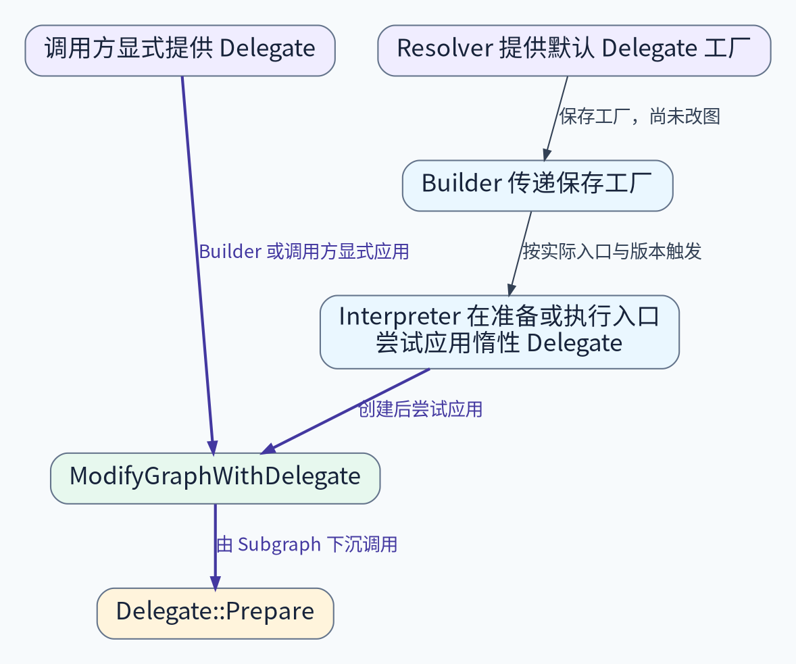

# Delegate（一）：创建、应用与执行资源

上一篇：[执行（二）](04b-interpreter-prepare.md) · [目录](README.md) · 下一篇：[Delegate（二）](04d-delegate-xnnpack.md)

这一篇先区分显式应用和默认工厂，再看 XNNPACK 适配层的线程池、权重缓存和所有权。创建对象不等于接管节点；应用之前还要通过子图和动态形状检查。

先接上 [Resolver 的第二条支路](04-resolver-delegate.md#1-resolver-查找什么)：`GetDelegateCreators()` 只把后端创建方法交给 Interpreter，`FindOp()` 才给普通节点提供 Registration。后面先看真正生成 Delegate 的时机，再看它如何拿到普通节点的信息。

## 1. Delegate 接口、能力与缓存句柄



*图 4-2　Delegate：显式应用与惰性应用的时机。两侧是可用的入口及触发时机，不是互斥的后端模式。注册工厂时还没有改图；首次触发的确切位置和错误处理以正文对应版本为准。*

`TfLiteDelegate` 也是 C 风格结构体。它的 `Prepare(context, delegate)` 不是某个 ABS 节点的 Prepare，而是检查图、选择可接管节点、请求改写执行计划。它可用 `CopyFromBufferHandle` 把后端存储同步回可由 CPU 读的张量，用 `CopyToBufferHandle` 做反方向，用 `FreeBufferHandle` 清理该句柄及后端为它管理的资源；释放细节由 Delegate 实现定义，不能理解成永远不释放资源。没有相关回调往往意味着该方向的句柄操作不受支持，不意味着后端完全没有私有分配。

| Flag | 读源码时看什么 |
| --- | --- |
| `AllowDynamicTensors` | 是否能处理动态张量及相应的输出形状变化。 |
| `RequirePropagatedShapes` | 需要先把形状沿原执行计划传播，再准备对应的委托 kernel；它不是对所有 Delegate 无条件启用。 |
| `PerOperatorProfiling` | 委托可以报更细粒度的内部算子事件，而不是只看整个分区。 |
| `HintFullyDelegatedToSingleDelegate` | 某些路径可省去为原 CPU 图做的准备/分配。不是「每个后端天然可以接管全图」；原稿分支显式核对 `IsFullyDelegated`，不能满足则返回错误。该函数遍历当前执行计划检查节点是否带 delegate。 |

创建期 `InterpreterBuilder::ApplyDelegates` 尝试显式传入的 Delegate，相关版本也处理自动获取的 Flex；不要把这段和 Resolver 默认工厂混在一起。Lazy Delegate 在 Builder 阶段保存 creator，通常由 Interpreter 首次 `AllocateTensors` 一类准备入口实际尝试（不是必须等到第一次 `Invoke`）。原稿的筛选条件是在启用 QS8 / QU8 构建时直接允许创建 provider，否则看是否有 FP32 张量；保存工厂仍不意味着创建成功，创建成功也不代表有节点可接管。

同样是一个抽象结构体，有以下的方法：

- prepare, 接受context和TfLiteDelegate两个参数，在modifygraphwithdelegate时会被调用，会查看整体的context中的计算图并通知tensorflowlite runtime替换掉其中对应的算子为本delegate实现

- CopyFromBufferHandle，接受context，TfLiteDelegate，TfLiteBufferHandle, TfLiteTensor四个参数，从delegate的bufferhandle中复制数据到对应的tensor中 （转移到cpu能直接访问的内存地址中）

- CopyToBufferHandle，与上述效果相反

- `FreeBufferHandle` 按 Delegate 契约释放句柄及其负责的资源；没有该回调不证明后端完全不拥有私有存储。

以下为成员对象：

- flags，使用二进制存储delegate的一些特征
  1. kTfLiteDelegateFlagsAllowDynamicTensors = 1 true代表delegate可以处理dynamic tensor，也要求delegate处理动态的输出
  2. kTfLiteDelegateFlagsRequirePropagatedShapes = 2，true代表对于dynamic tensor，在调用delegate kernel的prepare之前，自动完成相关tensor的形状传播，即通过输入的tensor形状修改对应的之后的tensor
  3. kTfLiteDelegateFlagsPerOperatorProfiling - 4，调整性能的监控到更细的级别，不为整个delegate记录事件，而是会记录delegate内部的算子事件，最后将数据汇总到operator-wise区域（delegate内部可能包含多个算子）
  4. kTfLiteDelegateFlagsHintFullyDelegatedToSingleDelegate = 8，内存分配的优化提示，保证subgraph中所需要的所有算子都可以由一个delegate代理，可以让LiteRT runutime跳过原本用于准备CPU执行路径的内存分配功能做，是提示但不保证delegate有这个功能

## 2. XNNPACK 工厂、线程池与权重缓存

XNNPACK 是 CPU 推理内核库，XNNPACK Delegate 是其与 Interpreter 之间的适配层。原稿的 `MaybeCreateXNNPACKDelegate` 在未集成的构建里可能返回空；集成构建会合并默认 options，再按该版本的 QS8（有符号量化 8 位）/ QU8（无符号量化 8 位）支持配置构造对象。用带定制删除器的 `TfLiteDelegatePtr` 管理对象生命周期。

- **线程池**：区分外部借用和自行拥有。借用运行时 CPU 后端的线程池不应由 Delegate 析构，独有池按配置创建与销毁。Emscripten 无 pthread 的构建不走相同的多线程代码，线程数并不是永远取 Interpreter 或 options 的同一个值。
- **权重缓存**：权重重排（packing）把常量转换为更适合内核读取的布局；开启缓存可在其生命周期内复用重排结果。可借用用户传入的 cache/provider，也可按配置创建自有 provider。借用者要保证所有者寿命；文件路径、内存锁定、映射方式均看具体选项和平台。`LockMemory` 若实际启用，目标是尝试让相关页保持驻留，不能保证所有缺页都消失。

对照：[XNNPACK Delegate](https://github.com/google-ai-edge/LiteRT/blob/e3c11f0d0e7ec02ecb6fd4ee872d5ee569402f62/tflite/delegates/xnnpack/xnnpack_delegate.cc)。

```cpp
  delegate_creators_.push_back([](TfLiteContext* context) {
    return tflite::MaybeCreateXNNPACKDelegate(context,
                                              XNNPackQS8Options::default_value);
  });
```

builtinopresolver创建的最后，还会向delegate_createors_中推入了一个lambda表达式用于创建delegate
`TFLITE_BUILD_WITH_XNNPACK_DELEGATE` 决定这个构建能否真正走 XNNPACK 创建分支；`XNNPackQS8Options` 是其中有符号 8 位量化支持的配置。读工厂时先区分「二进制有没有后端」和「启用了哪些类型的算子」，后者仍不是接管结果。

集成的情况：

```cpp
TfLiteDelegatePtr MaybeCreateXNNPACKDelegate(
    TfLiteContext* context, XNNPackQS8Options xnnpack_qs8_options) {
  auto opts = TfLiteXNNPackDelegateOptionsDefault();
  switch (xnnpack_qs8_options) {
    case XNNPackQS8Options::enabled:
      opts.flags |= TFLITE_XNNPACK_DELEGATE_FLAG_QU8;
      break;
    case XNNPackQS8Options::disabled:
      opts.flags &= ~(1UL << (TFLITE_XNNPACK_DELEGATE_FLAG_QU8 - 1));
      break;
    case (XNNPackQS8Options::default_value):
    default:
      break;
  }

  return TfLiteDelegatePtr(
      TfLiteXNNPackDelegateCreateWithThreadpool(&opts, context),
      TfLiteXNNPackDelegateDelete);
}
```

defaultoptions为XNNPACK根据编译期宏配置的一些默认参数
QS8代表是否支持quantizad signed 8-bit，QU8代表是否支持quantizad unsigned 8-bit

```cpp
using TfLiteDelegatePtr =
    std::unique_ptr<TfLiteDelegate, void (*)(TfLiteDelegate*)>;
```

TfliteDelegatePtr是一个指向TfLiteDelegate的指针，TfLiteXNNPackDelegateCreateWithThreadpool返回了一个TfLiteDelegate对象

```cpp
TfLiteDelegate* TfLiteXNNPackDelegateCreateWithThreadpool(
    const TfLiteXNNPackDelegateOptions* options, TfLiteContext* context) {
  xnn_status status = xnn_initialize(/*allocator=*/nullptr);
  if (status != xnn_status_success) {
    return nullptr;
  }

  xnn_workspace_t workspace = nullptr;
  if (xnn_create_workspace(&workspace) != xnn_status_success) {
    return nullptr;
  }

  auto* xnnpack_delegate =
      new ::tflite::xnnpack::Delegate(options, workspace, context);
  return xnnpack_delegate ? xnnpack_delegate->tflite_delegate() : nullptr;
}
```

xnn_initialize等都属于XNNPACK包中的内容，在此不做赘述，只说明Delegate的构造过程

### 线程池：复用还是自己创建

<details>
<summary>展开这段 C++ 跟读代码</summary>

```cpp
  explicit Delegate(const TfLiteXNNPackDelegateOptions* options_ptr,
                    xnn_workspace_t workspace, TfLiteContext* context = nullptr)
      : options_(options_ptr ? *options_ptr
                             : TfLiteXNNPackDelegateOptionsDefault()) {
    int num_subgraphs = 1;
    if (context) {
      tflite::Subgraph* this_subgraph =
          reinterpret_cast<tflite::Subgraph*>(context->impl_);
      num_subgraphs = this_subgraph->GetSubgraphs()->size();
    }

    static_unpacked_data_.resize(num_subgraphs);
#if !defined(__EMSCRIPTEN__) || defined(__EMSCRIPTEN_PTHREADS__)
    pthreadpool_t threadpool = nullptr;
#ifdef TFLITE_KERNEL_USE_XNNPACK
    if (context != nullptr) {
      threadpool =
          CpuBackendContext::GetFromContext(context)->get_xnnpack_threadpool();
    }
#endif
    if (threadpool != nullptr) {
      threadpool_.reset(threadpool);
      own_threadpool_ = false;
    } else {
      own_threadpool_ = true;
      if (options_.num_threads > 1) {
        threadpool_.reset(
            pthreadpool_create(static_cast<size_t>(options_.num_threads)));
        threadpool = threadpool_.get();
      }
    }

#endif
```

</details>

这一段主要是针对XNNPACK的多线程处理，先是通过!defined(__EMSCRIPTEN__) || defined(__EMSCRIPTEN_PTHREADS__)判断了当前是否为Emscripten的单线程环境，如果是则直接跳出，#ifdef TFLITE_KERNEL_USE_XNNPACK代表了原生平台或者Emscripten多线程可以从Context中获取线程池.
CpuBackendContext继承自TfLiteInternalBackendContext, 代表了一系列可供tflite使用的环境工具，如创建线程池等。own_threadpool被用来区分线程池是由外部传入的还是自己创建的从而在销毁时决定是否释放线程池。如果是XNNPACK下的线程池会默认拥有context中设置的最大线程数，否则会对应options中设置的线程数

### 权重缓存与 provider

<details>
<summary>展开这段 C++ 跟读代码</summary>

```cpp
    TFLITE_LOG_PROD_ONCE(tflite::TFLITE_LOG_INFO,
                         "Created TensorFlow Lite XNNPACK delegate for CPU.");

    delegate_.flags = GetXNNPackDelegateFlags();
    workspace_.reset(workspace);

    if (!options_.weights_cache) {
      if (options_.weight_cache_provider) {
        weight_cache_provider_ = maybe_unique_ptr<MMapWeightCacheProvider>(
            reinterpret_cast<MMapWeightCacheProvider*>(
                options_.weight_cache_provider),
            kNotOwned);
      }
      if (!weight_cache_provider_->IsActive() &&
          (options_.weight_cache_file_path ||
           options_.weight_cache_file_descriptor > 0)) {
        FileDescriptor fd;
        if (options_.weight_cache_file_descriptor > 0) {
          fd.Reset(options_.weight_cache_file_descriptor);
        }
        if (!weight_cache_provider_->LoadOrStartBuild(
                options_.weight_cache_file_path, std::move(fd))) {
          TFLITE_LOG_PROD(tflite::TFLITE_LOG_ERROR,
                          "XNNPack weight cache could neither be loaded from "
                          "or saved to '%s'. Check that this location is "
                          "readable and writable.",
                          options_.weight_cache_file_path);
        }
      } else if (!weight_cache_provider_->IsActive() &&
                 !weight_cache_provider_.owning()) {
        TFLITE_LOG_PROD(
            tflite::TFLITE_LOG_ERROR,
            "XNNPack weight cache was manually overridden but not loaded and "
            "no file path or file descriptor was provided.");
      }
      if (weight_cache_provider_->IsActive()) {
        if (options_.weight_cache_lock_memory) {
          if (!weight_cache_provider_->LockMemory()) {
            TFLITE_LOG_PROD(
                tflite::TFLITE_LOG_ERROR,
                "XNNPack weight cache could not be locked in memory.");
          }
        }

        options_.weights_cache =
            reinterpret_cast<TfLiteXNNPackDelegateWeightsCache*>(
                &weight_cache_provider_->GetCacheProvider());
        options_.weight_cache_file_path =
            weight_cache_provider_->GetFilePath().data();
      } else {
        TFLITE_LOG(tflite::TFLITE_LOG_VERBOSE,
                   "XNNPack weight cache not enabled.");
      }
    }
  }
```

</details>

`weights_cache_` 是缓存，`weight_cache_provider` 负责提供、查找和管理内容。packing 得到的是内核偏好的权重布局；可复用的是这份准备结果，不是上一轮的激活或模型输出。
若配置提供外部 provider，Delegate 使用但不接管其所有权；若传入适用的缓存路径且没有外部 provider，可以建立自己的。锁页用于减少换出，并不消除所有缺页。

对于没有启用XNNPACK的情况下，则会直接返回空指针

```cpp
TFLITE_ATTRIBUTE_WEAK TfLiteDelegatePtr AcquireXNNPACKDelegate() {
  return TfLiteDelegatePtr(nullptr, [](TfLiteDelegate*) {});
}
```

## 3. 显式应用与 Lazy Delegate

实际源码：[register.cc:414–426](https://github.com/google-ai-edge/LiteRT/blob/e3c11f0d0e7ec02ecb6fd4ee872d5ee569402f62/tflite/core/kernels/register.cc#L414-L426)、[interpreter.cc:333–339](https://github.com/google-ai-edge/LiteRT/blob/e3c11f0d0e7ec02ecb6fd4ee872d5ee569402f62/tflite/core/interpreter.cc#L333-L339)、[interpreter.cc:344–352](https://github.com/google-ai-edge/LiteRT/blob/e3c11f0d0e7ec02ecb6fd4ee872d5ee569402f62/tflite/core/interpreter.cc#L344-L352)。

```text
BuiltinOpResolver 创建时：
    注册 builtin，再保存一个尝试创建 XNNPACK 的工厂
    不带默认委托的构造路径只注册 builtin
触发 lazy 应用时：
    如果已全委托或没有工厂，直接结束
    取走工厂列表，避免重复尝试
    逐项调用工厂；有对象才尝试改图
```

1. 普通 `BuiltinOpResolver` 先装入 builtin 注册项，再追加一个 XNNPACK creator；不带默认委托的构造仍会注册 builtin，但没有这一步。
2. 运行时才遍历 factory。没有 creator 或已完全委托就不做这一步；执行时先把列表 swap 出来，避免多次重复应用。
3. 工厂返回空表示此项未创建；返回对象后才尝试 `ModifyGraphWithDelegateImpl()`。因此只看到 Resolver 构造成功不能断言 XNNPACK 生效。

对照：[默认工厂实际应用](https://github.com/google-ai-edge/LiteRT/blob/e3c11f0d0e7ec02ecb6fd4ee872d5ee569402f62/tflite/core/interpreter.cc#L333-L395)。

lazydelegate会在interpreterbuild创建时判断，条件如下：

```cpp
inline bool ShouldCreateLazyDelegateProviders(int num_fp32_tensors) {
#if defined(XNNPACK_DELEGATE_ENABLE_QS8) || defined(XNNPACK_DELEGATE_ENABLE_QU8)
  return true;
#else
  return num_fp32_tensors > 0;
#endif
}
```

这个快照下，启用 QS8/QU8 或存在 FP32 Tensor 时可以保存 lazy creator；实际是否创建、能接几个节点，还要看工厂与能力筛选。

```cpp
 OpResolver::TfLiteDelegateCreators GetDelegateCreators() const final {
    return delegate_creators_;
  }
```

默认工厂的创建与应用可能在 `AllocateTensors()` 等入口触发，不必等到第一次 `Invoke()`，也不能把登记工厂当成已改图。

## 4. Interpreter 选择子图并尝试改图

```text
Interpreter::ModifyGraphWithDelegateImpl
  → 每个适用的 Subgraph::ModifyGraphWithDelegate
      → 保存原执行计划 / 检查状态、动态形状与适用性
      → 切换为 DelegateContext
      → TfLiteDelegatePrepareInternal（opaque 或普通回调）
          → Delegate 选节点并调用 ReplaceNodeSubsetsWithDelegateKernels
      → 切回 KernelContext
      → 检查覆盖范围、更新形状/内存及状态
```

原稿的 Interpreter 级实现会先按下标建立 Subgraph 信息并校验，而后逐个处理适用子图；有失败清理和恢复路径。Subgraph 在准备原图时按 `execution_plan_` 的索引调用 `PrepareOpsStartingAt`，跟踪是否出现动态输出及准备进度。开始一轮与从中间继续不同，不能把每次的动态张量检测都当成独立的全图检查。Prepare 可能添加临时张量，所以会预留向量容量，避免底层存储意外移动；也不要自行长期持有会失效的元素指针。

不能处理动态张量且没有全委托提示时，原计划通常需要先准备，用于识别动态形状。全委托的优化路径允许 Delegate 自行完成准备；否则不能简单跳过。原来是 Immutable 时，有些路径暂置 Uninvokable 以执行再次准备；失败时按错误阶段和状态恢复原计划或移除委托，不能假定任何报错都等于「已经安全 CPU 回退」。

### 静态委托为何先跑普通算子的 Prepare

[委托入口与动态能力判断](https://github.com/google-ai-edge/LiteRT/blob/e3c11f0d0e7ec02ecb6fd4ee872d5ee569402f62/tflite/core/subgraph.cc#L2588-L2651)里，**应用 Delegate 之前也可能调用普通算子的 Prepare**。已经处于 `kStateInvokableAndImmutable` 的子图，先改回未就绪，给后续重新准备留出空间；否则，若新委托既不支持动态张量，又没有「单一委托接管全图」提示，就从位置 0 准备当前执行计划，提前探测动态输出。如果探测到动态张量，源码先让内存分配回到一致状态，再返回 `kTfLiteApplicationError`。这个探测不是运行推理，也不是委托自己的图编译。

对照：[Interpreter 改图入口](https://github.com/google-ai-edge/LiteRT/blob/e3c11f0d0e7ec02ecb6fd4ee872d5ee569402f62/tflite/core/interpreter.cc#L405-L483)。

显式委托和后来由默认工厂创建的 Delegate 可走相同的改图入口，区别在何时创建、应用及由谁持有。

```cpp
TfLiteStatus Interpreter::ModifyGraphWithDelegateImpl(
    TfLiteDelegate* delegate) {
  std::vector<int> all_subgraph_indices(subgraphs_.size());
  for (int i = 0; i < subgraphs_.size(); ++i) {
    all_subgraph_indices[i] = i;
  }
  return ModifyGraphWithDelegateImpl(delegate, all_subgraph_indices);
}
```

先创建了一个subgraph index到subgraph的映射

<details>
<summary>展开这段 C++ 跟读代码</summary>

```cpp
TfLiteStatus Interpreter::ModifyGraphWithDelegateImpl(
    TfLiteDelegate* delegate, const std::vector<int>& active_subgraph_indices) {
  if (active_subgraph_indices.empty()) {
    TF_LITE_REPORT_ERROR(error_reporter_,
                         "Active subgraph indices must not be empty.");
    return kTfLiteApplicationError;
  }

  std::vector<bool> active_subgraphs(subgraphs_.size(), false);
  for (int subgraph_index : active_subgraph_indices) {
    if (subgraph_index < 0 || subgraph_index >= subgraphs_.size()) {
      TF_LITE_REPORT_ERROR(error_reporter_,
                           "Active subgraph index %d is out of range.",
                           subgraph_index);
      return kTfLiteApplicationError;
    }
    active_subgraphs[subgraph_index] = true;

  TfLiteStatus status = kTfLiteOk;
  for (int subgraph_index = 0; subgraph_index < subgraphs_.size();
       ++subgraph_index) {
    if (!active_subgraphs[subgraph_index]) {
      continue;
    }
    auto& subgraph = subgraphs_[subgraph_index];
    if (IsValidationSubgraph(subgraph->GetName().c_str()) ||
        subgraph->IsDelegationSkippable()) {
      TFLITE_LOG(TFLITE_LOG_INFO,
                 "Skipping calling ModifyGraphWithDelegate on Subgraph %i: %s",
                 subgraph->GetSubgraphIndex(), subgraph->GetName().c_str());
      continue;
    }
```

</details>

subgraph的数据合法性验证

```cpp
    status = subgraph->ModifyGraphWithDelegate(delegate);
    if (status != kTfLiteOk) {
      break;
    }
  }
  if (status == kTfLiteDelegateError) {
    TF_LITE_ENSURE_STATUS(RemoveAllDelegates());
  }
  return status;
}
```

由每个subgraph调用ModifyGraphWithDelegate进行实际替换，最终如果发生问题，会调用remove方法移除interpreter内的delegate

### Subgraph 的改图准备

对照：[委托前后处理](https://github.com/google-ai-edge/LiteRT/blob/e3c11f0d0e7ec02ecb6fd4ee872d5ee569402f62/tflite/core/subgraph.cc#L2583-L2715)。

```cpp
TfLiteStatus Subgraph::ModifyGraphWithDelegate(TfLiteDelegate* delegate) {
  auto status = ModifyGraphWithDelegateImpl(delegate);
  telemetry::TelemetryReportEvent(&context_, "ModifyGraphWithDelegate", status);
  return status;
}

TfLiteStatus Subgraph::ModifyGraphWithDelegateImpl(TfLiteDelegate* delegate) {
  TFLITE_SCOPED_TAGGED_DEFAULT_PROFILE(profiler_.get(),
                                       "ModifyGraphWithDelegate");

  if (delegate == nullptr) {
    ReportError("Null delegate.");
    return kTfLiteDelegateError;
  }

  auto reset_delegation_if_not_ok = [this](TfLiteStatus status) {
    if (status != kTfLiteOk) {
      TF_LITE_ENSURE_STATUS(RemoveAllDelegates());
      ReportError(
          "Restored original execution plan after delegate application "
          "failure.");
      return kTfLiteDelegateError;
    }
    return kTfLiteOk;
  };
```

做准备工作，检查delegate是否非空并准备错误发生时的lambda函数

```cpp
  TF_LITE_ENSURE_STATUS(RedoAllDelegates());

  int64_t delegate_flags = TfLiteDelegateGetFlagsInternal(delegate);
  const bool delegate_supports_dynamic_shapes =
      delegate_flags & kTfLiteDelegateFlagsAllowDynamicTensors;
  const bool hint_fully_delegated_to_single_delegate =
      delegate_flags & kTfLiteDelegateFlagsHintFullyDelegatedToSingleDelegate;
  const auto pre_delegation_state = state_;

  if (state_ == kStateInvokableAndImmutable) {
    state_ = kStateUninvokable;
```

这里判断两种不同的承诺：是否支持动态 Tensor，以及调用方是否提示由单个 Delegate 接管整图。提示可以改变准备流程，但实际是否全接管还要在改图后检查。
kStateInvokableAndImmutable代表了当前的计算图已经主备好并且不支持dynamic tensor，为了应用新的delegate，将state暂时转换为uninvokable即不可调用，以便后续prepare和内存规划。

```cpp
  } else if (!delegate_supports_dynamic_shapes &&
             !hint_fully_delegated_to_single_delegate) {
    int last_execution_plan_index_prepared;
    TF_LITE_ENSURE_STATUS(PrepareOpsStartingAt(
        0, execution_plan_, &last_execution_plan_index_prepared));
    if (has_dynamic_tensors_) {
      TF_LITE_ENSURE_STATUS(EnsureMemoryAllocations());
      TFLITE_LOG_PROD_ONCE(
          tflite::TFLITE_LOG_WARNING,
          "Attempting to use a delegate that only supports static-sized "
          "tensors with a graph that has dynamic-sized tensors (tensor#%d is a "
          "dynamic-sized tensor).",
          dynamic_tensor_index_);
      return kTfLiteApplicationError;
    }
  }

  if (delegates_applied_.empty()) {
    pre_delegation_execution_plan_ = execution_plan_;
  }
```

这一段保留了原稿关注的条件分支。静态且没有全委托提示时，准备普通算子是为了探测动态输出，不是为了省掉它们的准备开销。满足提示的路径可以跳过这次预检查，但应用后仍要验证是否实际接管整图。

要跟进普通算子的循环与动态暂停，先看执行篇中的 Prepare 流程。

逐节点普通算子准备见 [PrepareOpsStartingAt](04b-interpreter-prepare.md#1-prepareopsstartingat逐个执行计划位置准备)。

## 5. Delegate Prepare 前后为什么切换 Context

实际源码：[subgraph.cc:2647–2662](https://github.com/google-ai-edge/LiteRT/blob/e3c11f0d0e7ec02ecb6fd4ee872d5ee569402f62/tflite/core/subgraph.cc#L2647-L2662)。

```text
首次应用委托时保留原执行计划
Context 临时开放委托回调
调用 Delegate 的 Prepare，记录结果
恢复普通内核 Context
按 Prepare 结果继续或恢复原计划
```

1. 先保存首次改写前的 `execution_plan_`，为失败恢复保留原序列；前面的分支还会根据已应用委托、动态 Tensor 能力等决定是否先准备普通算子。
2. `SwitchToDelegateContext()` 临时提供读取计划、查询节点、替换分区等接口，委托通过这些回调请求改图，不直接拥有 TFLite 子图。
3. Prepare 返回后切回普通 kernel Context，再处理错误；不要把“某个节点不支持”与“整个 Delegate Prepare 失败”混为一谈。

对照：[Delegate Prepare 调用与 Context 还原](https://github.com/google-ai-edge/LiteRT/blob/e3c11f0d0e7ec02ecb6fd4ee872d5ee569402f62/tflite/core/subgraph.cc#L2647-L2662)。

```cpp
  SwitchToDelegateContext();
  TfLiteStatus status = TfLiteDelegatePrepareInternal(&context_, delegate);
  SwitchToKernelContext();
  TF_LITE_ENSURE_STATUS(reset_delegation_if_not_ok(status));

  if (hint_fully_delegated_to_single_delegate && !IsFullyDelegated()) {
    ReportError(
        "Hint fully delegated to single delegate is set, but the graph is not "
        "fully delegated.");
    return kTfLiteApplicationError;
  }
```

TfLiteDelegatePrepareInternal会调用delegate的prepare方法

```cpp
TfLiteStatus TfLiteDelegatePrepareInternal(TfLiteContext* context,
                                           TfLiteDelegate* delegate) {
  TfLiteStatus status = kTfLiteOk;
  if (TfLiteDelegateIsOpaque(delegate) &&
      delegate->opaque_delegate_builder->Prepare) {
    status = delegate->opaque_delegate_builder->Prepare(
        reinterpret_cast<TfLiteOpaqueContext*>(context),
        reinterpret_cast<TfLiteOpaqueDelegate*>(delegate),
        delegate->opaque_delegate_builder->data);
  } else {
    status = delegate->Prepare(context, delegate);
  }
  return status;
}
```

普通内核和 Delegate 都有传统/不透明两类回调入口，但它们处理的对象不同。图上各节点的 `OpPrepare` 处理节点和张量；图级 `TfLiteDelegatePrepareInternal()` 把当前图交给 Delegate 检查。XNNPACK 对象创建时已填好 `Prepare` 回调，子图在应用它时才调用。接着读 [XNNPACK 选点](04d-delegate-xnnpack.md)，看这个回调如何产生候选列表。
