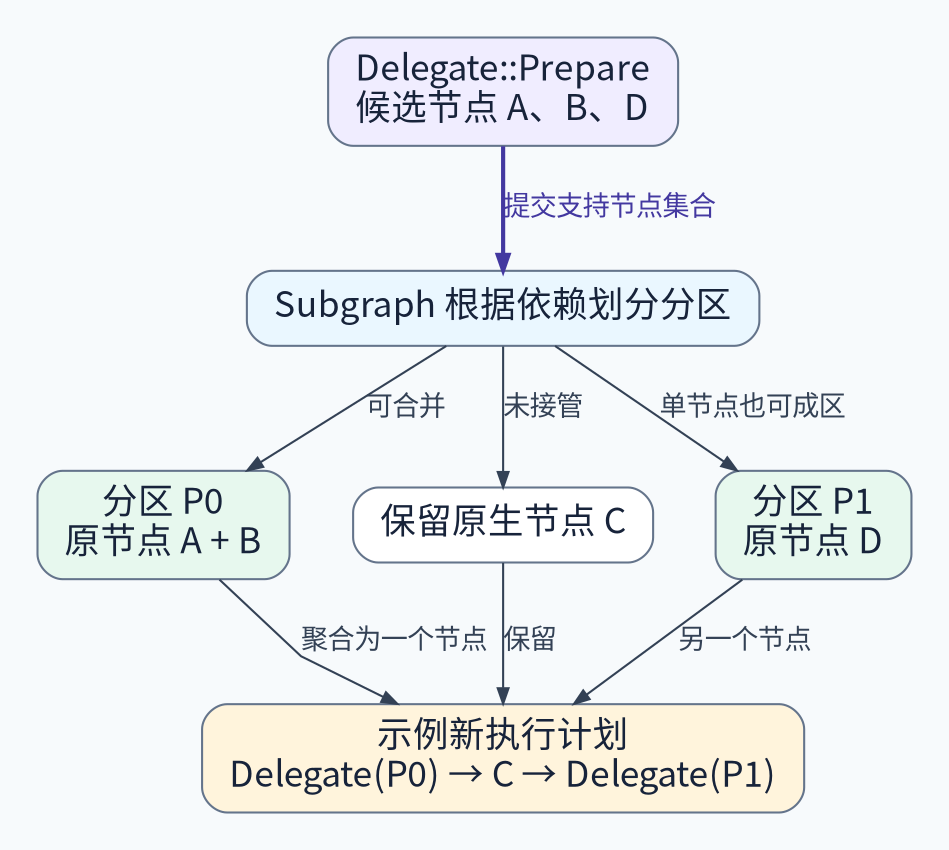

# Delegate（三）：图分区、代理节点与状态收尾

上一篇：[Delegate（二）](04d-delegate-xnnpack.md) · [目录](README.md) · 下一篇：[ADD 实验](05-reading-lab.md)

可委托的节点列表只是输入。Runtime 还要尊重数据和控制依赖，生成分区描述、追加代理节点，并重写真正要执行的计划。最后核对形状、内存及状态。

## 1. 候选怎样变成分区



*图 4-3　Delegate：先选择受支持的节点，再按图分区改写。下面是示例，不是“所有支持节点必定合并”。原始图里 A、B、D 可委托，C 留给原内核。图分区允许时，A、B 合为一个委托分区，D 留作另一个；一个 Delegate 可负责多个分区，一个分区可包多个原节点。边界 Tensor 继续连接相邻分区或原生节点。*

`ReplaceNodeSubsetsWithDelegateKernels` 先建立 DELEGATE 的 registration；opaque 路径还要维护外部算子对象的生命周期。随后通过 `PartitionGraph` 按依赖划分分区：区分委托和非委托节点，依赖就绪才能被调度；可合并时尽可能聚合，不要求原计划里的下标天然相邻，也不能破坏数据依赖与必要的控制顺序。如果禁止节点融合，则使用更保守的分法。分区阶段本身仍未改写计划。

```text
改写前（示意）：[节点 0 CPU, 节点 1 委托, 节点 2 委托, 节点 3 CPU]
改写后        ：[节点 0 CPU, 委托节点 K(1,2), 节点 3 CPU]
```

非委托分区把原节点下标写回新执行计划；委托分区构造包含原节点列表、边界输入/输出以及 delegate 引用的 params，将其作为新节点初始化数据。新节点和对应 kernel registration 保存进 `nodes_and_registration_` 并进入执行计划。原节点未必从存储中消失，**执行计划里的下标不再指向它们才是不逐个执行的原因。** 真正 Invoke 时走委托节点的回调，委托内部根据分区搭建并运行 XNNPACK 图，与原始 TFLite Subgraph 不是同一个对象。

对照：[ReplaceNodeSubsetsWithDelegateKernels](https://github.com/google-ai-edge/LiteRT/blob/e3c11f0d0e7ec02ecb6fd4ee872d5ee569402f62/tflite/core/subgraph.cc#L576-L690)。

```cpp
TfLiteStatus Subgraph::ReplaceNodeSubsetsWithDelegateKernels(
    TfLiteRegistration registration, const TfLiteIntArray* nodes_to_replace,
    TfLiteDelegate* delegate) {
  registration.builtin_code = BuiltinOperator_DELEGATE;
  if (registration.registration_external) {
    registration.registration_external->builtin_code = BuiltinOperator_DELEGATE;
  }

  if (TfLiteDelegateIsOpaque(delegate)) {
    if (!registration.registration_external) {
      TFLITE_LOG(
          tflite::TFLITE_LOG_WARNING,
          "For a delegate with the 'opaque_delegate_builder' field set, the "
          "delegate kernel's TfLiteRegistration object must have the "
          "'registration_external' field set.");
      return kTfLiteDelegateError;
    }

    OpResolver::OpId op_id{registration.registration_external->builtin_code,
                           registration.registration_external->custom_name,
                           registration.registration_external->version};
    auto [it, inserted] = registration_externals_->emplace(
        op_id,
        std::unique_ptr<TfLiteOperator>(registration.registration_external));
    if (!inserted) {
      auto registration_external_from_cache = it->second.get();
      registration.registration_external = registration_external_from_cache;
    }
  }
```

将delegate的registration注册为BuiltinOperator_DELEGATE类型，如果使用的不透明的delegate，管理外部注册对象tfliteoperator的所有权和生命周期

```cpp
  if (!nodes_to_replace->size) {
    return kTfLiteOk;
  }

  std::vector<NodeSubset> node_subsets;
  if (PartitionGraph(nodes_to_replace, &node_subsets) == kTfLiteError) {
    return kTfLiteError;
  }
```

`PartitionGraph` 先根据数据与控制依赖把候选与非候选划分为分区，不修改执行计划。保留中间 Tensor、禁止融合或禁用聚类等配置会限制可合并范围，而不是只看节点是否相邻。

## 2. 分区边界怎样从依赖关系算出来

[PartitionGraph 的 epoch 逻辑](https://github.com/google-ai-edge/LiteRT/blob/e3c11f0d0e7ec02ecb6fd4ee872d5ee569402f62/tflite/graph_info.cc#L90-L259)

1. 起始时把没有节点生产的 Tensor 看作可用，例如外部输入和常量；有生产者的先标成未就绪。不要按 Tensor 编号大小判断依赖。
2. 逐个考虑尚未安排的节点：输入的生产者以及控制前驱必须可用，候选与当前分区还必须是同一类型（委托或普通）。聚类/融合配置限制能否把不相邻节点吸收进来。
3. 消费者从更早分区或图外拿到某个 Tensor 时，它成为当前分区的输入；若来自更早分区，它也成为生产分区的输出。图对外输出还要另行标到生产分区，即使后面没有节点消费。
4. 先得到一组分区描述，才创建 Delegate 节点和刷新 `execution_plan_`。原节点及注册表仍用于保留依赖、恢复原计划等，不是划完分区就把整段对象删掉。

对照：[PartitionGraphIntoIndependentNodeSubsets](https://github.com/google-ai-edge/LiteRT/blob/e3c11f0d0e7ec02ecb6fd4ee872d5ee569402f62/tflite/graph_info.cc#L90-L259)。

```cpp
TfLiteStatus Subgraph::PartitionGraph(const TfLiteIntArray* nodes_to_replace,
                                      std::vector<NodeSubset>* node_subsets) {
  const InterpreterInfo info(this);
  const bool disable_node_fusion =
      ShouldPreserveAllTensors() || DisableDelegateNodeFusion();
  return tflite::PartitionGraphIntoIndependentNodeSubsets(
      &info, nodes_to_replace, node_subsets,
      /*greedily=*/!DisableDelegateClustering(), control_edges_,
      disable_node_fusion);
}
```

graphpatrition即使将计算图按照tensor之间的输入输出建图，之后根据依赖关系将节点划分为多个nodesubset，尽可能把可以由同一个delegate执行的节点合并，同时保证元计算图的语义不变，分割的原则如下：

1. 同一分区node必须有相同的分区类型，Partition和NonPartition两种
2. 节点的所有非可选输入必须已可用，才可以加入当前分区。
3. 显式控制前驱也必须已经安排，不能只检查数据边。
4. 尽可能合并
5. fusion限制时不合并

## 3. 创建代理节点并重写执行计划

实际源码：[subgraph.cc:564–574](https://github.com/google-ai-edge/LiteRT/blob/e3c11f0d0e7ec02ecb6fd4ee872d5ee569402f62/tflite/core/subgraph.cc#L564-L574)、[subgraph.cc:641–653](https://github.com/google-ai-edge/LiteRT/blob/e3c11f0d0e7ec02ecb6fd4ee872d5ee569402f62/tflite/core/subgraph.cc#L641-L653)、[subgraph.cc:667–681](https://github.com/google-ai-edge/LiteRT/blob/e3c11f0d0e7ec02ecb6fd4ee872d5ee569402f62/tflite/core/subgraph.cc#L667-L681)、[subgraph.cc:1235–1241](https://github.com/google-ai-edge/LiteRT/blob/e3c11f0d0e7ec02ecb6fd4ee872d5ee569402f62/tflite/core/subgraph.cc#L1235-L1241)。

```text
PartitionGraph 根据依赖关系与聚类配置生成分区
清空当前执行计划
依分区顺序：
    普通分区 → 将原节点编号放回计划
    委托分区 → 构造带边界张量的代理节点，将它加入计划
    委托分区的边界输出与代理节点记录所属 Delegate
```

1. `PartitionGraph()` 根据依赖、控制边和聚类配置算出分区。相邻不保证同一分区，非相邻也不代表绝不可能合并；边界上只列该分区对外需要的 Tensor。
2. 清空旧执行计划后，普通分区把原节点编号放回计划；由委托负责的分区用 `AddNodeWithParameters()` 追加代理节点。该函数在结束时将新节点编号放进计划。
3. 代理节点持有分区输入、输出和委托初始化参数，边界输出 Tensor 也会记录所属委托。原节点记录不等于全部删除；推理走的是改写后的计划，不是简单按节点表下标遍历。

把这段分成两次决策更容易看清：XNNPACK 决定**哪些节点能接**，TFLite 决定**哪些候选可以放在一个分区**。例如两个候选节点之间若隔着必须由普通内核执行、并且后一个候选依赖其输出的节点，就不能把两个候选合成一个代理节点；否则代理节点还没跑完，普通内核就等不到它所需的前半段结果。这个例子也解释了为什么只按原执行计划上连续的编号分组不够。

<details>
<summary>展开这段 C++ 跟读代码</summary>

```cpp
  TFLITE_LOG_PROD(tflite::TFLITE_LOG_VERBOSE,
                  "Replacing %d out of %d node(s) with delegate (%s) node, "
                  "yielding %zu partitions "
                  "for subgraph %d (%s).",
                  nodes_to_replace->size, execution_plan_.size(),
                  GetDelegateKernalName(registration), node_subsets.size(),
                  subgraph_index_, name_.c_str());

  execution_plan_.clear();

  for (auto& node_subset : node_subsets) {
    switch (node_subset.type) {
      case NodeSubset::kTfNonPartition:
        for (auto it = node_subset.nodes.begin(); it != node_subset.nodes.end();
             ++it) {
          execution_plan_.push_back(*it);
        }
        break;
      case NodeSubset::kTfPartition: {
        int node_index;

        void* delegate_params = nullptr;
        if (TfLiteDelegateIsOpaque(delegate)) {
          TfLiteOpaqueDelegateParams* opaque_params =
              CreateOpaqueDelegateParams(delegate, node_subset);
          delegate_params = opaque_params;
        } else {
          TfLiteDelegateParams* params =
              CreateDelegateParams(delegate, node_subset);
          delegate_params = params;
        }
        TF_LITE_ENSURE_STATUS(AddNodeWithParameters(
            node_subset.input_tensors, node_subset.output_tensors, {}, nullptr,
            0, delegate_params, &registration, &node_index));

        for (int tensor_index : node_subset.output_tensors) {
          TfLiteTensor* tensor = &tensors_[tensor_index];
          TF_LITE_ENSURE(&context_, tensor->delegate == nullptr ||
                                        tensor->delegate == delegate);
          tensor->delegate = delegate;
        }

        TfLiteNode* node = &nodes_and_registration_[node_index].first;
        node->delegate = delegate;
      } break;
      case NodeSubset::kTfUnexplored:
        return kTfLiteError;
        break;
    }
  }
  return kTfLiteOk;
}
```

</details>

根据之前的区分结果，非delegate分区直接加入executionplan，delegate分区则会先创建params其中包含node，delegate，input，output等信息，接着创建新的delegatenode，这个node也是tflitenode会关联新的输入输出，params会作为初始化数据传递给registration的init，node和delegate kernel的registration保存到nodes_and_registration_。

```cpp
bool Subgraph::IsFullyDelegated() const {
  for (const int nid : execution_plan_) {
    const TfLiteNode& node = nodes_and_registration_[nid].first;
    if (node.delegate == nullptr) return false;
  }
  return true;
}
```

`IsFullyDelegated()` 检查当前执行计划中的节点是否都由委托负责，不是检查 `nodes_and_registration_` 是否只剩代理节点。
最后是prepare的最后流程

## 4. 完成改图、刷新分配与恢复

- **Uninvokable**：需要准备或重新分配，不能执行。
- **Invokable**：当前可执行，允许符合规则的后续调整。
- **InvokableAndImmutable**：可执行但图受到不可变约束，典型情形是应用了不支持动态张量的 Delegate。

原稿分支的尾部处理区分三类：当前委托不支持动态张量时通常确保内存分配并标记 Immutable（满足全委托提示可走优化分支）；当前委托支持动态、但旧图已 Immutable 时，重新 Prepare，若引入动态张量则恢复计划并报错；原图已 Invokable 且可动态时，刷新必要分配以保持一致。新图还未准备的普通路径可留待分配阶段。调试时按「Resolver 查找 → 普通内核 Prepare / 形状 → Delegate 选点 → 分区与边界 → 内存分配 → Invoke」顺序定位，不要把任何一个阶段的通过当成后续已经成功。

### 看失败发生在什么阶段，而不是只看“没用上委托”

| 观察到的现象 | 从哪里查 |
| --- | --- |
| creator 返回空 | 还没创建对象。看构建是否接入 XNNPACK，以及 resolver 工厂配置。 |
| 某个候选未通过 `VisitNode` | 正常的能力筛选；其他可用分区仍可委托，该节点仍可由原内核执行。 |
| 静态委托在预检查发现动态输出 | 在委托 Prepare 之前拒绝这次应用，返回 `kTfLiteApplicationError`。 |
| Delegate Prepare 自己失败 | 先切回普通 Context，再按该路径恢复原执行计划并返回委托错误；不能说所有错误都无条件静默回退。 |
| 声明整图委托提示，但仍有普通节点 | 应用时会验证 `IsFullyDelegated()`；不满足时报错，不把提示当成功结果。 |

查最后三项时对照 [预检查、改图、状态恢复](https://github.com/google-ai-edge/LiteRT/blob/e3c11f0d0e7ec02ecb6fd4ee872d5ee569402f62/tflite/core/subgraph.cc#L2588-L2711)。把断点放在入口、`PrepareOpsStartingAt`、`TfLiteDelegatePrepareInternal` 和 `ReplaceNodeSubsetsWithDelegateKernels`，就能判断失败是在普通内核准备、后端选点、分区替换，还是分配这一段。

对照：[应用委托后的状态处理](https://github.com/google-ai-edge/LiteRT/blob/e3c11f0d0e7ec02ecb6fd4ee872d5ee569402f62/tflite/core/subgraph.cc#L2663-L2716)。

<details>
<summary>展开这段 C++ 跟读代码</summary>

```cpp
  if (!delegate_supports_dynamic_shapes) {
    if (!hint_fully_delegated_to_single_delegate) {
      state_ = kStateUninvokable;
      TF_LITE_ENSURE_STATUS(
          reset_delegation_if_not_ok(EnsureMemoryAllocations()));
    }

    state_ = kStateInvokableAndImmutable;
  } else if (pre_delegation_state == kStateInvokableAndImmutable) {
    int last_execution_plan_index_prepared;
    TF_LITE_ENSURE_STATUS(reset_delegation_if_not_ok(PrepareOpsStartingAt(
        0, execution_plan_, &last_execution_plan_index_prepared)));
    if (has_dynamic_tensors_) {
      TF_LITE_ENSURE_STATUS(RemoveAllDelegates());
      ReportError(
          "Cannot allow dynamic tensors due to previous delegation, resetting "
          "to original execution plan.");
      return kTfLiteApplicationError;
    }
    TF_LITE_ENSURE_STATUS(
        reset_delegation_if_not_ok(EnsureMemoryAllocations()));
    state_ = kStateInvokableAndImmutable;
  } else if (pre_delegation_state == kStateInvokable) {
    TF_LITE_ENSURE_STATUS(
        reset_delegation_if_not_ok(EnsureMemoryAllocations()));
  }
  delegates_applied_.push_back(delegate);

  return status;
}
```

</details>

这里主要负责根据delegate对动态tensor的支持能力，重新准备tensor内存，并更新subgraph的状态，确保修改后的计算图正常，几种状态定义如下：

kStateUninvokable	当前图尚未准备好执行，需要重新 Prepare 或分配内存
kStateInvokable	图已具备执行条件，仍允许后续进行相关调整
kStateInvokableAndImmutable	图已准备好执行，并受到不可变状态约束，通常是应用不支持动态 Tensor 的 Delegate 后的状态

对应了三种情况：

1. 当前 Delegate 不支持动态 Tensor	重新准备内存，然后将图标记为 Immutable
2. 当前 Delegate 支持动态 Tensor，但之前的 Delegate 不支持	检查新 Delegate 是否引入动态 Tensor；若有则移除 Delegates 并报错
3. 当前 Delegate 支持动态 Tensor，之前的图已经是 Invokable	调用 EnsureMemoryAllocations()，保持图的内存分配状态一致

至此modify的流程基本结束了

## 源码导航

代码对照版本：LiteRT [`e3c11f0`](https://github.com/google-ai-edge/LiteRT/tree/e3c11f0d0e7ec02ecb6fd4ee872d5ee569402f62)；流程块是按固定版本整理的阅读稿；可以点对应行号看完整实现。

- [OpResolver 接口](https://github.com/google-ai-edge/LiteRT/blob/main/tflite/core/api/op_resolver.h) · [MutableOpResolver](https://github.com/google-ai-edge/LiteRT/blob/main/tflite/mutable_op_resolver.cc) · [内建注册](https://github.com/google-ai-edge/LiteRT/blob/main/tflite/core/kernels/register.cc)
- [C 数据结构与 Delegate flags](https://github.com/google-ai-edge/LiteRT/blob/main/tflite/core/c/common.h) · [Elementwise 示例](https://github.com/google-ai-edge/LiteRT/blob/main/tflite/kernels/elementwise.cc)
- [Interpreter](https://github.com/google-ai-edge/LiteRT/blob/main/tflite/core/interpreter.cc) · [Subgraph](https://github.com/google-ai-edge/LiteRT/blob/main/tflite/core/subgraph.cc) · [图分区](https://github.com/google-ai-edge/LiteRT/blob/main/tflite/graph_info.cc) · [XNNPACK Delegate](https://github.com/google-ai-edge/LiteRT/blob/main/tflite/delegates/xnnpack/xnnpack_delegate.cc)
