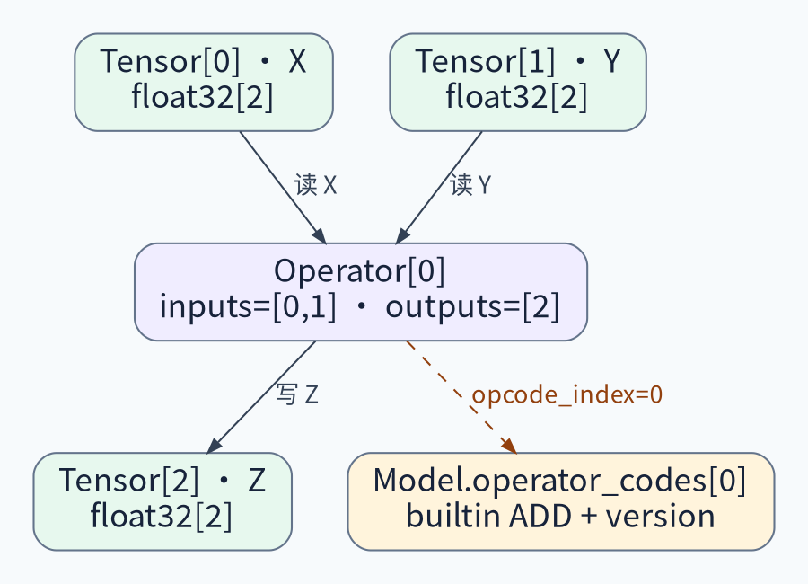
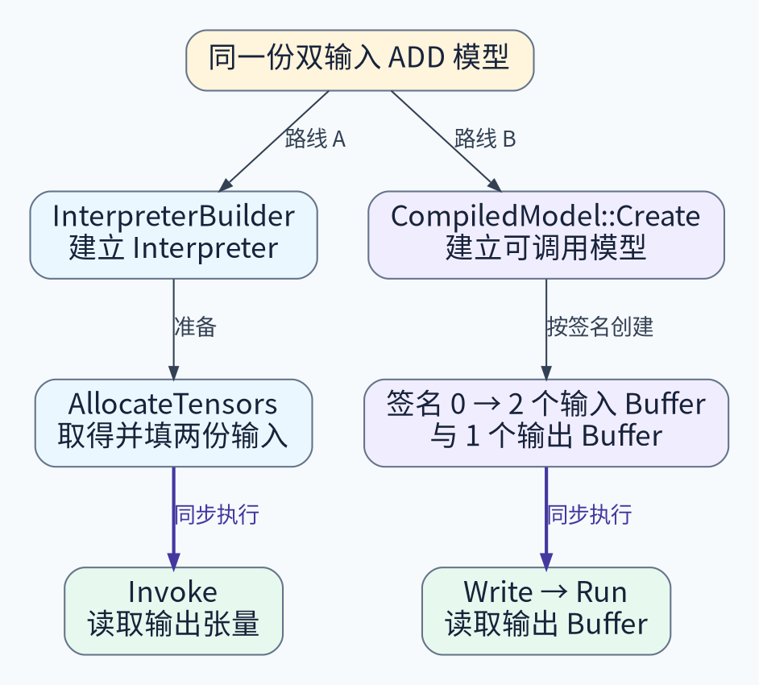

# LiteRT 源码笔记（五）：用一个 ADD 串起模型与执行

[上一篇：图分区与代理节点](04e-delegate-partition.md) · [系列目录](README.md)

前几篇分别讲模型里的表和索引、LiteRT 的模型 IR、Interpreter 的构建，以及算子与 Delegate。这篇固定一个很小的模型，沿着两套 C++ API 各走一遍。模型只有一个节点，读到哪里都容易知道当前对象来自哪一张表。

## 1. 先把计算和文件对起来



*图 5-1　ADD 示例：文件索引和算子数据流。数据流里两个输入张量汇合到一个 ADD，然后产生一个输出。虚线是 opcode_index 引用，不表示数据流。节点记的是所属子图内的 0、1、2，调用 API 时的输入序号另行解释。*

设两个输入和一个输出都是 `float32[2]`，计算 `Z = ADD(X, Y)`，融合激活函数为 `NONE`。用 `X = [1, 2]`、`Y = [3, 4]` 做探针，预期输出 `[4, 6]`。这只是一个用来读源码的模型结构，不代表下面展示的数字是某个现有文件的字节偏移。

| 表或字段 | 例子 | 读到它时回答的问题 |
| --- | --- | --- |
| `Model.operator_codes[0]` | builtin `ADD`，带算子版本 | 调用的是什么算子？ |
| `SubGraph[0].tensors[0, 1, 2]` | `X, Y, Z`，形状均为 `[2]` | 参与计算的张量有哪些？ |
| `SubGraph[0].operators[0]` | `opcode_index=0, inputs=[0,1], outputs=[2]` | 这个节点怎样接到张量表？ |
| `SubGraph[0].inputs / outputs` | `[0,1]` / `[2]` | 外部需要填什么，运行后读什么？ |
| `Operator.builtin_options` | `AddOptions`，融合激活 `NONE` | 这个 ADD 有什么额外配置？ |
| `Tensor.buffer` | 三个张量都可指向保留的空 Buffer 0 | 文件是否提供常量数据？本例的输入在调用时填入。 |

这些表里有三种很容易混在一起的编号：`opcode_index` 查**模型的算子表**，节点输入输出索引查**当前子图的张量表**，`buffer` 查**模型的 Buffer 表**。所有编号都可以从零开始，但它们不是同一张表。

## 2. 路线 A：用 Interpreter 看一个节点怎样跑起来

下面按官方最小示例缩写，增加固定输入和结果检查。假设 `path` 来自可信的本地模型、模型无自定义算子，且是上面的 float32 双输入 ADD。片段放在返回 `int` 的函数中，省略头文件；真正复用到其他模型时，应按实际 tensor 类型、维度和字节数校验，不能照搬下标和长度。

```cpp
auto model = tflite::FlatBufferModel::BuildFromFile(path);
if (!model) return 1;

tflite::ops::builtin::BuiltinOpResolver resolver;
std::unique_ptr<tflite::Interpreter> interpreter;
tflite::InterpreterBuilder builder(*model, resolver);
if (builder(&interpreter) != kTfLiteOk || !interpreter) return 2;
if (interpreter->AllocateTensors() != kTfLiteOk) return 3;

auto* x = interpreter->typed_input_tensor<float>(0);
auto* y = interpreter->typed_input_tensor<float>(1);
if (!x || !y) return 4;
x[0] = 1.0f; x[1] = 2.0f;
y[0] = 3.0f; y[1] = 4.0f;

if (interpreter->Invoke() != kTfLiteOk) return 5;
const auto* z = interpreter->typed_output_tensor<float>(0);
return z && z[0] == 4.0f && z[1] == 6.0f ? 0 : 6;
```

按源码断点来读：

1. **Builder 建图。** 在 `BuildLocalIndexToRegistrationMapping` 看 `opcode_index` 如何查到 `ADD` 注册项；然后看节点的张量索引如何传给子图。到这里已经知道执行的是哪个节点，但还没有写入本次输入。
2. **AllocateTensors 准备。** 跟踪子图的 `PrepareOpsAndTensors` 与注册项的 `prepare` 回调。对于静态的示例，可以在这一步之后看输入输出的内存；有动态 shape 的模型，某些输出只能在执行时确定，因此不能用本例推断所有 tensor 都已分配。用 `ResizeInputTensor` 改形状后，要按 API 要求重新分配并重新取得指针。若换一个输出尺寸由输入数据决定的模型，可以跟进 [Prepare 的暂停点与 Invoke 续跑](04b-interpreter-prepare.md#3-allocatetensors-暂停后invoke-怎样继续)，分别观察准备位置、动态 Tensor 编号和分配位置。上面的静态 ADD 不会触发这个分支。
3. **Invoke 执行。** 进入 `Subgraph::Invoke` 后看实际执行计划。未委托的节点会走注册项对应的执行回调；如果默认或显式 Delegate 已接管节点，就可能经过 Delegate 节点。从主线找不到 builtin ADD 的调用时，先确认当前执行计划，而不是先怀疑 ADD 没有运行。

做对照实验时要记录是否启用了默认 Delegate。以 TensorFlow v2.20.0 的相应 C++ API 为例，可用 `tflite::ops::builtin::BuiltinOpResolverWithoutDefaultDelegates` 代替上面的 resolver，同时不要显式添加 Delegate，再观察 builtin 路径。这和只指定 CPU 不是一回事：CPU 也可以运行委托后端。示例把 `model` 和 `resolver` 都保留到 Interpreter 使用结束，避免把模型字节的生命周期问题和执行错误混在一起。

### 2.1 把 I/O 位置和 Tensor 编号分开

上面的小模型恰好把 X、Y、Z 放在 T0、T1、T2，容易看不出两种下标的区别。读源码时可以换一个教学布局：令三个张量位于 T3、T7、T9，省略表中其他槽位，保持类型和形状不变。不需要改原示例代码中的输入位置。

| 运行时列表 | API 参数 | 实际访问的张量 |
| --- | --- | --- |
| `inputs() == [3, 7]` | `typed_input_tensor<float>(0)` | T3（X） |
| `inputs() == [3, 7]` | `typed_input_tensor<float>(1)` | T7（Y） |
| `outputs() == [9]` | `typed_output_tensor<float>(0)` | T9（Z） |

1. 在 [Builder（一）的 I/O 小节](03-interpreter-builder.md#inputs--outputs-是怎样填进去的) 对照 `SetInputs/SetOutputs`，确认列表来自文件声明，不是从 ADD 的输入、输出反推的。
2. 在 `AllocateTensors()` 成功后进 `typed_input_tensor<float>(0)`，依次看 `index == 0`、`inputs()[index] == 3` 和 `typed_tensor<float>(3)`。直接调用 `typed_tensor<float>(0)` 查的是 T0，不是 X；也不要反过来把 3 传给只有两项的 `typed_input_tensor`。
3. ADD 节点保存 `inputs=[3,7]`、`outputs=[9]`。给 X、Y 填入 `[1,2]` 和 `[3,4]`，成功 Invoke 后从第 0 个输出读 T9，预期是 `[4,6]`。这里是对照用的假设布局，不是本仓库附带的模型文件。

## 3. 路线 B：用 CompiledModel 看外部 Buffer 怎样绑定



*图 5-2　同一个模型，两种外部调用顺序。左右分别是调用者看到的 API 流程，不是从左侧再转去右侧。Interpreter 例子用 typed_input_tensor 写入已分配的输入；CompiledModel 例子由调用方传入按签名创建的 TensorBuffer。执行后都应读出 [4,6]。*

按本文固定的 LiteRT 版本，调用 `CompiledModel` 时看不到 Builder，但两条源码路径会在内部汇合：Runtime 可[复用模型留存的 FlatBuffer](https://github.com/google-ai-edge/LiteRT/blob/e3c11f0d0e7ec02ecb6fd4ee872d5ee569402f62/litert/runtime/compiled_model.cc#L1169-L1191)；若 JIT 改了模型，则[把新图序列化](https://github.com/google-ai-edge/LiteRT/blob/e3c11f0d0e7ec02ecb6fd4ee872d5ee569402f62/litert/runtime/compiled_model.cc#L2053-L2087)。随后 [`InitializeRuntime()`](https://github.com/google-ai-edge/LiteRT/blob/e3c11f0d0e7ec02ecb6fd4ee872d5ee569402f62/litert/runtime/compiled_model.cc#L673-L682)把对应的模型视图、Allocation 和 Resolver 传给内部的 `InterpreterBuilder`。这解释了为什么前面的 Builder 知识仍然用得上，但调用方在这条路线用的是签名和 `TensorBuffer`，而非直接操作 Interpreter 的输入指针。

LiteRT 的 `CompiledModel` 接口把输入输出放在调用者持有的 `TensorBuffer` 对象中。下面按官方 `run_model_simple.cc` 的调用顺序摘出关键行，省略辅助函数、类型查询和输出比对的包装代码；`GetOptions()` 从示例配置中选 CPU，`path` 为模型路径。使用能取得签名索引 0、且该签名按 X/Y 顺序接受两个 float32 输入的测试模型。若手头模型没有符合假设的签名，先检查 API 反映出来的签名、输入输出布局和类型，不要硬套下面的下标。

```cpp
LITERT_ASSIGN_OR_RETURN(auto env, GetEnvironment());
LITERT_ASSIGN_OR_RETURN(auto options, GetOptions());
LITERT_ASSIGN_OR_RETURN(auto model, CompiledModel::Create(env, path, options));
const size_t sig = 0;
LITERT_ASSIGN_OR_RETURN(auto inputs, model.CreateInputBuffers(sig));
LITERT_ASSIGN_OR_RETURN(auto outputs, model.CreateOutputBuffers(sig));
const std::array<float, 2> x{1.0f, 2.0f}, y{3.0f, 4.0f};
std::array<float, 2> z{};
LITERT_RETURN_IF_ERROR(inputs[0].Write<float>(absl::MakeConstSpan(x)));
LITERT_RETURN_IF_ERROR(inputs[1].Write<float>(absl::MakeConstSpan(y)));
LITERT_RETURN_IF_ERROR(model.Run(sig, inputs, outputs));
LITERT_RETURN_IF_ERROR(outputs[0].Read<float>(absl::MakeSpan(z)));
```

`CreateInputBuffers` 和 `CreateOutputBuffers` 按该签名的要求创建运行用 Buffer；`Write` 把这一轮的输入送进去；`Run` 把这些输入输出 Buffer 用于这次同步调用。模型文件里 `Tensor.buffer=0` 并不会取消这一步。反过来，如果把 `Y` 改为编入模型的常量，它还在子图的张量表和 ADD 的输入索引里，但不必继续作为签名的外部输入。

这里有两处“第 0 个”也要分开：`sig=0` 选签名，`inputs[0]` 选这个签名的第一个输入。它们都不能直接充当子图张量表的索引。想继续看内部时，从 `CompiledModel::Create` 与同步 `Run` 往下追即可；具体后端初始化和委托选择以当前 checkout 为准，不要把第二篇的 IR 对象直接说成第三篇 Builder 的参数。

## 4. 改三个条件，检查自己有没有读懂

这三个变化一次只改一项。调试时先记录共同基线：模型用哪个 opcode，Builder 给节点绑定了哪个 Registration，`AllocateTensors()` 后输入指针是否可用，`Invoke()` 时走的是普通节点还是代理节点。这样输出同样为 `[4,6]`，也能看出过程是不是同一条。

| 改动 | 先判断什么 | 查哪里 |
| --- | --- | --- |
| 把 `Y` 设为模型常量 | 节点仍需要 Y；外部接口不一定再接受 Y | `Tensor.buffer`、子图/签名输入、运行时只读 tensor |
| 输入由固定 `[2]` 改为可变长度 | 默认 `shape` 与 `shape_signature` 分工不同；改大小后旧地址不能继续用 | 模型 Tensor、Interpreter resize 和 allocate、算子的 prepare |
| 允许 Delegate 接管 ADD | 文件里的图没有因此变化；运行时执行计划可能变化 | Resolver、Delegate `Prepare`、执行计划和选定后端 |

排查顺序可以固定为：先看模型有没有读出来，再看节点有没有找到注册项，接着看 shape、buffer 和分配，最后看实际走的是 builtin 还是 Delegate。这样遇到一个错误，不必同时在 FlatBuffers、运行时和后端三个层面猜原因。

## 对照源码

- [TensorFlow v2.20.0：Interpreter 最小示例](https://github.com/tensorflow/tensorflow/blob/v2.20.0/tensorflow/lite/examples/minimal/minimal.cc)
- [TensorFlow v2.20.0：Subgraph 实现](https://github.com/tensorflow/tensorflow/blob/v2.20.0/tensorflow/lite/core/subgraph.cc)
- [LiteRT：CompiledModel 最小示例（固定提交）](https://github.com/google-ai-edge/LiteRT/blob/e3c11f0d0e7ec02ecb6fd4ee872d5ee569402f62/litert/tools/run_model_simple.cc)
- [LiteRT：TensorBuffer 读写接口（固定提交）](https://github.com/google-ai-edge/LiteRT/blob/e3c11f0d0e7ec02ecb6fd4ee872d5ee569402f62/litert/cc/litert_tensor_buffer.h)
- [LiteRT C++ API](https://developers.google.com/edge/litert/next/cpp)
